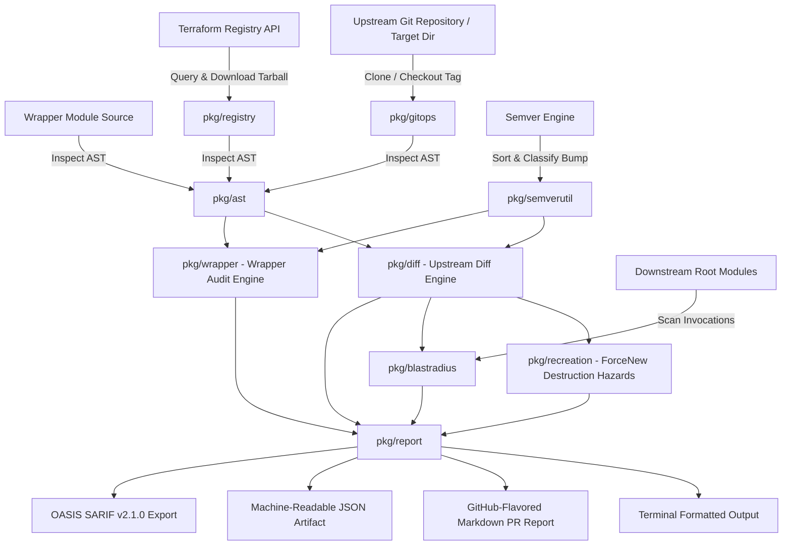

# Architecture & Design Specification

## Overview

`terraform_ast` (`tfastdiff`) is a production-grade static analysis tool written in Go. It compares the Abstract Syntax Tree (AST) and top-level configuration metadata of Terraform modules—specifically focusing on wrappers for enterprise modules like **Google GKE** (`terraform-google-modules/kubernetes-engine/google`) and **AWS EKS** (`terraform-aws-modules/eks/aws`)—against upstream releases.

The tool provides automated compatibility verification, identifying breaking changes, type constraint shifts, removed outputs, and safe version pinning boundaries before code is merged or deployed.



---

## Core Packages

### 1. `pkg/ast` (Abstract Syntax Tree & Configuration Inspection)
- **Engine**: Built on `github.com/hashicorp/terraform-config-inspect/tfconfig` and `github.com/hashicorp/hcl/v2/hclsyntax`.
- **Capabilities**:
  - Extracts module inputs (`variables`), default values, required flags, descriptions, and type constraints.
  - Extracts module outputs, descriptions, and sensitivity flags.
  - Performs deep HCL AST scanning to inspect child `module "..."` blocks, extracting exact arguments forwarded by wrapper modules and delegations in `output "..."` definitions.
  - Performs deep structural `object({ ... })` type diffing and primitive type compatibility checking (e.g. `string` vs `number`, `list` vs `set`, `any` widening vs narrowing).

### 2. `pkg/semverutil` (Semantic Versioning & Tag Lifecycle)
- **Engine**: Powered by `golang.org/x/mod/semver`.
- **Capabilities**:
  - Canonicalizes version strings (ensuring standard `v` prefix).
  - Determines semver bump transitions: `MAJOR` (breaking), `MINOR` (features), `PATCH` (fixes), `DOWNGRADE`, `IDENTICAL`, and `INVALID`.
  - Filters and sorts tags deterministically in ascending or descending order.

### 3. `pkg/gitops` (Git Operations & Version Extraction)
- **Engine**: Powered by `github.com/go-git/go-git/v5`.
- **Capabilities**:
  - Clones remote repositories with shallow clone optimization (`--depth 1`) or inspects local Git checkouts in-place.
  - In-memory repository caching avoids redundant downloads across multiple tag evaluations.
  - Extracts all semantic version tags from Git references.
  - Checks out specific tags, branches, or commits into isolated staging directories for AST comparison.

### 4. `pkg/registry` (Terraform Registry Protocol Client)
- **Capabilities**:
  - Native client implementing the official Terraform Registry Service Discovery protocol (`https://registry.terraform.io/v1/modules/...`).
  - Resolves available module versions and downloads release tarballs.
  - Verifies package checksums and extracts target modules and submodules into sandboxed directories for AST inspection.

### 5. `pkg/diff` (Upstream Diff Comparator)
- **Capabilities**:
  - Compares two versions of an upstream module.
  - Categorizes differences into:
    - **Breaking Changes**: Removed inputs, newly required inputs without defaults, type constraint changes, removed outputs.
    - **New Features**: Newly introduced optional inputs with defaults, newly introduced outputs.
    - **Warnings**: Widened types (e.g., `list(string)` to `set(string)`), sensitive flags added, deprecation notices, provider constraint updates.
  - Computes high-level safety verdict: `SAFE`, `BREAKING_CHANGES`, `WARNINGS_ONLY`, or `DOWNGRADE`.

### 6. `pkg/recreation` (ForceNew Destruction & Hazard Analysis)
- **Capabilities**:
  - Encodes infrastructure destruction heuristics for immutable cloud resources (GKE cluster name, project ID, location, secondary subnet CIDR blocks, AWS EKS cluster name, VPC ID, KMS key specifications).
  - Flags breaking input shifts that trigger provider `ForceNew` destruction/recreation cycles, preventing catastrophic data loss and downtime during module upgrades.

### 7. `pkg/blastradius` (Downstream Consumer & Environment Scanner)
- **Capabilities**:
  - Recursively traverses root modules, environment directories (e.g. `environments/dev`, `environments/prod`), and terragrunt configurations.
  - Identifies which downstream consumers invoke target modules and pin specific versions.
  - Maps breaking upstream changes directly to impacted environments and downstream root module inputs.

### 8. `pkg/wrapper` (Wrapper Compatibility & Pin Analyzer)
- **Capabilities**:
  - Audits a wrapper module against a target upstream module.
  - Detects wrapper-specific breakages:
    - **Passed Removed Arguments**: Wrapper passes arguments to upstream that no longer exist (causes Terraform syntax/argument error).
    - **Missing Required Inputs**: Upstream requires inputs without defaults that the wrapper does not provide (causes missing required argument error).
    - **Type Incompatibilities**: Wrapper defines a variable with a type constraint that conflicts with upstream expectations.
    - **Broken Delegations**: Wrapper re-exports an upstream output that was renamed or removed in the new release.
  - Recommends exact version pinning syntax (e.g. `version = "30.0.0"`).
  - Generates clear, actionable remediation steps.

### 9. `pkg/report` (Multi-Format Reporting & Golden Matcher)
- **Capabilities**:
  - Formats results into interactive terminal text with status indicators (`🚨`, `✨`, `⚠️`, `💡`).
  - Generates GitHub-flavored Markdown with alert callouts (`> [!CAUTION]`, `> [!WARNING]`, `> [!NOTE]`) and tables.
  - Serializes machine-readable JSON for CI/CD pipeline automation.
  - Generates **OASIS SARIF v2.1.0** reports for direct ingestion into GitHub Code Scanning and security dashboards.
  - Provides golden file assertion helpers (`AssertGoldenMatch`) for canonical regression testing.

---

## Container Architecture & DevSecOps Hardening

The repository provides a production-grade, hardened container image designed under strict **DevSecOps** principles:

```
+-------------------------------------------------------------------------+
| Builder Stage (golang:alpine)                                           |
|  - CGO_ENABLED=0 (static compilation)                                   |
|  - Dependency caching with 'go mod verify'                              |
|  - Compiler flags: -trimpath (prevents host path disclosure)            |
|  - Linker flags: -ldflags="-s -w -extldflags '-static'" (strip symbols) |
+-------------------------------------------------------------------------+
                                    |
                                    v (copy statically-linked binary)
+-------------------------------------------------------------------------+
| Final Stage (gcr.io/distroless/static-debian12:nonroot)                 |
|  - Ultra-minimal footprint (~5.7 MB)                                    |
|  - Non-root user: USER 65532:65532 (UID/GID nonroot)                    |
|  - Attack surface elimination: NO shell (/bin/sh), NO package manager   |
|  - Read-only root filesystem compatible (--read-only)                   |
|  - OCI Standard Annotations (org.opencontainers.image.*)                |
|  - Context hygiene: .dockerignore excludes tests, caches, credentials   |
+-------------------------------------------------------------------------+
```

### DevSecOps Controls
1. **Multi-Stage Build**: Isolates full Go compiler toolchain and development dependencies in the builder stage. The final runtime container contains only the compiled binary and root CA certificates.
2. **Distroless Base (`gcr.io/distroless/static-debian12:nonroot`)**: Completely removes shells (`/bin/sh`, `/bin/bash`), package managers (`apk`, `apt`), and common binaries (`curl`, `wget`), neutralizing command injection and remote execution vectors.
3. **Hardened Binary Compilation**:
   - `CGO_ENABLED=0`: Produces a fully self-contained static binary without glibc dependencies.
   - `-trimpath`: Strips local file system paths from stack traces to prevent source directory leakage.
   - `-ldflags="-s -w"`: Strips symbol tables and DWARF debugging information, reducing binary size and hindering reverse engineering.
4. **Least Privilege Execution**: Explicitly configured to execute as unprivileged user `65532:65532`, preventing container breakout vulnerabilities.
5. **Read-Only Root Filesystem Ready**: Capable of executing under `--read-only` rootfs with `--security-opt no-new-privileges:true`.

