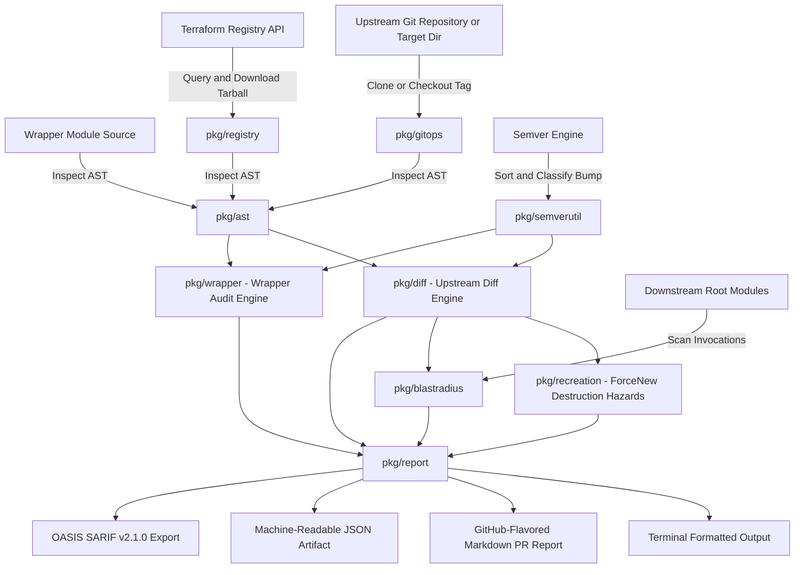

# Architecture & Design Specification

## Overview

`terraform_ast` (`tfastdiff`) is a production-grade static analysis tool written in Go. It compares the Abstract Syntax Tree (AST) and top-level configuration metadata of Terraform modules—specifically focusing on wrappers for enterprise modules like **Google GKE** (`terraform-google-modules/kubernetes-engine/google`) and **AWS EKS** (`terraform-aws-modules/eks/aws`)—against upstream releases.

The tool provides automated compatibility verification, identifying breaking changes, type constraint shifts, removed outputs, and safe version pinning boundaries before code is merged or deployed.



---

## Core Packages

### 1. `pkg/ast` (Abstract Syntax Tree & Configuration Inspection)
- **Engine**: Built on `github.com/hashicorp/terraform-config-inspect/tfconfig` and `github.com/hashicorp/hcl/v2/hclsyntax`.
- **Capabilities**:
  - Extracts module inputs (`variables`), default values, required flags, descriptions, and type constraints.
  - Extracts module outputs, descriptions, and sensitivity flags.
  - Performs deep HCL AST scanning to inspect child `module "..."` blocks, extracting exact arguments forwarded by wrapper modules and delegations in `output "..."` definitions.
  - Performs deep structural `object({ ... })` type diffing and primitive type compatibility checking (e.g. `string` vs `number`, `list` vs `set`, `any` widening vs narrowing).

### 2. `pkg/semverutil` (Semantic Versioning & Tag Lifecycle)
- **Engine**: Powered by `golang.org/x/mod/semver`.
- **Capabilities**:
  - Canonicalizes version strings (ensuring standard `v` prefix).
  - Determines semver bump transitions: `MAJOR` (breaking), `MINOR` (features), `PATCH` (fixes), `DOWNGRADE`, `IDENTICAL`, and `INVALID`.
  - Filters non-semver tags and sorts the remainder deterministically in ascending order.

### 3. `pkg/gitops` (Git Operations & Version Extraction)
- **Engine**: Powered by `github.com/go-git/go-git/v5`.
- **Capabilities**:
  - Clones remote repositories with shallow clone optimization (`--depth 1`) or inspects local Git checkouts in-place.
  - Normalises Terraform VCS module sources before cloning: strips the `git::` prefix and expands the `github.com/` and `bitbucket.org/` shorthands into `https://<host>/<path>.git`, so every source the classifier routes here reaches go-git as a cloneable URL.
  - Parses the module's position inside a repository: `//subdir` selects the directory handed back for inspection and `?ref=` pins the revision when the CLI's version flags are absent (an explicit flag wins), so a module inside a repository is analysed at the revision and location its source names. A missing or escaping subdirectory is an error, never a silent inspection of the repository root.
  - `IsGitURL` is the single predicate for "this source must be cloned", shared by the CLI and the upgrade planner.
  - A thread-safe in-memory `RepositoryCache` (`gitops.GlobalCache`) keeps one shared clone per repository, so repeated tag evaluations and multi-version upgrade paths re-clone from the local copy instead of re-downloading. Extracted versions are memoised per source and ref, and everything is released by `Clear()` when the run ends.
  - Extracts all semantic version tags from Git references.
  - Checks out specific tags, branches, or commits into isolated staging directories for AST comparison.

### 4. `pkg/registry` (Terraform Registry Protocol Client)
- **Capabilities**:
  - `IsRegistrySource` and `ParseRegistrySource` agree on exactly one grammar (`namespace/name/provider`,
    optionally hostname-prefixed) and reject empty or URL-metacharacter components, so a malformed address can never
    become a request against a partially empty, query-extended or path-redirected registry path.
  - VCS and local sources are never registry addresses: `git::`, `git@`, any URL scheme (`git://`,
    `ssh://`, `file://`, `http(s)://`), the `github.com/` and `bitbucket.org/` shorthands Terraform
    expands into git URLs, and the `.git` repository suffix are all rejected by both functions.
  - A module source can name the host every request goes to, so the client refuses link-local and
    unspecified addresses (`169.254.0.0/16`, which contains the `169.254.169.254` cloud metadata
    endpoint, `fe80::/10`, and `0.0.0.0/8`) on every connection, redirect and `X-Terraform-Get`
    follow-up. The check runs after name resolution as well as on literal addresses, and a refusal
    is reported immediately instead of being retried as a transient failure; public, RFC1918 and
    loopback registry hosts stay reachable so private and development registries keep working.
  - `X-Terraform-Get` may name any module source Terraform understands, but only `http(s)` archive
    URLs can be downloaded here; a VCS source in the header is rejected with an error naming the
    value rather than surfacing as an opaque URL parse failure.
  - Native client implementing the official Terraform Registry Service Discovery protocol (`https://registry.terraform.io/v1/modules/...`).
  - Resolves available module versions and downloads release tarballs, retrying transient failures with exponential backoff.
  - Extracts target modules and submodules into sandboxed directories for AST inspection, rejecting archive entries that escape the destination directory.

### 5. `pkg/diff` (Upstream Diff Comparator)
- **Capabilities**:
  - Compares two versions of an upstream module.
  - Categorizes differences into:
    - **Breaking Changes**: Removed inputs, newly required inputs without defaults, type constraint changes, removed outputs.
    - **New Features**: Newly introduced optional inputs with defaults, newly introduced outputs.
    - **Warnings**: Widened types (e.g., `list(string)` to `set(string)`), sensitive flags added, deprecation notices, provider constraint updates.
  - Computes high-level safety verdict: `SAFE`, `BREAKING_CHANGES`, `WARNINGS_ONLY`, or `DOWNGRADE`.

### 6. `pkg/recreation` (ForceNew Destruction & Golden Plan Verification Engine)
- **Capabilities**:
  - Encodes infrastructure destruction heuristics for immutable cloud resources (GKE cluster name, project ID, location, region, network, subnetwork and secondary subnet CIDR blocks; AWS EKS cluster name, VPC ID and cluster IP family).
  - Dynamically inspects Terraform Provider Schemas (`terraform providers schema -json`) to extract `requires_replace` constraints across root and nested blocks.
  - **Golden Plan & Execution Plan Verification**:
    - Ingests Terraform plan JSON (`terraform show -json <planfile>`) via `--golden-plan` or automated autodiscovery (`golden-plan.json`, `golden_plan.json`, `tfplan.json`, `plan.json`, `.terraform/tfplan.json`).
    - Flattens and normalizes planned resources across `resource_changes`, top-level `resources`, and hierarchical `planned_values.root_module`.
    - Correlates planned resources against `ForceNew` immutable arguments, unmigrated address shifts, and direct replacement actions (`["delete", "create"]`).
    - Surfaces confirmed hazards in all reporting formats and automatically revokes safe update status if hazards are confirmed.

### 7. `pkg/blastradius` (Downstream Consumer & Environment Scanner)
- **Capabilities**:
  - Recursively traverses root modules, environment directories (e.g. `environments/dev`, `environments/prod`), and terragrunt `terragrunt.hcl` configurations.
  - Identifies which downstream consumers invoke the audited wrapper, along with the inputs they pass and the outputs they consume.
  - Maps breaking upstream changes directly to impacted environments and downstream root module inputs, and reports per-consumer risk scores.
  - Dynamic Terragrunt inputs that cannot be resolved statically are flagged as incomplete analysis rather than silently ignored.

### 8. `pkg/wrapper` (Wrapper Compatibility & Pin Analyzer)
- **Capabilities**:
  - Audits a wrapper module against a target upstream module.
  - Detects wrapper-specific breakages:
    - **Passed Removed Arguments**: Wrapper passes arguments to upstream that no longer exist (causes Terraform syntax/argument error).
    - **Missing Required Inputs**: Upstream requires inputs without defaults that the wrapper does not provide (causes missing required argument error).
    - **Type Incompatibilities**: Wrapper defines a variable with a type constraint that conflicts with upstream expectations.
    - **Broken Delegations**: Wrapper re-exports an upstream output that was renamed or removed in the new release.
  - Recommends exact version pinning syntax (e.g. `version = "30.0.0"`).
  - Generates clear, actionable remediation steps.

### 9. `pkg/ast` Intermediate Representation (IR) & State Graph Theory
- **The "Static AST Fallacy"**: Traditional Terraform static checkers compare module interfaces (variables and outputs). In the Terraform execution engine, however, state persistence is keyed strictly by **hierarchical instance addresses** (`module.vpc.aws_subnet.this["public"]`). If an internal module refactoring converts a singleton resource to an indexed one (`count` or `for_each`) or changes submodule nesting, interface types remain 100% identical, but `terraform apply` triggers silent **destruction and re-creation** of all existing cloud resources.
- **Canonical Address Model (`ResourceAddress`)**:
  - Full hierarchical address decomposition: `[ModulePath].[Mode].[Type].[Name][[IndexKey]]`.
  - Canonical formatting and parsing: handles arbitrary module depths (`module.parent.module.child`), data resources (`data.aws_ami.ubuntu`), and instance keys (`[0]`, `["a"]`).
- **Evaluation Graph (`EvaluationGraph`)**:
  - Constructs a directed graph of all declared managed and data resource addresses.
  - Nodes $N = \{ \text{addr} \to \text{ResourceDef} \}$ track resource mode, type, name, and provider configurations.
- **Topological Shift Detection & Recreation Prediction**:
  - `DetectAddressShifts(oldMod, newMod)` performs bidirectional bipartite address comparison.
  - Unmatched addresses sharing identical type/mode are detected as address shifts ($\text{addr}_{old} \to \text{addr}_{new}$) and flagged as state recreation hazards (`IsRecreation: true`).
  - Completely dropped resources are identified as state instance deletions.

### 10. `pkg/codemod` (Automated Code Remediation & State Migration)
- **Capabilities**:
  - In-place AST refactoring with `hclwrite` preserving comments, formatting, and file structure.
  - Atomic multi-file writes: all modified files are staged in memory and validated before committing to disk.
  - Automated `moved {}` block synthesis: `SynthesizeMovedBlocksForShifts` maps detected AST address shifts directly into Terraform 1.1+ state migration blocks (`moved { from = ...; to = ... }`), deduplicating transitions and appending idempotently via `WriteMovedBlocks`.

### 11. `pkg/policy` (Open Policy Agent OPA & Rego v1 Governance)
- **Engine**: Official Open Policy Agent Go SDK (`github.com/open-policy-agent/opa/v1/rego`).
- **Capabilities**:
  - Evaluates standard OPA Rego policies against structured findings (`input.breaking_changes`, `input.bump_type`, `input.blast_radius`).
  - Supports modern Rego v1 syntax (`contains`, `if`) and legacy rule formats (`deny[msg]`, `violation[msg]`).
  - Fail-closed security architecture: invalid queries or unknown rule blocks fail explicitly rather than permitting unvalidated changes.

### 12. `pkg/report` (Multi-Format Reporting & Golden Matcher)
- **Capabilities**:
  - Formats results into interactive terminal text with leading status indicators that mark
    breaking changes, new features, warnings, and policy violations.
  - Generates GitHub-flavored Markdown with alert callouts (`> [!CAUTION]`, `> [!WARNING]`, `> [!NOTE]`) and tables.
  - Serializes machine-readable JSON for CI/CD pipeline automation.
  - Generates **OASIS SARIF v2.1.0** reports for direct ingestion into GitHub Code Scanning and security dashboards, advertising only the rules that back an emitted result.
  - Emits recreation hazards and downstream consumer findings in every format, including as first-class `TF-RECREATION-HAZARD` and `TF-BLAST-RADIUS-CONSUMER` SARIF rules.
  - Golden-file regression helpers live in `internal/goldentest`, keeping `testing` and the assertion libraries out of the shipped binary.
  - JSON and SARIF encoders return plain bytes rather than an error: the report graph is composed
    exclusively of JSON-safe types, so encoding cannot fail and no unreachable error path exists.

---

## Container Architecture & DevSecOps Hardening

The repository provides a production-grade, hardened container image designed under strict **DevSecOps** principles:

```
+-------------------------------------------------------------------------+
| Builder Stage (golang:alpine)                                           |
|  - CGO_ENABLED=0 (static compilation)                                   |
|  - Dependency caching with 'go mod verify'                              |
|  - Compiler flags: -trimpath (prevents host path disclosure)            |
|  - Linker flags: -ldflags="-s -w -extldflags '-static'" (strip symbols) |
+-------------------------------------------------------------------------+
                                    |
                                    v (copy statically-linked binary)
+-------------------------------------------------------------------------+
| Final Stage (gcr.io/distroless/static-debian12:nonroot)                 |
|  - Ultra-minimal footprint (~5.7 MB)                                    |
|  - Non-root user: USER 65532:65532 (UID/GID nonroot)                    |
|  - Attack surface elimination: NO shell (/bin/sh), NO package manager   |
|  - Read-only root filesystem compatible (--read-only)                   |
|  - OCI Standard Annotations (org.opencontainers.image.*)                |
|  - Context hygiene: .dockerignore excludes tests, caches, credentials   |
+-------------------------------------------------------------------------+
```

### DevSecOps Controls
1. **Multi-Stage Build**: Isolates full Go compiler toolchain and development dependencies in the builder stage. The final runtime container contains only the compiled binary and root CA certificates.
2. **Distroless Base (`gcr.io/distroless/static-debian12:nonroot`)**: Completely removes shells (`/bin/sh`, `/bin/bash`), package managers (`apk`, `apt`), and common binaries (`curl`, `wget`), neutralizing command injection and remote execution vectors.
3. **Hardened Binary Compilation**:
   - `CGO_ENABLED=0`: Produces a fully self-contained static binary without glibc dependencies.
   - `-trimpath`: Strips local file system paths from stack traces to prevent source directory leakage.
   - `-ldflags="-s -w"`: Strips symbol tables and DWARF debugging information, reducing binary size and hindering reverse engineering.
4. **Least Privilege Execution**: Explicitly configured to execute as unprivileged user `65532:65532`, preventing container breakout vulnerabilities.
5. **Read-Only Root Filesystem Ready**: Capable of executing under `--read-only` rootfs with `--security-opt no-new-privileges:true`.

