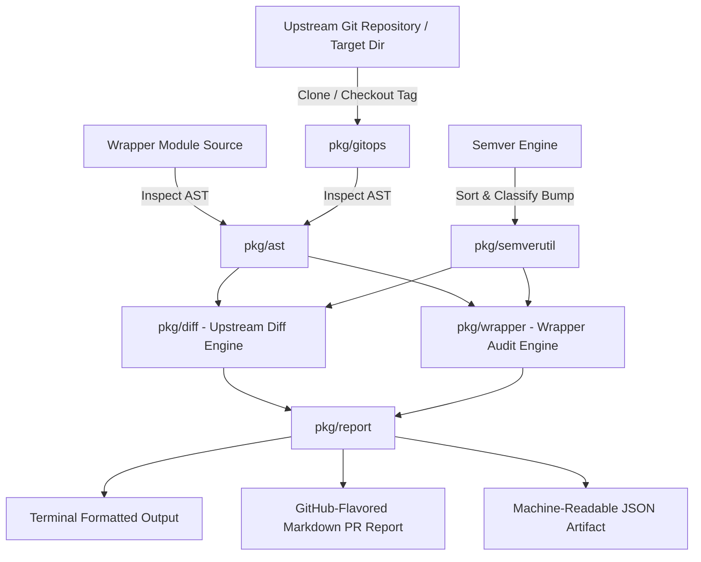

# Architecture & Design Specification

## Overview

`terraform_ast` (`tfastdiff`) is a production-grade static analysis tool written in Go. It compares the Abstract Syntax Tree (AST) and top-level configuration metadata of Terraform modules—specifically focusing on wrappers for enterprise modules like **Google GKE** (`terraform-google-modules/kubernetes-engine/google`) and **AWS EKS** (`terraform-aws-modules/eks/aws`)—against upstream releases.

The tool provides automated compatibility verification, identifying breaking changes, type constraint shifts, removed outputs, and safe version pinning boundaries before code is merged or deployed.

---

## Core Packages

### 1. `pkg/ast` (Abstract Syntax Tree & Configuration Inspection)
- **Engine**: Built on `github.com/hashicorp/terraform-config-inspect/tfconfig` and `github.com/hashicorp/hcl/v2/hclsyntax`.
- **Capabilities**:
  - Extracts module inputs (`variables`), default values, required flags, descriptions, and type constraints.
  - Extracts module outputs, descriptions, and sensitivity flags.
  - Performs deep HCL AST scanning to inspect child `module "..."` blocks, extracting exact arguments forwarded by wrapper modules and delegations in `output "..."` definitions.
  - Performs structural and primitive type compatibility checking (e.g. `string` vs `number`, `list` vs `set`, `any` widening vs narrowing).

### 2. `pkg/semverutil` (Semantic Versioning & Tag Lifecycle)
- **Engine**: Powered by `golang.org/x/mod/semver`.
- **Capabilities**:
  - Canonicalizes version strings (ensuring standard `v` prefix).
  - Determines semver bump transitions: `MAJOR` (breaking), `MINOR` (features), `PATCH` (fixes), `DOWNGRADE`, `IDENTICAL`, and `INVALID`.
  - Filters and sorts tags deterministically in ascending or descending order.

### 3. `pkg/gitops` (Git Operations & Version Extraction)
- **Engine**: Powered by `github.com/go-git/go-git/v5`.
- **Capabilities**:
  - Clones remote repositories or inspects local Git checkouts in-place.
  - Extracts all semantic version tags from Git references.
  - Checks out specific tags, branches, or commits into isolated staging directories for AST comparison.

### 4. `pkg/diff` (Upstream Diff Comparator)
- **Capabilities**:
  - Compares two versions of an upstream module.
  - Categorizes differences into:
    - **Breaking Changes**: Removed inputs, newly required inputs without defaults, type constraint changes, removed outputs.
    - **New Features**: Newly introduced optional inputs with defaults, newly introduced outputs.
    - **Warnings**: Widened types (e.g., `list(string)` to `set(string)`), sensitive flags added, deprecation notices, provider constraint updates.
  - Computes high-level safety verdict: `SAFE`, `BREAKING_CHANGES`, `WARNINGS_ONLY`, or `DOWNGRADE`.

### 5. `pkg/wrapper` (Wrapper Compatibility & Pin Analyzer)
- **Capabilities**:
  - Audits a wrapper module against a target upstream module.
  - Detects wrapper-specific breakages:
    - **Passed Removed Arguments**: Wrapper passes arguments to upstream that no longer exist (causes Terraform syntax/argument error).
    - **Missing Required Inputs**: Upstream requires inputs without defaults that the wrapper does not provide (causes missing required argument error).
    - **Type Incompatibilities**: Wrapper defines a variable with a type constraint that conflicts with upstream expectations.
    - **Broken Delegations**: Wrapper re-exports an upstream output that was renamed or removed in the new release.
  - Recommends exact version pinning syntax (e.g. `version = "30.0.0"`).
  - Generates clear, actionable remediation steps.

### 6. `pkg/report` (Multi-Format Reporting & Golden Matcher)
- **Capabilities**:
  - Formats results into interactive terminal text with status indicators (`🚨`, `✨`, `⚠️`, `💡`).
  - Generates GitHub-flavored Markdown with alert callouts (`> [!CAUTION]`, `> [!WARNING]`, `> [!NOTE]`) and tables.
  - Serializes machine-readable JSON for CI/CD pipeline automation.
  - Provides golden file assertion helpers (`AssertGoldenMatch`) for canonical regression testing.
