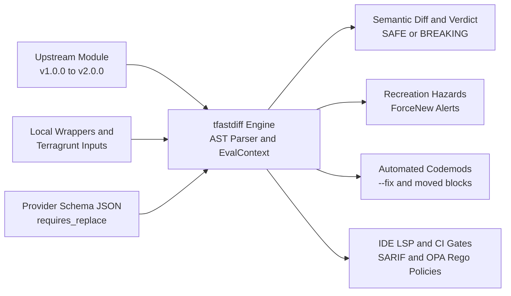

# Executive Summary: Features & Enterprise Use Cases

`terraform_ast` (`tfastdiff`) is an enterprise-grade Abstract Syntax Tree (AST) diff, semantic compatibility analysis, and automated migration engine for HashiCorp Terraform and OpenTofu modules.

---

## Executive Overview

Modern cloud platforms rely on shared Terraform and OpenTofu modules to provision critical infrastructure across Google Cloud (GCP), Amazon Web Services (AWS), and Microsoft Azure. However, upgrading upstream modules often introduces subtle breaking changes—such as removed variables, tightened type constraints, altered outputs, or attribute modifications that trigger catastrophic resource recreation (`ForceNew`).

`tfastdiff` eliminates upgrade uncertainty by parsing Terraform configurations directly into an AST, evaluating expressions and variable taint dependencies, computing semantic compatibility diffs, predicting blast radius across monorepos, and generating automated migration codemods.

---

## Key Platform Features

### 1. Semantic AST Inspection & Deep Diff Engine (`pkg/ast`, `pkg/diff`)
- **Direct AST Parsing**: Parses `.tf` and `.tf.json` files without requiring an initialized `.terraform` directory or live cloud credentials.
- **Modern HCL & OpenTofu Support**: Full first-class support for `removed {}` blocks (with soft destruction lifecycle `destroy = false`), `check {}` assertions, programmatic `import {}`, custom provider functions (`function "..." {}`), and client-side state encryption blocks (`encryption {}`).
- **Comprehensive Change Categorization**: Accurately classifies changes into **Breaking Changes** (removed inputs, newly required inputs without defaults, narrowed type constraints, removed outputs), **New Features** (optional inputs, new outputs), and **Deprecation Warnings**.
- **Object Schema Inspection**: Traverses deeply nested `object(...)` type constraints, detecting added required fields or incompatible attribute definitions.

### 2. Expression Evaluation Context & Taint Reachability (`pkg/eval`)
- **Embedded `hcl.EvalContext`**: Pure, hermetic implementations of Terraform standard functions (`concat`, `merge`, `lookup`, `coalesce`, `element`, `lower`, `upper`, `trimspace`, `jsondecode`).
- **Terragrunt Dynamic Inputs**: Evaluates Terragrunt `inputs = merge(...)` blocks and wrapper variable delegations without failing with incomplete analysis.
- **Dependency Taint Analysis**: Traces input variables through intermediate `locals` and child module calls to verify whether an upstream breaking change reaches an active managed resource or remains dead code.

### 3. State Recreation, `ForceNew` Hazards & Dynamic Auto-Discovery (`pkg/recreation`)
- **Dynamic Provider Schema Auto-Discovery**: Automatically inspects `required_providers` in the AST, discovers local schemas or queries built-in ForceNew attribute tables for standard cloud providers (AWS, GCP, AzureRM, Kubernetes, Cloudflare), and writes schemas to the persistent L2 disk cache.
- **Dynamic Provider Schema Ingestion**: Ingests custom schema dumps (`terraform providers schema -json`) to extract `requires_replace` metadata across arbitrary cloud resource attributes.
- **Built-in Cloud Heuristics**: Pre-configured immutability detection for flagship multi-cloud modules:
  - **GCP GKE**: Cluster name, region, network, subnetwork, and secondary pod CIDR blocks.
  - **AWS EKS**: Cluster name, VPC attachment, and IP family.
  - **Azure AKS**: Cluster name, resource group, location, and DNS prefix.
- **Disaster Prevention**: Alerts teams before applying plans that would trigger complete database rebuilds or Kubernetes control plane destructions.

### 4. Intermediate Representation (IR) & State Graph Theory (`pkg/ast`)
- **Eliminating the "Static AST Fallacy"**: While static variable analysis ensures syntactic compatibility, Terraform's runtime state is organized as a hierarchical instance address graph. If an internal resource switches from singleton to indexed (`count` or `for_each`) or is moved into a child module, the interface diff is empty, but Terraform destroys and recreates the resource on apply.
- **Canonical Address Model**: Evaluates addresses into canonical forms (`module.vpc.aws_subnet.this["a"]`) capturing module nesting, resource mode (`managed` vs `data`), type, name, and index keys.
- **Evaluation Graph & Shift Detection**: Builds an IR graph (`EvaluationGraph`) of module resources and detects address displacements between versions (`DetectAddressShifts`), alerting operators to unmitigated state destruction.

### 5. Monorepo Blast Radius & Inter-Procedural Taint Reachability (`pkg/blastradius`, `pkg/eval`)
- **Recursive Monorepo Traversal**: Discovers all downstream root modules and Terragrunt environments consuming an upstream module.
- **Inter-Procedural Taint Reachability**: Directly wires `--taint <var>` into `--blast-radius` scans, dynamically tracing value flows through module calls and filtering out downstream consumers that do not actively pass or consume tainted variables.
- **Consumer Impact Assessment**: Pinpoints exactly which call sites pass deprecated arguments or reference removed outputs.
- **Unified SARIF & JSON Reporting**: Emits structured diagnostics (`TF-BLAST-RADIUS-CONSUMER`) for GitHub Code Scanning and enterprise compliance dashboards.

### 6. Automated Migration Codemods & State Refactoring (`pkg/codemod`, `pkg/planner`)
- **In-Place Refactoring (`--fix`)**: Modifies `.tf` files using `hclwrite` to cleanly strip obsolete arguments while preserving indentation and comments.
- **Automated `moved {}` Block Synthesis**: Detects resource address shifts between module versions and automatically synthesizes Terraform 1.1+ state migration declarations (`moved { from = ... to = ... }`), preventing production downtime and state loss.
- **Transitive Multi-Version Planner**: Analyzes intermediate Git releases (e.g. `v25.0.0` to `v31.0.0`) to find the highest contiguous "safe harbor" version.

### 7. Enterprise Policy Governance (Official OPA Go SDK & Rego v1) (`pkg/policy`)
- **Real Open Policy Agent (OPA) Integration**: Powered by the official Open Policy Agent Go SDK (`github.com/open-policy-agent/opa/v1/rego`) with full Rego v1 keyword support (`contains`, `if`), comprehensions, sets, and helper rules.
- **Architectural Rules**: Enforce policies such as blocking major version jumps in production environments, requiring review if blast radius exceeds 5 root modules, or disallowing breaking changes in PCI-DSS compliant repositories.

### 8. IDE Language Server Protocol Daemon (`pkg/lsp`)
- **Editor Diagnostics**: Runs over stdio (`tfastdiff daemon` / `--lsp`) implementing JSON-RPC 2.0 for VS Code, Neovim, and JetBrains. Diagnostics are published on open, change, and save, and are computed from the in-editor buffer so they reflect unsaved edits.
- **Quick-Fix Code Actions**: `textDocument/codeAction` and `workspace/executeCommand` write `moved {}` blocks and inject missing required module inputs. Both commands are registered in `executeCommandProvider`, so a client can actually run them.
- **Protocol Correctness**: Notifications are never answered, the `initialize`/`shutdown`/`exit` lifecycle is honoured, and message framing rejects an out-of-range `Content-Length` instead of allocating from it.

### 9. Enterprise Supply Chain Security & SLSA Level 3 (`.github/workflows`)
- **Hermetic SLSA Level 3 Provenance**: Automated cryptographic build attestations via GitHub Actions builders.
- **Sigstore Cosign Keyless Signing**: Cryptographically signs release binaries and container images.
- **Syft SBOM**: Generates both CycloneDX and SPDX Software Bill of Materials at build time.
- **Hardened Distroless Containers**: Strict non-root UID `65532:65532`, read-only rootfs (`--read-only`), and zero critical/high CVEs.

---

## Enterprise Use Cases

| # | Use Case | Target Audience | Problem Solved | Primary Value |
| :-: | :--- | :--- | :--- | :--- |
| **1** | **Upstream Module Upgrades** | Platform & DevOps Engineers | Upgrading public or internal modules (GKE, EKS, AKS) without breaking wrapper abstractions. | Zero-downtime upgrades, guaranteed semantic compatibility. |
| **2** | **Monorepo CI/CD Pull Request Gates** | SRE & Cloud Architects | Module maintainers inadvertently merging breaking changes that affect downstream teams. | Automated PR blocking (`--exit-code`), SARIF code scanning annotations. |
| **3** | **Automated Refactoring & Migration PRs** | Infrastructure Engineers | Manually updating hundreds of module call sites across repositories. | In-place automated fix (`--fix`) and `moved {}` block generation. |
| **4** | **Infrastructure Recreation Prevention** | Cloud Security & Operations | Accidental cluster or database drops caused by modifying immutable attributes. | Early detection of `ForceNew` hazards before running `terraform apply`. |
| **5** | **Multi-Version Strategic Upgrade Planning** | Engineering Leadership | Migrating long-unmaintained infrastructure forward across multiple major versions. | Identifies optimal safe intermediate versions and upgrade paths. |
| **6** | **IDE Feedback Loop** | Terraform Developers | Discovering module compatibility errors late in the CI cycle. | Editor diagnostics from the in-editor buffer, plus quick-fix actions that write `moved {}` blocks and inject missing inputs. |
| **7** | **Multi-Cloud Upstream Drift Monitoring** | Enterprise Architecture | Public registry modules silently releasing breaking changes or deprecations. | Daily automated matrix scans across GCP, AWS, and Azure. |

---

## Technical Specifications & Verification Guarantees

- **Language & Runtime**: Pure Go (statically linked, zero external CGO dependencies).
- **Test Coverage**: **100.0% statement coverage** across all packages enforced in CI.
- **Verification Gates**:
  - `gofmt` & `go vet`: Clean.
  - `golangci-lint`: 0 issues (govet, staticcheck, unused, gosec).
  - Concurrency Safety: 0 data races under `go test -race`.
  - Differential Fuzzing: Fuzz-tested against official HashiCorp Terraform and OpenTofu compilers.
  - Algebraic Invariants: Formally verified Identity ($\Delta(A \to A) = \emptyset$) and Triangle Inequality ($\Delta(A \to B) \cup \Delta(B \to C) \supseteq \Delta(A \to C)$).
  - Terratest Plan State Validation: Offline validation confirming `Plan: 0 to destroy` on safe updates and `(forces replacement)` on ForceNew hazards.
