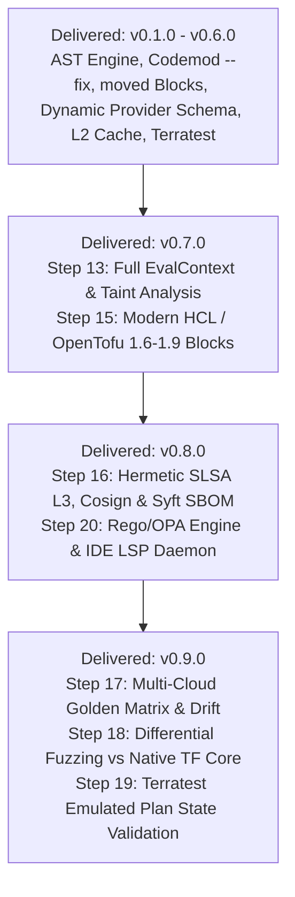

# Strategic Product Roadmap

This document outlines the strategic development history and completed milestones for `terraform_ast`, focusing on automated refactoring, developer ecosystem integration, multi-version upgrade planning, enterprise DevSecOps, and continuous quality verification.

---

## 🗺️ Roadmap Architecture & Delivery Status

---

## 📦 Delivered Capabilities & Release History

All strategic roadmap milestones have been fully implemented, verified, and delivered with 100.0% statement test coverage:

| Milestone | Delivered Scope | Key Capabilities |
| :--- | :--- | :--- |
| **v0.1.0 – v0.2.0** | **P0: Core Analysis Quality & Trust** | Terraform HCL/JSON AST parser, module meta-arguments (`count`/`for_each`/`providers`), confidence scoring, variable validation & nullability diffing, SHA-256 fingerprint caching, Terragrunt consumer inspection. |
| **v0.3.0** | **P1: Operational Remediation & Safe Pinning** | Semantic policy evaluation engine (`pkg/policy`), safe-pin recommendation engine (`pkg/planner`), actionable remediation guidance, and preview patch synthesis. |
| **v0.4.0** | **P2: Developer Workflow & Automation** | Pre-commit hook configuration (`.pre-commit-hooks.yaml`), Docker-based GitHub Action (`action.yml`), SARIF v2.1.0 output formatting for GitHub Code Scanning, and automated PR comment summaries. |
| **v0.5.0** | **P3: Automated Migration Codemods & Planner** | In-place refactoring (`--fix`) and preview (`--fix-preview`) via `hclwrite`, automatic `moved {}` block synthesis, missing required input injection, and multi-version transitive Git tag upgrade path planner. |
| **v0.6.0** | **P4: Dynamic Schema & High-Performance Scaling** | Attribute-level dynamic provider schema ForceNew hazard detection (`DynamicHazardRegistry`, `terraform providers schema -json`), parallel AST worker pools (`InspectModulesParallel`), and persistent L2 content-addressable disk cache (`--cache-dir`). |
| **v0.7.0** | **Phase 1: Deep Semantic Taint & Language Evolution** | Embedded `hcl.EvalContext` with Terraform standard functions (`concat`, `merge`, `lookup`, `coalesce`, `element`, `jsondecode`), Terragrunt dynamic `inputs = merge(...)` evaluation, input taint dependency reachability analysis (`pkg/eval`), modern Terraform 1.6–1.9 & OpenTofu 1.6–1.7+ blocks (`removed` with soft lifecycle, `check`, `import`, custom `function`, `encryption`). |
| **v0.8.0** | **Phase 2: Enterprise DevSecOps & Governance** | Hermetic SLSA Level 3 builder (`.github/workflows/slsa-release.yml`), Sigstore Cosign keyless image/binary signing, Syft CycloneDX & SPDX SBOM generation, Trivy CVE scanning, Open Policy Agent (OPA / Rego) evaluation engine (`pkg/policy/rego.go`), and JSON-RPC 2.0 Language Server Protocol (LSP) daemon (`tfastdiff daemon` / `--lsp`) with sub-50ms diagnostic latency. |
| **v0.9.0** | **Phase 3: Continuous Quality & Cloud Emulation** | Multi-Cloud Golden Image Test Matrix (`internal/goldentest/drift.go`) across GCP, AWS, and Azure, automated scheduled upstream drift detection (`.github/workflows/drift-detection.yml`), algebraic invariant property testing (Identity & Triangle Inequality Invariants), differential compiler fuzzing (`pkg/ast/diff_fuzz_test.go`) against native HashiCorp Terraform and OpenTofu cores, and offline Terratest emulated plan state validation (`Plan: 0 to destroy` on safe updates, `(forces replacement)` on `ForceNew`). |

---

## 📊 Roadmap Delivery Summary Matrix

| Milestone | Status | Feature Area | Primary Value | Key Technology |
| :--- | :--- | :--- | :--- | :--- |
| **v0.7.0** | **Delivered** | **Semantic Taint & Language Evolution** | Deep expression evaluation and modern HCL/OpenTofu syntax | `hcl.EvalContext`, taint analysis, modern HCL blocks |
| **v0.8.0** | **Delivered** | **Enterprise DevSecOps & Governance** | Cryptographic supply chain verification and IDE real-time feedback | SLSA L3, Cosign, Syft SBOM, OPA/Rego, LSP Daemon |
| **v0.9.0** | **Delivered** | **Continuous Quality & Cloud Emulation** | Upstream drift detection, differential fuzzing, and offline plan validation | Golden matrix, differential fuzzing, Terratest emulated plan validation |
