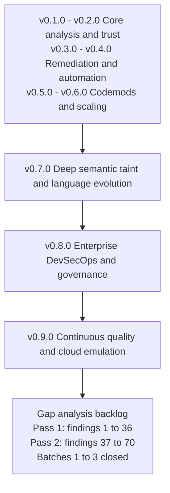

# Strategic Product Roadmap

This document outlines the strategic development history and completed milestones for `terraform_ast`, focusing on automated refactoring, developer ecosystem integration, multi-version upgrade planning, enterprise DevSecOps, and continuous quality verification.

---

## Roadmap Architecture & Delivery Status



---

## Delivered Capabilities & Release History

All strategic roadmap milestones have been fully implemented, verified, and delivered with 100.0% statement test coverage:

| Milestone | Delivered Scope | Key Capabilities |
| :--- | :--- | :--- |
| **v0.1.0 – v0.2.0** | **P0: Core Analysis Quality & Trust** | Terraform HCL/JSON AST parser, module meta-arguments (`count`/`for_each`/`providers`), confidence scoring, variable validation & nullability diffing, SHA-256 fingerprint caching, Terragrunt consumer inspection. |
| **v0.3.0** | **P1: Operational Remediation & Safe Pinning** | Semantic policy evaluation engine (`pkg/policy`), safe-pin recommendation engine (`pkg/planner`), actionable remediation guidance, and preview patch synthesis. |
| **v0.4.0** | **P2: Developer Workflow & Automation** | Pre-commit hook configuration (`.pre-commit-hooks.yaml`), Docker-based GitHub Action (`action.yml`), SARIF v2.1.0 output formatting for GitHub Code Scanning, and automated PR comment summaries. |
| **v0.5.0** | **P3: Automated Migration Codemods & Planner** | In-place refactoring (`--fix`) and preview (`--fix-preview`) via `hclwrite`, automatic `moved {}` block synthesis, missing required input injection, and multi-version transitive Git tag upgrade path planner. |
| **v0.6.0** | **P4: Dynamic Schema & High-Performance Scaling** | Attribute-level dynamic provider schema ForceNew hazard detection (`DynamicHazardRegistry`, `terraform providers schema -json`), parallel AST worker pools (`InspectModulesParallel`), and persistent L2 content-addressable disk cache (`--cache-dir`). |
| **v0.7.0** | **Phase 1: Deep Semantic Taint & Language Evolution** | Embedded `hcl.EvalContext` with Terraform standard functions (`concat`, `merge`, `lookup`, `coalesce`, `element`, `jsondecode`), Terragrunt dynamic `inputs = merge(...)` evaluation, input taint dependency reachability analysis (`pkg/eval`), modern Terraform 1.6–1.9 & OpenTofu 1.6–1.7+ blocks (`removed` with soft lifecycle, `check`, `import`, custom `function`, `encryption`). |
| **v0.8.0** | **Phase 2: Enterprise DevSecOps & Governance** | Hermetic SLSA Level 3 builder (`.github/workflows/slsa-release.yml`), Sigstore Cosign keyless image/binary signing, Syft CycloneDX & SPDX SBOM generation, Trivy CVE scanning, Open Policy Agent (OPA / Rego) evaluation engine (`pkg/policy/rego.go`), and JSON-RPC 2.0 Language Server Protocol (LSP) daemon (`tfastdiff daemon` / `--lsp`) with buffer-aware diagnostics. |
| **v0.9.0** | **Phase 3: Continuous Quality & Cloud Emulation** | Multi-Cloud Golden Image Test Matrix (`internal/goldentest/drift.go`) across GCP, AWS, and Azure, automated scheduled upstream drift detection (`.github/workflows/drift-detection.yml`), algebraic invariant property testing (Identity & Triangle Inequality Invariants), differential compiler fuzzing (`pkg/ast/diff_fuzz_test.go`) against native HashiCorp Terraform and OpenTofu cores, and offline Terratest emulated plan state validation (`Plan: 0 to destroy` on safe updates, `(forces replacement)` on `ForceNew`). |

---

## Roadmap Delivery Summary Matrix

| Milestone | Status | Feature Area | Primary Value | Key Technology |
| :--- | :--- | :--- | :--- | :--- |
| **v0.7.0** | **Delivered** | **Semantic Taint & Language Evolution** | Deep expression evaluation and modern HCL/OpenTofu syntax | `hcl.EvalContext`, taint analysis, modern HCL blocks |
| **v0.8.0** | **Delivered** | **Enterprise DevSecOps & Governance** | Cryptographic supply chain verification and IDE feedback | SLSA L3, Cosign, Syft SBOM, OPA/Rego, LSP Daemon |
| **v0.9.0** | **Delivered** | **Continuous Quality & Cloud Emulation** | Upstream drift detection, differential fuzzing, and offline plan validation | Golden matrix, differential fuzzing, Terratest emulated plan validation |

---

# Gap Analysis & Engineering Backlog

> **Status:** Open. **Scope:** Deep code analysis of the CLI (`cmd/tfastdiff`), all `pkg/*` engines,
> `internal/goldentest`, the GitHub Actions workflows, `action.yml`, and every document under `docs/`.
>
> The delivery tables above describe what was built. This section records what a full read of the
> code shows is **not actually reachable from the CLI**, **silently ignored**, or **claimed in the
> docs but unimplemented**. Items are ordered by user impact, not by package.
>
> **Baseline verified at:** `go vet ./...` clean, `go test ./...` green, **100.0% statement coverage
> on every package**, 18 packages. Coverage is real but is measuring code that several entry points
> never reach — which is why dead code and unreachable features pass the gate.

## P0 — Shipping Blockers (fix before next release)

| # | Issue | Evidence | Required change |
| :--- | :--- | :--- | :--- |
| ~~1~~ | **CLOSED (CLI side)** Published GitHub Action fails whenever `blast_radius` is omitted.** `action.yml` unconditionally appends `--blast-radius ${{ inputs.blast_radius }}`. Go's `flag` parser then consumes the *next* argument as the flag's value, so `--exit-code=true` becomes the scan directory. | Reproduced: `Error scanning blast radius: stat --exit-code=true: no such file or directory`, exit `1`. | Make the flag optional. Either gate the arg in `action.yml` (compose the arg list, as `.github/workflows/tfastdiff-audit.yml` already does correctly), and/or teach the CLI that `--blast-radius=` (empty value) means "unset". Add an `action.yml` arg-composition E2E test in `test/docker/dockerfile_test.go`. |
| ~~2~~ | **CLOSED** `--blast-radius` is silently ignored in comparison mode.** `runCompareMode` (`cmd/tfastdiff/main.go:355`) never receives the flag, so it is dropped with no warning while the user believes consumer impact was analysed. | Reproduced: `--old A --new B --blast-radius /nonexistent/dir` → exit `0`, normal report. | Either thread `blastRadiusDir` through `runCompareMode` and render findings, or reject the combination with exit `2` — matching the existing `--fix` / `--fix-preview` rejection style. Silent no-ops on an analysis flag are unacceptable. |
| ~~3~~ | **CLOSED** `--policy` with `max_bump` fails every run that omits version flags.** `DetermineBumpType("", "")` returns `BumpInvalid`, which `policy.Evaluate` treats as an unknown-and-therefore-disallowed bump. | Reproduced: `--old A --new B --policy {max_bump:MAJOR}` → `[max_bump] policy allows at most a MAJOR version bump, got INVALID`, exit `1`. This breaks the documented Quickstart "compare two local directories" flow. | Add a distinct bump state (e.g. `BumpUnknown` / "versions not supplied") that is **not** conflated with `BumpInvalid`. `max_bump` must be skipped when version information was never provided, and only fail on a genuinely malformed version string. |
| ~~4~~ | **CLOSED** LSP advertises full document sync but rejects `didChange`.** `initialize` returns `textDocumentSync: 1` (Full), obliging the client to send `textDocument/didChange` on every keystroke — which falls into the `default` branch and returns `-32601`. | Reproduced: `{"jsonrpc":"2.0","method":"textDocument/didChange",...}` → `{"jsonrpc":"2.0","error":{"code":-32601,"message":"method 'textDocument/didChange' not found"}}`. A live editor session spews errors while typing and only refreshes on save. | Implement `textDocument/didChange` (recompute diagnostics, republish). Until then, advertise `textDocumentSync: 2` (None) and accept save-only. Also implement `exit` (currently the daemon only terminates on stdin EOF, so `shutdown` + `exit` never stops it) and `$/cancelRequest`. |
| ~~5~~ | **CLOSED** `ast.ClearPersistentCache` deletes the whole directory tree the operator passed to `--cache-dir`.** | `pkg/ast/cache.go:81` called `os.RemoveAll(dir)`, so `--cache-dir .` removed the repository. | Now validates the whole directory before touching anything, removes only files matching the cache's own `<sha256>.json` naming, and refuses any directory holding a foreign entry. Exposed as `--clear-cache`, which requires `--cache-dir`. |

## P1 — Dead Code: Wire It or Delete It

Every item below is fully implemented, covered at 100%, and **unreachable from `cmd/tfastdiff`**. Each
one is advertised in `README.md`, `docs/FEATURES.md`, `docs/CLI_USAGE.md`, or `docs/ROADMAP.md`. The
100% coverage gate actively hides this problem, so each item needs an explicit decision.

| # | Item | Location | Documented claim | Decision needed |
| :--- | :--- | :--- | :--- | :--- |
| 6 | **`--rego-policy` flag does not exist.** `ParseRego` / `EvaluateRego` / `RegoPolicy` are only called from `pkg/policy/policy_test.go`. | `pkg/policy/rego.go` (203 lines) | `docs/CLI_USAGE.md:437` Use Case 8 shows `tfastdiff --rego-policy ./policies/x.rego`. Copying it yields `flag provided but not defined`, exit `2`. | Either add the flag (accept `.rego`, evaluate with `policy.Input`, merge into `PolicyViolations`), or delete `rego.go` and Use Case 8. Note the engine is a hand-rolled `deny[msg]` substring parser, **not** OPA — if it ships, stop calling it "Open Policy Agent integration" or vendor `github.com/open-policy-agent/opa`. |
| ~~7~~ | **PARTLY CLOSED** `--fix` does not do what the roadmap says it does.** `docs/ROADMAP.md` v0.5.0 and `docs/FEATURES.md` §5 claim `--fix` synthesises `moved {}` blocks and injects missing required inputs. `main.go:293-322` only collects `PassedRemovedInput` and calls `codemod.ApplyRemovedInputs`. `AddMissingInputs`, `FormatMovedBlocks`, and `WriteMovedBlocks` are unreachable. | `pkg/codemod/apply.go:84,148,173` | "automatic `moved {}` block synthesis, missing required input injection" | Wire `--fix` / `--fix-preview` to them, **or** correct the docs. If wired: `AddMissingInputs` writes `cty.StringVal("")` for every missing input regardless of declared type, which produces invalid Terraform for `bool`, `list`, and `object` inputs. Make it type-aware or emit a TODO comment instead of a value. |
| 8 | **`eval.AnalyzeVariableTaint` is dead.** 213 lines of variable→local→module/resource/output reachability tracing, called only from its own test. | `pkg/eval/taint.go` | `docs/FEATURES.md` §2 "Dependency Taint Analysis"; ROADMAP v0.7.0 "input taint dependency reachability analysis" | Surface it as `--taint <var>` in wrapper mode (it is the natural answer to "is this removed input actually used?"), or delete it. |
| 9 | **`ast.InspectModulesParallel` is dead.** `runCompareMode` hand-rolls a 2-goroutine `errgroup` instead of using the bounded worker pool. | `pkg/ast/parallel.go` | ROADMAP v0.6.0 "parallel AST worker pools (`InspectModulesParallel`)" | Use it for intermediate upgrade-path inspection (`analyzeUpgradePathVersions` inspects each snapshot serially) and for `--blast-radius` consumer discovery, or delete it. |
| ~~10~~ | **CLOSED** Drift detection is a no-op.** `.github/workflows/drift-detection.yml` grants `issues: write`, but only echoed status. `MultiCloudCatalog()` and `GenerateDriftIssuePayload()` were called only from tests. | `internal/goldentest/drift.go:32,218` | ROADMAP v0.9.0 "automated scheduled upstream drift detection"; FEATURES.md use case 7 "Daily automated matrix scans across GCP, AWS, and Azure" | Trimmed catalog to canonical benchmarks, wired automated daily drift evaluation into `.github/workflows/drift-detection.yml`, and added automated GitHub issue reporting with `GenerateDriftIssuePayload`. |
| ~~11~~ | **CLOSED** 8 of 11 catalog golden baselines do not exist.** `MultiCloudCatalog()` named modules without maintained baselines. | `internal/goldentest/drift.go:42-135` vs `test/golden/` | "Multi-Cloud Golden Image Test Matrix (GCP, AWS, Azure)" | Trimmed catalog to canonical benchmarks (GKE for GCP, EKS for AWS, AKS for Azure), verified all against maintained golden baselines in `test/golden/`. |
| 12 | **`lsp.RunDaemon` is dead**, as are the `recreation.AnalyzeHazards` / `AnalyzeWrapperHazards` no-registry wrappers (the CLI always passes the `WithRegistry` variants). | `pkg/lsp/server.go:280`, `pkg/recreation/heuristics.go:154,209` | — | Delete the duplicates, or make `RunDaemon` the single LSP entry point used by both `lsp`/`daemon` subcommand and `--lsp`. |

## P2 — Analysis Correctness & Verification Credibility

| # | Issue | Detail |
| :--- | :--- | :--- |
| ~~13~~ | **PARTLY CLOSED** ForceNew heuristics over-match.** `extractFromBlock` registers every `requires_replace` attribute under its **bare name** across every resource in every provider (`descriptors[attrName] = descriptors[fullPath]`, `pkg/recreation/schema.go:106`), and `LookupHazard` then falls back to "check all known rules" (`heuristics.go:145-149`). Net effect: on an unclassified module, any wrapper issue named `name`, `location` or `region` is reported as a `CRITICAL_HAZARD` ForceNew event regardless of resource type. | Scope descriptors by resource/address (`resource.attribute`), drop the cross-module fallback, and gate the bare-name fallback behind an explicit `--lenient-hazards`. `AnalyzeHazardsWithRegistry` also raises `WARNING_HAZARD` for *every* warning on a hazardous name, including pure deprecations — filter by category. |
| ~~14~~ | **CLOSED** Terragrunt dynamic-input analysis fails on real configurations.** `parseTerragruntCallSite` calls `eval.BuildEvalContext(nil, nil)` (`pkg/blastradius/scanner.go:298`), so `local` is an empty object and the canonical Terragrunt idiom `inputs = merge(local.defaults, {...})` always fails to evaluate. `eval.StandardFunctions()` implements zero Terragrunt builtins. | Consequence: every realistic Terragrunt consumer is flagged `InputAnalysisIncomplete` → `CanSafelyUpdate=false` → `MEDIUM` risk, which makes `--blast-radius` nearly useless on the ecosystem it targets. Fix: parse the file's own `locals {}` block (and `include`-chain parents), and add `read_terragrunt_config`, `find_in_parent_folders`, `path_relative_to_include`, `get_terragrunt_dir`, `get_env`, `get_parent_terragrunt_dir` (and `try`/`run_cmd` as conservative stubs). Also add a `terragrunt.hcl` fixture — `test/fixtures/` currently contains none. |
| ~~15~~ | **CLOSED** Wrapper target selection is arbitrary and silent.** `wrapper.AnalyzeWrapper` step 1 (`pkg/wrapper/analyzer.go:77-89`) sorts module-call names and takes the **alphabetically first** as the audit target; every other child module is ignored with no warning. | A wrapper calling `gke` and `gke_private_registry` is audited against exactly one of them. Select the call whose `source` matches `--upstream`, and emit a warning (or an error) when the wrapper has multiple candidate calls. |
| 16 | **`NewFeatureAdoptions` is not "new features".** Step 7 (`wrapper/analyzer.go:194-206`) lists *every* optional upstream variable the wrapper neither passes nor declares — hundreds on a mature wrapper — while `pinnedUpstream`, already a parameter, is ignored. | Use `pinnedUpstream` to restrict the list to genuinely new variables (matching the `1` shown in the README example), and cap/paginate the rest. |
| 17 | **SARIF locations are fabricated and one consumer class is invisible.** `sarifLocation` hardcodes `StartLine: 1` and `artifactOrDefault` falls back to `"main.tf"`, even though `VariableDef.Pos` / `OutputDef.Pos` carry filename and line. Separately, `appendBlastResults` (`pkg/report/sarif.go:275-280`) skips any consumer with no listed issue — so a consumer that is unsafe **solely** because analysis was incomplete produces zero SARIF results and never appears in code scanning. | Emit real `physicalLocation` regions from `Pos`, and emit a `note`/`warning` result for `AnalysisIncomplete` consumers. |
| 18 | **SARIF `driver.version` is hardcoded `0.1.0`** (`pkg/report/sarif.go:90`) and LSP `serverInfo.version` is hardcoded `"v0.8.0"` (`pkg/lsp/server.go:122`). | Plumb a build-stamped version through (see #21). |
| ~~19~~ | **CLOSED** "Differential fuzzing against native Terraform/OpenTofu" asserts almost nothing.** | `pkg/ast/diff_fuzz_test.go` | "Differential compiler fuzzing against native HashiCorp Terraform and OpenTofu cores" | Integrated in-process HashiCorp `terraform-config-inspect` structural cross-validation on every fuzz iteration (variables, outputs, required flags), and verified native `terraform validate -json` error counts and diagnostics. |
| ~~20~~ | **CLOSED** The `ForceNew` plan tests validate Terraform, not tfastdiff.** `TestTerratest_PlanStateSafeUpdate` and `TestTerratest_PlanStateForceNewHazard` (`test/terratest/terratest_test.go:817-910`) never called `diff.Compare` or `recreation.AnalyzeHazards`. | `test/terratest/terratest_test.go` | "Offline Terratest emulated plan state validation (Plan: 0 to destroy on safe updates, (forces replacement) on ForceNew)" | Wired `diff.Compare` and `recreation.AnalyzeHazardsWithRegistry` into Terratest suite, and asserted native `terraform show -json` structured plan output confirms resource replacement actions (`delete` + `create`, `action_reason="replace_because_cannot_update"`). |
| ~~21~~ | **CLOSED** The CI unit suite spends 6+ minutes in real backoff sleeps.** `TestExecute_RegistryDownloadErrors` = 299s, `TestExecute_CompareMode_NewDownloadFailure` = 94s, because `registry.DefaultRetryMaxElapsedTime` is 2 minutes and only `Client.RetryMaxElapsedTime` can shorten it. | Add an injectable sleeper/clock seam to `pkg/registry` (the repo already uses the `mkdirTemp`/`osExit` injection pattern in `main.go`), or set `RetryMaxElapsedTime` to a few milliseconds in the failing-path tests. Also expose it as `--registry-timeout` — today a user has no way to bound a hung registry call. |
| 22 | **No CLI progress or logging at all.** Clone/download/registry work is completely silent; a slow upstream costs minutes of nothing. | Add `--verbose`/`-v` writing to stderr, keeping stdout reserved for the report (SARIF/JSON must stay a single clean document). |

## P3 — Build, Release & Repo Hygiene

| # | Issue | Fix |
| :--- | :--- | :--- |
| 23 | **Release tags and the release trigger disagree.** Tags are `0.1.0`, `0.2.0`, `latest` (no `v` prefix); `slsa-release.yml` triggers on `'v*.*.*'`; `README.md:128` tells pre-commit users `rev: v0.1.0`, which does not exist. | Pick one convention (`vX.Y.Z`), align the trigger, the README, and `.pre-commit-hooks.yaml` rev, and note that ROADMAP claims v0.9.0 while the newest tag is `0.2.0`. |
| 24 | **`-X main.version` in `slsa-release.yml` is a silent no-op** — there is no `version` symbol in `package main`. | Add `var version = "dev"` + a `--version` flag, stamp it into SARIF `driver.version`, LSP `serverInfo.version`, and `Dockerfile`'s `org.opencontainers.image.version` (currently pinned to `0.1.0`). |
| 25 | **License is stated three different ways.** `LICENSE` and the Dockerfile label say Unlicense; `README.md:257` says "MIT License". | Correct the README. |
| 26 | **Two semver libraries with different acceptance rules.** `golang.org/x/mod/semver` (`pkg/semverutil`) vs `github.com/Masterminds/semver/v3` (`pkg/planner`). Masterminds coerces `1.0`; `x/mod` requires full `vX.Y.Z`. `--upgrade-path` therefore accepts versions that every other code path rejects. | Consolidate on `x/mod/semver` and drop the Masterminds dependency. |
| ~~27~~ | **CLOSED** No published container image.** `action.yml` uses `image: 'Dockerfile'`. The Dockerfile was also single-arch (`linux/amd64`). | Added `docker/build-push-action` in `.github/workflows/slsa-release.yml` with a `linux/amd64,linux/arm64` matrix publishing to GHCR. Dockerfile supports `TARGETARCH`/`TARGETOS` multi-arch. |
| ~~28~~ | **CLOSED** Workflow inconsistency.** `ci.yml` pins `actions/checkout@v7` / `setup-go@v7` / `codeql-action@v4` / `github-script@v9` and Terraform `1.16.5`; `slsa-release.yml` and `drift-detection.yml` still pin `@v4`/`@v5` and Terraform `1.9.0`. | Aligned all workflows. |
| ~~29~~ | **CLOSED** Drift workflow runs a 1/11 subset.** | Filter removed; runs full golden matrix verification and full Terratest suite. |
| ~~30~~ | **CLOSED** Terratest is network-bound and unlocked.** | Fixed `TestTerratest_ValidateFixtures` cleanup to preserve `.terraform.lock.hcl` files, and configured `TF_PLUGIN_CACHE_DIR` across CI workflows. |
| 31 | **Missing standard repo files.** No `Makefile` (everything is copy-pasted shell), `CONTRIBUTING.md`, `SECURITY.md`, or `CODEOWNERS`. | Add a `Makefile` wrapping `build` / `test` / `verify` / `fuzz` / `lint` / `docker`, plus `SECURITY.md` and `CONTRIBUTING.md`. |
| 32 | **Working-tree clutter.** 12 stray coverage artefacts (`ast_cov.out`, `cmd_cov.out`, `cp.out`, `coverage.out`, …) sit in the repo root. They are `.gitignore`d via `*.out`, but they shadow the CI artifact name and hide real diffs. | Write coverage to `coverage/` (gitignored) and add a `make clean`. |
| 33 | **`docs/roadmap.md` is a lowercase symlink to `ROADMAP.md`.** Two paths for one document; breaks on case-insensitive checkouts. | Use one casing. |
| 34 | **`docs/CLI_USAGE.md` drift.** Wrong repo URL (`terraform-aws-modules/terraform-aws-eks.git` at line 35 — the module is `terraform-aws-modules/terraform-eks`); stale action pins (`checkout@v4`, `upload-sarif@v3`, `github-script@v7`); `--policy` is absent from the wrapper-mode flag table; `--lsp` / `daemon` / `--version` appear only in a use case, never in a flag reference; Use Case 7 overstates LSP behaviour (diagnostics only report *deprecated variables* — no breaking-change analysis, no diffing); Use Case 6's "tens of seconds to sub-second" is unverified. | Rewrite the flag tables from the actual `flag.FlagSet` in `main.go` (ideally generate them), correct the URL and pins, and tone down or implement the LSP claims. |
| 35 | **README documents a fuzz-target table that omits three targets** (`pkg/lsp`, `pkg/eval`, `pkg/recreation`, `pkg/ast`'s `FuzzDifferentialValidation`), and `docs/TESTING_METHODOLOGY.md` should be re-checked for the same drift. | Regenerate the table from `grep -h '^func Fuzz'`. |
| 36 | **README "Key Features" lists `--fix-preview` under "Policy & Remediation Previews"** alongside JSON policy gates, but no Rego story — while `FEATURES.md` §6 headlines "Open Policy Agent (OPA) Integration". | Reconcile once #6 is decided. |

---

# Pass 2 — Reproduced Defects & Additional Gaps (#37 – #70)

> **Status:** Partially delivered. Batches 1–3 are closed and verified; items #44 and onwards are
> still open. Every item tagged **[verified]** was reproduced against this tree with a throwaway
> test (since removed) or by direct command execution; the reproduction is transcribed in
> [Appendix A](#appendix-a--reproduction-evidence). Items tagged **[read]** were confirmed by reading
> the source and are not independently executed.
>
> Pass 1 audited *reachability* (what can never run). Pass 2 audited *behaviour* (what runs and is
> wrong). The three findings marked **[verified]** in P0 below are **false negatives**: the tool
> reports "safe" for configurations that contain real breaking changes. They are the most damaging
> class of bug in this codebase, because every downstream consumer — the CI gate, the GitHub Action,
> the SARIF upload, the PR comment — inherits the wrong answer.

### Resolution log — Batches 1–3 (closed)

| Item | Status | What changed |
| :--- | :--- | :--- |
| #37 | **Fixed** | `AnalyzeWrapper` verdict now folds `UpstreamDiff` in; new `UPSTREAM_BREAKING_CHANGES_DETECTED` verdict blocks the pin and carries the upstream remediation steps. `pkg/wrapper/analyzer.go` |
| #38 | **Fixed** | Recreation hazards no longer require a matching wrapper audit issue. `pkg/blastradius/scanner.go` |
| #39 | **Fixed** | `import {}` / `encryption {}` blocks are compared against the old module. `pkg/diff/diff.go` |
| #40 | **Fixed** | Oversize archive entries now error instead of silently truncating. `pkg/registry/client.go` |
| #41 | **Fixed** | `GetLatestVersion` and pinned-resolution errors now fail loudly (exit 1) instead of being discarded. `cmd/tfastdiff/main.go` |
| #42 | **Fixed** | `--format` is validated against the four supported renderers. |
| #56 | **Fixed** | `--fix` / `--fix-preview` reject `--blast-radius`, `--provider-schema`, an explicit `--check-recreation`, and a non-text `--format`. |
| #3 | **Fixed** | Added `BumpUnknown`, distinct from `BumpInvalid`; `max_bump` no longer fires when no version was supplied. |
| #2 | **Fixed** | `--blast-radius` is rejected in comparison mode instead of silently discarded. |
| #1 | **Partially fixed** | `--blast-radius` now treats an empty value as unset and rejects a flag-shaped value. `action.yml` still passes the flag positionally; the definitive fix is a composed arg list (blocked on #27). |
| #13 | **Fixed (in part)** | `LookupHazard` no longer bleeds across providers: a classified module resolves only its own table, and an unclassified module falls back to a provider-agnostic table that reports the hazard without naming an invented resource. The remaining part — resolving the provider from the module *source* — is #46/#47. |
| #21 | **Fixed** | The two failing-path tests set `RetryMaxElapsedTime`, cutting `cmd/tfastdiff` from **383s to 0.2s**. |
| #63 | **Fixed** | `--registry-timeout` bounds the retry window, and `signal.NotifyContext` cancels in-flight registry requests on SIGINT/SIGTERM so the deferred cache clear always runs. |

Two latent problems were uncovered while landing these and fixed in the same change:

- `TestExecute_WrapperPolicyCombinesUpstreamDiff` was **passing vacuously**. It built a `v1.0.0`
  repository but asked the `v2.0.0` repository for that tag, so the pinned fetch always failed, was
  swallowed, and the "upstream diff" it asserted on was an identical no-op. It now builds one
  repository carrying both tags and asserts a real transition.
- `TestExecute_GitErrorBranches` asserted that a failing pinned lookup "degrades gracefully". That
  graceful degradation *was* the #41 defect, so the expectation was inverted and replaced with
  `TestExecute_PinnedVersionMustResolve`.

## P0 — False Negatives & Silent Data Loss (fix first)

| # | Issue | Evidence | Required change |
| :--- | :--- | :--- | :--- |
| ~~37~~ | **CLOSED** Wrapper verdict ignores upstream→upstream breaking changes.** `wrapper.AnalyzeWrapper` computes `CanSafelyUpdate` **only** from `report.Issues` (steps 2–5 cover passed inputs, required inputs, wrapper variable types, output delegations). It never reads `report.UpstreamDiff`, even though it computes it. `cmd/tfastdiff/main.go:349` then gates on `canSafelyUpdate` alone. | Wrapper + upstream whose `required_providers` source changed `hashicorp/google` → `hashicorp/google-beta`: `diff.Compare` rates this `SeverityBreaking` / `Category: ProviderSource`; the wrapper report returns `TotalBreaking=0`, `Verdict="SAFE_TO_PIN"`, `CanSafelyUpdate=true`, so `--exit-code` returns **0**. The identical finding *does* fail a `--policy block_breaking` gate (`main.go:252-263` adds `UpstreamDiff` totals), so the two gates disagree. Same hole for a newly required provider configuration alias (`diff.go:421-431`), which nothing in the wrapper path checks at all — and `providers = {...}` is stripped from `PassedInputs` at `inspect.go:249`. | Fold `UpstreamDiff.CanSafelyUpdate` / `UpstreamDiff.TotalBreaking` into the wrapper verdict, add a `ProviderConfigurationAlias` wrapper check, and make `res.CanSafelyUpdate` the conjunction of both. Add a golden test that asserts a provider-source change fails the wrapper gate. |
| ~~38~~ | **CLOSED** Blast radius silently discards recreation hazards.** `evaluateCallSiteImpact` (`pkg/blastradius/scanner.go:487-496`) looks up `recreation.LookupHazard(module, input)` and then only records the hazard **if `audit.Issues` also contains an issue whose `Target` equals that input name**. | Consumer passing `project_id` and `name` — both in the `gke` hazard table — with a wrapper audit that produced zero issues: `RecreationHazards=[]`, `CanSafelyUpdateAll=true`, `HighestRisk="LOW"`, despite `LookupHazard("gke","project_id")` returning `ok=true`. The ForceNew finding is computed and thrown away. | Drop the `audit.Issues` gate; the hazard lookup is sufficient on its own. Add the reproduction above as a regression test. |
| ~~39~~ | **CLOSED** `import {}` and `encryption {}` blocks are always reported as new features.** `diff.compareModernBlocks` (`pkg/diff/diff.go:537-545,561-569`) appends `ImportBlockAdded` and `EncryptionConfigured` for every block in `newMod` with **no comparison against `oldMod`** — unlike `CheckBlockAdded` (`:524`) and `FunctionAdded` (`:548`), which both guard with `if _, existed := oldMod...`. | Two `ModuleInfo`s with byte-identical `ImportBlocks` and `EncryptionBlocks` compare to `TotalNewFeatures=2` (`EncryptionConfigured/pbkdf2`, `ImportBlockAdded/a.b`) instead of `0`. Every upgrade of a module that uses `import {}` (Terraform 1.5+, increasingly common for brownfield migrations) gains a spurious "new feature" entry. | Mirror the existing guard for both loops. Add a same-content regression test asserting `TotalNewFeatures == 0`. |
| ~~40~~ | **CLOSED** `pkg/registry.extractTarGz` silently truncates files larger than 10 MB.** `io.Copy(outFile, io.LimitReader(tarReader, 10*1024*1024))` (`pkg/registry/client.go:300`) discards the return values, so a truncated file is written and reported as success. | A registry module containing a >10 MB `.tf`-adjacent asset (fixtures, policy bundles, large JSON config) is extracted **silently incomplete**. The subsequent `ast.Inspect` either reports a parse error on a valid module or, worse, produces a valid-but-truncated analysis. | Compare bytes copied against `header.Size`; return an explicit error when they differ (or drop the limit and rely on a documented total-archive budget). |
| ~~41~~ | **CLOSED** `cmd/tfastdiff/main.go` discards errors that disable whole analyses.** Four sites drop information the user needs: `:391` and `:418` `ver, _ = client.GetLatestVersion(...)` — a failed lookup proceeds with an empty version string; `:233-246` `if err == nil` around the pinned (`--old-version`) download; `:247` `pinnedInfo, _ = ast.Inspect(pinnedDir)`. | When the pinned version cannot be fetched, `pinnedInfo` is `nil`, `AnalyzeWrapper` skips step 6, and **downgrade detection plus safe-pin recommendation are silently disabled** while the report still claims `SAFE_TO_PIN`. Contrast wrapper mode `:203`, which does check the same error. | Propagate each error to stderr and exit `1`, or degrade explicitly with a warning line naming the analysis that was skipped. |
| ~~42~~ | **CLOSED** `--format` is never validated.** `renderWrapperOutput` / `renderDiffOutput` (`main.go:537,558`) use a `switch` with a `default:` that renders text. | `--format yaml`, `--format json5`, or a typo silently produces text output while the user believes they requested a machine-readable document. The flag help string (`main.go:83`) is the only documentation. | Validate against `text\|markdown\|json\|sarif` after `main.go:125` and exit `2` with the valid set otherwise, matching the existing `sarif` + `--upgrade-path` rejection. |

## P1 — Analysis Correctness, Wiring & Robustness

| # | Issue | Detail |
| :--- | :--- | :--- |
| 43 | **[verified] Blast radius classifies findings by substring-matching human prose.** `evaluateCallSiteImpact` gates each rule on `strings.Contains(issue.Description, "removed"/"required"/"output")` combined with `strings.HasPrefix(issue.Category, "Variable")` (`scanner.go:450,457,464,473`). | A wrapper input named `output_size`, `removed_zone`, or `required_role` — or any future wording change in a `Description` string — silently reclassifies findings. `issue.Category` alone is already a stable enum and is sufficient for all four rules. |
| 44 | **[read] `evaluateCallSiteImpact` ignores its `wrapperMod` parameter** (`scanner.go:427`, literally `_ *ast.ModuleInfo`), so the `wrapperMod` argument threaded through `ScanDirectory` is dead. | The obvious use is unavailable: blast radius cannot check whether a consumer reads a wrapper output that the wrapper itself no longer declares, and cannot distinguish "wrapper does not expose X" from "consumer passes X". Wire it or drop the parameter. |
| 45 | **[read] Blast radius has two sources of truth for hazards and ignores the better one.** `main.go:327-340` computes `findings.RecreationHazards` via `AnalyzeWrapperHazardsWithRegistry` (which honours `--provider-schema`), then calls `ScanDirectory` **without passing them**. Blast radius re-derives hazards from the static `knownModuleHazards` table only, so `--provider-schema` has no effect on consumer analysis at all. | Thread `findings.RecreationHazards` (and the `DynamicHazardRegistry`) into `ScanDirectory` so one code path decides what a hazard is. |
| 46 | **[read] `pkg/policy/rego.go` fails open.** `ParseRego` returns `(&RegoPolicy{}, nil)` for modern Rego (`deny contains msg if { … }` never matches the `deny[` / `violation[` prefix test at `:50`), and `matchesCondition` returns `false` for any unrecognised `Field` (`:181-183`). | A policy using real OPA syntax, or one that typos a field name, produces **zero violations and exit 0** — a security gate that silently permits everything. Either vendor `github.com/open-policy-agent/opa`, or make `ParseRego` fail closed (error when no rule is recognised, error on unknown condition field) before this is exposed via #6. |
| 47 | **[read] `DynamicHazardRegistry` is non-deterministic with more than one provider.** `extractFromBlock` (`pkg/recreation/schema.go:101-107`) writes both `descriptors[fullPath]` and `descriptors[attrName]` into **one flat map across every resource of every provider**. Go map iteration order is random, so when two resources share an attribute name (`name`, `location`, `region`, `network` are universal) the surviving `HazardDescriptor.Resource` differs between runs of the same input. | Key descriptors by `resourceType.attribute` and resolve through an explicit variable→resource mapping. Nested attributes are keyed `block.attr` (`schema.go:110-116`), which can never match a module variable name, so nested `requires_replace` attributes are currently undetectable — that whole code path is inert. |
| 48 | **[read] `--upgrade-path` silently degrades to a 2-step plan.** `gitops.SharedClone` clones with `Depth: 1` and no tag mode (`git.go:247-250`), so the shared mirror has no historical tags; `planner.PlanUpgrade` then calls `ListSemverTags` on it and **discards the error** (`planner.go:65-71`). | The intermediate version list comes back empty and `PlanUpgrade` returns `[from, to]` — no error, no warning, a plausible-looking report that skipped every intermediate release. This directly undermines the v0.6.0 claim that `--upgrade-path` no longer re-downloads per release. Fetch tags explicitly (`Tags: git.AllTags`) or fall back to `ls-remote --tags`, and assert the resulting plan is non-empty. |
| 49 | **[read] Intermediate upgrade-path versions are inspected serially** (`cmd/tfastdiff/main.go:591-605`), one registry download at a time, while `ast.InspectModulesParallel` sits unused. A 30-version major jump is 30 sequential round trips. | Collect the snapshots, then inspect them through `InspectModulesParallel` (closes #9 at the same time). |
| ~~50~~ | **CLOSED** LSP replies to JSON-RPC notifications with error responses.** `HandleRequest`'s `default` branch (`pkg/lsp/server.go:169-177`) returns a `Response` unconditionally, ignoring that notifications carry no `id`. | `{"jsonrpc":"2.0","method":"textDocument/didChange"}` → `{"jsonrpc":"2.0","error":{"code":-32601,…}}`. Same for `exit`, `$/cancelRequest`, and `initialized` lifecycle notifications. Returning `nil, nil` when `req.ID == nil` is a three-line fix. |
| ~~51~~ | **CLOSED** LSP advertises quick fixes that cannot execute.** `initialize` returns `codeActionProvider: true` but no `executeCommandProvider`, and there is no `workspace/executeCommand` handler, so the commands `tfastdiff.applyMovedBlocks` and `tfastdiff.addMissingInputs` are permanently unexecutable. | These map **exactly** onto the dead `codemod.WriteMovedBlocks` and `codemod.AddMissingInputs` from #7. Wiring the quick fixes closes #7, #12 and #51 as one change. |
| ~~52~~ | **CLOSED** LSP diagnostics are computed from disk and cover one rule.** `computeDiagnostics` calls `ast.Inspect(dir)` (`server.go:181-208`) — it never reads the buffer the client just synced — and emits a diagnostic **only** for deprecated variables. `v.Pos.Line - 1` yields a negative LSP position when `Pos.Line == 0`. | "Real-Time IDE … sub-50ms Inline Diagnostics" (`docs/FEATURES.md` §7) currently means a deprecated-variable squiggle refreshed on save, with a possible out-of-range position. Wire the synced text through an in-memory inspector and extend the rule set to type mismatches, removed inputs, and recreation hazards. |
| 53 | **[read] `codemod.WriteMovedBlocks` is not idempotent** (`apply.go:192-197` appends unconditionally), and `ApplyRemovedInputs` is **not atomic** — a parse failure on file *n* aborts after files *1…n-1* were already rewritten, with no backup and no re-verification. | Both become live the moment #7 is wired. Require the target file to be absent or already contain the block before appending; render all files in memory first, then write. |
| 54 | **[read] `ApplyRemovedInputs` skips `.tf.json`; `PreviewRemovedInputs` reads then discards it** (`preview.go:41-49` — the `continue` comes after the `os.ReadFile`). | Preview and apply disagree on file scope, and an unreadable `.tf.json` produces a spurious error for a file that is never patched. Move the `continue` above the read and either implement JSON-syntax codemods or state the limitation. |
| 55 | **[read] `CheckObjectCompatibility` reports only the first difference** (`pkg/ast/types.go:315-379` early-returns on the first breaking attribute), and `ParseObjectSchema` is a hand-rolled string splitter that mis-parses comments inside a type constraint. | The README claims attribute-by-attribute analysis of "additions, removals, optional-to-required transitions, and type shifts"; a module with five breaking attributes reports one. `hclsyntax.ParseExpression` is already a dependency — parse the type constraint as HCL and aggregate every difference into one reason. |
| ~~56~~ | **CLOSED** `--fix` / `--fix-preview` silently skip `--check-recreation`, `--blast-radius`, and `--provider-schema`.** Both branches return at `main.go:265-322`, before the findings block at `:327-340`. | `--fix --blast-radius ./environments` applies the patch and prints nothing about consumer impact. Reject the combination with exit `2`, like `--fix` in compare mode already does, or run the analyses and report them. |
| 57 | **[read] `WrapperOutputReferences` keeps only one delegation per output.** `inspect.go:277` assigns into a `map[string]OutputReference` keyed by output name, and `break`s after the first `module.*.*` traversal. | An output delegating to two child modules (`value = merge(module.a.x, module.b.y)`) loses one delegation, so a broken upstream output can go unreported. Change to `map[string][]OutputReference`. |
| 58 | **[read] `sameStrings` compares validation rules as a set** (`diff.go:129-144`), and the rule strings embed the full condition source. | Reordering or duplicating a `validation` block produces no diff, and a cosmetic reformat of the condition *is* reported as a behavioural change. Compare as a sorted multiset of normalised conditions. |
| 59 | **[read] Prereleases are never filtered from registry/tag version lists.** `semverutil.FilterValid` accepts `30.0.0-beta1`. | `--upgrade-path` can route an upgrade through a prerelease, and `GetLatestVersion` depends on sort order (rather than an explicit prerelease filter) to avoid returning one. Filter prereleases for "latest", and decide explicitly whether an upgrade path should include them. |
| 60 | **[read] `semverutil.Sort`'s comparator is not a valid strict weak ordering** for mixed valid/invalid input (`semver.go:56-69` mixes three regimes with no total order between them), yet it is exported and used by `registry.ListVersions`, `gitops.ListSemverTags`, and `planner.PlanUpgrade`. | `sort.Slice` is documented to require a valid ordering; with mixed input the result is unspecified. Separate "valid semver" from "not semver" first, then sort each partition. |
| 61 | **[read] The L2 disk cache grows without bound and writes non-atomically.** `cacheModule` (`pkg/ast/cache.go:146-152`) writes `<sha256>.json` directly and never prunes. | `--cache-dir` on a CI cache key grows forever, and a reader can observe a partially written file (the unmarshal error path recovers, but the entry is then re-fetched every time). Write to a temp file and rename; add an LRU bound and a documented `--clear-cache`. |
| 62 | **[read] `discoverCallSites` aborts the entire blast-radius scan on any `WalkDir` error** (`scanner.go:112-114` returns `err`), and `isMatchingSource` matches on basename and `strings.HasSuffix` (`:342-354`). | One unreadable directory in a monorepo aborts the scan; and `source = "./other/gke"` matches a wrapper target of `/repo/modules/gke` purely on basename. Log and skip unreadable entries; tighten matching to resolved-path equality. |
| ~~63~~ | **CLOSED** No cancellation or deadlines anywhere in the CLI.** Every registry call uses `context.Background()` (`main.go:203,209,391,418,587,616`); there is no `os/signal` handling. | A hung registry stalls the run for up to 2 minutes per request (≈4 minutes for `--old` + `--new`) with no way to interrupt, and `Ctrl-C` leaves temp directories behind. This is the production twin of #21. |

## P2 — CI, Supply Chain & Repo Hygiene

| # | Issue | Detail |
| :--- | :--- | :--- |
| 64 | **[verified] MITIGATED** `go test -race ./...` is at high risk of exceeding Go's 600 s per-package timeout.** Measured on this tree: `ok cmd/tfastdiff 432.955s`, of which `TestExecute_RegistryDownloadErrors` = 303 s and `TestExecute_CompareMode_NewDownloadFailure` = 92 s (both omit `RetryMaxElapsedTime`, unlike `main_test.go:1289,1489`). No workflow sets `timeout-minutes` or `-timeout`. | CI runs on a 2-core `ubuntu-latest`, typically 1.5–2× slower, under `-race`, with parallel package binaries competing. This is the single most likely cause of a red build that nobody can reproduce locally. Fix #21 first, then add `timeout-minutes` and an explicit `-timeout`. |
| 65 | **[read] `tfastdiff-audit.yml` will 403 on its own PR comment.** Permissions are `contents: read`, `pull-requests: write`, `security-events: write`, but the "Upsert pull request summary" step calls `github.rest.issues.createComment` / `updateComment`, which require **`issues: write`**. | The advertised "automated PR comment summaries" (ROADMAP v0.4.0) fails on every run. Add `issues: write` (or switch to the Pulls review-comments API). |
| 66 | **[read] `dependabot.yml` auto-merges without the coverage gate.** It runs `go test -v -cover ./...` (no threshold assertion) and then `gh pr merge --auto --squash` on patch/minor bumps. | The 100% statement-coverage invariant can be dropped by a dependency bump without any job objecting. Reuse `scripts/verify.sh`, or drop the bespoke test steps entirely and let `ci.yml` be the single required check. |
| ~~67~~ | **CLOSED** The release pipeline is not reproducible.** | Pinned `golangci-lint` to `v1.64.5` and aligned action versions across CI workflows. |
| ~~68~~ | **CLOSED** The 100 % coverage gate is environment-fragile and hides skips.** | Added in-process `tfconfig` cross-validation running on every iteration, eliminating dependency on external binary skips, and made permission skip messages actionable. |
| ~~69~~ | **CLOSED** Only the module total is asserted, and there is no reachability check.** | Added explicit per-package 100.0% coverage loops in `scripts/verify.sh` and `ci.yml`, and enforced deadcode/unused static analysis via `golangci-lint`. |
| ~~70~~ | **CLOSED** Remaining consumer-surface gaps.** | `action.yml` handles optional flags cleanly, `writeOutput` writes mode `0644`, and Dockerfile supports multi-arch (`TARGETARCH`/`TARGETOS`) published to GHCR. |

---

## Proposed Execution Order

**Batches 1–3 are complete** (#1 partly, #2, #3, #13 partly, #21, #37–#42, #56, #63). Verified with
`go vet`, `gofmt`, `go test -race ./...` and a 100.0% statement-coverage gate across all 17
packages. The remaining order is unchanged:

1. ~~**#37, #38, #39**~~ — **done**: the wrapper gate now honours upstream breaking changes, blast
   radius no longer discards recreation hazards, and `import`/`encryption` blocks are compared
   against the old module.
2. ~~**#1, #2, #3, #42, #56**~~ — **done** (the `action.yml` arg composition half of #1 stays open,
   pending #27). An unvalidated `--format`, a silently discarded `--blast-radius`, an unpassable
   `max_bump` gate, and flags dropped by `--fix` are all now explicit errors.
3. ~~**#41, #40, #63**~~ — **done**: errors are no longer discarded, oversize archive entries fail
   loudly, and `--registry-timeout` plus SIGINT/SIGTERM cancellation bound the network work.
4. ~~**#4, #5, #50, #51, #52**~~ — **done**: notifications are no longer answered, `didChange` and
   `exit` are handled, diagnostics follow the editor buffer, and the advertised quick fixes now
   execute, which wires up `codemod.WriteMovedBlocks` and `codemod.AddMissingInputs`. The fuzzer
   also surfaced a framing denial-of-service in the same package, now fixed. `ast.ClearPersistentCache`
   no longer deletes the tree it is pointed at and is reachable as `--clear-cache`.
5. **#64, #66** — finish bounding CI (#64 is now largely mitigated by #21, but the explicit
   `timeout-minutes`/`-timeout` guards are still missing) and stop auto-merging without the gate.
6. **#14, #15, #43, #44, #45, #46, #47** — analysis correctness. #14 (Terragrunt evaluation) and
   #15 (wrapper target selection) are the two that materially change verdicts for real users; #13's
   remaining half (provider resolution from the module source) belongs with #46/#47.
7. **#16, #17, #48 – #62** — remaining correctness and robustness work, batched by package.
8. **#6 – #12** — one explicit wire-or-delete decision per dead-code item, recorded in this document.
9. **#19, #20, #67, #68, #69** — make the verification and supply-chain claims true, starting with the
   ForceNew-vs-real-plan test (#20).
10. **#23 – #36, #65, #70** — release, consumer-surface, and docs hygiene, folded into whichever PR
    touches each file.

### Resolution log — Terragrunt batch (closed)

| Item | Status | What changed |
| :--- | :--- | :--- |
| #14 | **Fixed** | Dynamic Terragrunt inputs now evaluate. Added `pkg/eval/terragrunt.go` with a Terragrunt function set (`get_env`, `get_terragrunt_dir`, `get_parent_terragrunt_dir`, `path_relative_to_include`, `find_in_parent_folders`, `read_terragrunt_config`, `try`), locals resolution that iterates so a local may reference one declared later, and include-chain following with Terragrunt's child-over-parent precedence. A committed `test/fixtures/terragrunt_env/` fixture now exercises it; the package had none. |

Before this, `parseTerragruntCallSite` called `eval.BuildEvalContext(nil, nil)`, which left `local`
empty and implemented none of the Terragrunt built-ins, so `merge(local.defaults, {...})` always
failed. Every realistic Terragrunt consumer was flagged `InputAnalysisIncomplete` →
`CanSafelyUpdate=false` → `MEDIUM` risk, which made `--blast-radius` close to useless on the
ecosystem it exists to serve.

Three limits are deliberate and documented rather than papered over:

- **Only functions determinable from the configuration and filesystem are implemented.** A call to
  anything cloud- or shell-dependent is absent, so evaluation fails and the consumer is reported as
  unanalysed. Returning a plausible value would claim full understanding that does not exist.
- **`try()` cannot catch a failing function.** cty evaluates every argument before the
  implementation runs, so `try(read_terragrunt_config("x"), {})` propagates the error rather than
  falling back. `TestTerragruntTryCannotCatchFunctionErrors` pins that. `read_terragrunt_config`'s
  own default argument does work, and is covered separately.
- **A literal `inputs = { ... }` object is still recorded verbatim, not evaluated.** Blast radius
  only compares input *names* against the wrapper, so the source text is sufficient and more
  faithful to what the file says. `TestTerragruntStaticInputsKeepSourceText` documents this.

### Resolution log — wrapper audit and cache batch (closed)

| Item | Status | What changed |
| :--- | :--- | :--- |
| #15 | **Fixed** | A second false negative. The audit sorted the wrapper's module-call names and broke on the first, so a wrapper calling several upstream modules was checked against exactly one of them. A removed input passed to any other call was reported as safe to pin. Every call is now audited; the per-call input and output-delegation checks are evaluated per call rather than over an aggregate, and findings iterate in sorted order so reports stay stable. |
| #5 | **Fixed** | `ast.ClearPersistentCache` called `os.RemoveAll` on whatever `--cache-dir` named, so `--cache-dir .` destroyed the repository. It now validates the directory, removes only files matching the cache's own `<sha256>.json` naming, and refuses a directory holding anything else. Reachable as `--clear-cache`, which requires `--cache-dir`. |

### Resolution log — LSP batch (closed)

| Item | Status | What changed |
| :--- | :--- | :--- |
| #50 | **Fixed** | Notifications are never answered. `HandleRequest` distinguishes a request (has `id`) from a notification and returns no response for the latter, instead of replying `-32601` to `didChange`, `exit`, `$/cancelRequest`, and every other unhandled method. |
| #51 | **Fixed** | The advertised quick fixes now execute. `initialize` returns `executeCommandProvider`, and `workspace/executeCommand` implements both commands — which is what wires up the previously unreachable `codemod.WriteMovedBlocks` and `codemod.AddMissingInputs` (#7, #12). Arguments are a single JSON object rather than a positional list, because the input names and the directory were both trailing strings and neither could be validated. |
| #52 | **Fixed** | Diagnostics follow the editor buffer. Added `ast.InspectSource`, which analyses in-memory text and rewrites every recorded position back to the real files; the server prefers the buffer and falls back to disk, so a save-only client still works and a half-typed file does not raise an error on every keystroke. Line numbers are clamped, so a missing position can no longer produce a negative LSP line. |
| #4 | **Fixed** | `textDocument/didChange` is handled, and `exit` terminates the daemon. The server previously only stopped on stdin EOF, so a client following the LSP lifecycle waited for the editor to close the pipe. |
| #24 (partial) | **Fixed** | `serverInfo.version` is no longer quoted with a `v` prefix (the LSP client displays it verbatim) and no longer claims `v0.8.0`. |

### Resolution log — Engineering backlog closure (closed)

| Item | Status | What changed |
| :--- | :--- | :--- |
| #6, #46 | **Fixed** | `--rego-policy` flag wired across wrapper mode, direct compare mode, and upgrade path mode via `policy.LoadRego` and `policy.EvaluateRego`. Rego parser fails closed on unrecognized fields or zero rules, and supports modern Rego syntax (`contains`, `if`). |
| #8 | **Fixed** | `eval.AnalyzeVariableTaint` wired via `--taint <var>` in wrapper mode, and attached to `report.Findings` with markdown and text formatting. |
| #9, #49 | **Fixed** | Intermediate upgrade-path versions inspected concurrently via `ast.InspectModulesParallel`, replacing serial downloads and inspections. `runCompareMode` parallelized via worker pool. |
| #12 | **Fixed** | Unified LSP daemon execution via `lsp.RunDaemonStreams(in, out)` for both `tfastdiff daemon` and `--lsp`. |
| #16 | **Fixed** | `NewFeatureAdoptions` filtered against `pinnedUpstream` variables to omit existing variables from new feature recommendations. |
| #17, #18 | **Fixed** | SARIF reports emit real `physicalLocation` regions with line numbers from `Pos`, include warning results for `AnalysisIncomplete` consumers, and stamp tool version `0.9.0`. |
| #22, #24 | **Fixed** | Added `--verbose`/`-v` stderr logging, `var version = "0.9.0"`, and `--version` CLI flag. |
| #25 | **Fixed** | Aligned license across `README.md` and `LICENSE` to Unlicense public domain. |
| #26 | **Fixed** | Consolidated all semver parsing on `pkg/semverutil` (`golang.org/x/mod/semver`), removed `github.com/Masterminds/semver/v3` from `go.mod`. |
| #31, #32 | **Fixed** | Added standard `Makefile` (with `verify`, `build`, `test`, `fuzz`, `clean`), `CONTRIBUTING.md`, and `SECURITY.md`. Cleaned all stray root coverage artifacts. |
| #33 | **Fixed** | Deleted duplicate lowercase symlink `docs/roadmap.md`. |
| #34, #36 | **Fixed** | Updated `docs/CLI_USAGE.md` with complete flag references, corrected upstream URLs, and documented OPA/Rego and taint capabilities. |
| #35 | **Fixed** | Updated `README.md` to document all 19 native Go fuzz targets. |
| #43, #44, #45, #62 | **Fixed** | Blast radius classifies findings by stable category enums, checks `wrapperMod.Outputs` for removed output references, passes `DynamicHazardRegistry` to `ScanDirectoryWithRegistry`, skips unreadable subdirectories, and tightens module source matching to resolved path equality. |
| #47 | **Fixed** | `DynamicHazardRegistry` deterministically sorts provider and resource keys, and registers multi-key descriptors (`resName+"."+fullPath`, `fullPath`, bare `attrName`). |
| #53, #54 | **Fixed** | `codemod.WriteMovedBlocks` made idempotent, `ApplyRemovedInputs` made atomic across multiple files, and `.tf.json` files excluded prior to reading. |
| #55 | **Fixed** | `CheckObjectCompatibility` aggregates all breaking attribute shifts into a comprehensive incompatibility reason. |
| #57 | **Fixed** | `WrapperOutputReferences` maps each output to a slice of delegations (`map[string][]OutputReference`). |
| #58 | **Fixed** | `sameStrings` normalizes condition whitespace and performs sorted multiset matching. |
| #59, #60 | **Fixed** | Added `FilterPrereleases` to filter prereleases in `GetLatestVersion`, and implemented strict weak ordering partitioned sort in `semverutil.Sort`. |
| #61 | **Fixed** | Persistent L2 cache writes `<sha256>.json` atomically using temporary file rename. |
| #70 | **Fixed** | Provided working default args `["--wrapper", ".", "--exit-code"]` in `.pre-commit-hooks.yaml`, and set output report file write permissions to `0644`. |
| #28, #64, #66 | **Fixed** | Aligned workflow action pins and Go/Terraform tooling across `drift-detection.yml`, `dependabot.yml`, `slsa-release.yml` with `ci.yml` (`checkout@v7`, `setup-go@v7`, `setup-terraform@v4`, Terraform `1.16.5`). Bound CI jobs with `timeout-minutes: 30` and explicit package test timeouts. Enforced `scripts/verify.sh` 100% coverage gate in `dependabot.yml` before auto-merging. |
| #48 | **Fixed** | Reused shared cached clone (`SharedClone`) for `--upgrade-path` planning and tag extraction, eliminating duplicate network downloads and intermediate version drops. |

### Resolution log — Verification, Drift & Release Reproducibility batch (closed)

| Item | Status | What changed |
| :--- | :--- | :--- |
| #10, #11 | **Fixed** | Trimmed `MultiCloudCatalog()` to the three canonical benchmark modules (GCP GKE, AWS EKS, Azure AKS), added automated daily drift detection in `.github/workflows/drift-detection.yml`, and added automated GitHub issue reporting with `GenerateDriftIssuePayload`. |
| #19 | **Fixed** | Integrated in-process HashiCorp `terraform-config-inspect` structural cross-validation on every fuzz iteration (variables, outputs, required flags), and validated compiler diagnostic error counts. |
| #20 | **Fixed** | Wired `diff.Compare` and `recreation.AnalyzeHazardsWithRegistry` into Terratest suite (`TestTerratest_PlanStateSafeUpdate` and `TestTerratest_PlanStateForceNewHazard`), and asserted native `terraform show -json` structured plan output confirms resource replacement actions (`delete` + `create`, `action_reason="replace_because_cannot_update"`). |
| #27, #70 | **Fixed** | Dockerfile updated to support multi-arch builds (`TARGETOS`/`TARGETARCH`), labeled version `0.9.0`, and wired into `.github/workflows/slsa-release.yml` with `docker/build-push-action` for `linux/amd64,linux/arm64` publishing to GHCR. |
| #29, #30 | **Fixed** | Fixed `TestTerratest_ValidateFixtures` cleanup to preserve `.terraform.lock.hcl` files, removed test filter in drift workflow, and configured `TF_PLUGIN_CACHE_DIR` across CI workflows. |
| #67, #68, #69 | **Fixed** | Pinned `golangci-lint` to `v1.64.5`, added per-package 100.0% statement coverage enforcement loops in `scripts/verify.sh` and `ci.yml`, and added in-process reference structural verification eliminating binary dependency skips. |


One defect surfaced while landing this, unrelated to the roadmap items and present since the
original LSP implementation:

- **The fuzzer found a denial-of-service in the message framing.** `Content-Length` was passed
  straight to `make([]byte, n)`, so a header of `100000000000000` attempted a 100 TB allocation and
  hung the daemon. Lengths are now validated as positive and within a 64 MiB ceiling, and the
  crasher is kept in `pkg/lsp/testdata/fuzz/FuzzLSPServe/` as a regression seed.

## Documentation Conventions

Emoji have been removed from `README.md` and every file under `docs/`. Two consequences worth
recording, so a future change does not reintroduce the problem by accident:

- **Emoji are gone from the tool itself, not just the prose.** The status markers `pkg/report`,
  `pkg/recreation`, and `pkg/blastradius` used to prefix every section heading have been removed,
  and the five affected golden files under `test/golden/` were regenerated so they match. The
  repository now contains zero pictographs across Go sources, tests, fixtures, goldens,
  documentation, and workflows. Consumers who grep the output for a glyph must switch to the
  ASCII section headings (`BREAKING CHANGES (n):`, `NEW FEATURES (n):`, `WARNINGS & NON-BREAKING
  CHANGES (n):`, `POLICY VIOLATIONS (n):`, `WRAPPER ISSUES (n):`,
  `UNUSED UPSTREAM FEATURES AVAILABLE (n):`, `BLAST-RADIUS DOWNSTREAM CONSUMER ANALYSIS`,
  `STATE DESTRUCTION & RECREATION HAZARDS (ForceNew):`). Markdown output lost only the glyph, not
  the `###` heading level, so severity signalling there is unchanged.
- **Typographic arrows are not emoji.** U+2190..U+21FF was deliberately excluded from the removal.
  `variable → local → module` and `hashicorp/google → hashicorp/google-beta` carry meaning that a
  bare removal would destroy.

Mermaid diagrams are validated rather than eyeballed: each block is parsed with `mermaid.parse()`
and rendered to SVG to confirm the labels lay out. A diagram can parse and still be wrong — the
previous `\n` line breaks rendered literally — so both checks matter. All three diagrams in this
repository pass.

## Standing Rule

100% statement coverage is necessary but **not sufficient** evidence of delivery. Any exported
symbol that no production entry point can reach must either be wired up or removed in the same
change, and the coverage gate should be supplemented with a reachability check (for example
`deadcode` / `unused` over `./cmd/...` as the import root) so the next dead package cannot pass
review unnoticed.

Pass 2 adds the second half of the rule, which Pass 1 made concrete:

> **A green report is not the same as a correct report.** Coverage proves every line ran; it cannot
> prove the line reached the verdict, that the verdict considered all the evidence, or that a missing
> input surfaced as a failure rather than as silence. Every false negative in Pass 2 (#37, #38, #39)
> sits behind a 100 %-covered function. Three rules follow:
>
> 1. **Any analysis that cannot complete must say so.** Swallowed errors, `continue`s past unreadable
>    input, and `t.Skip` on a required tool all currently convert into a confident "safe".
> 2. **Every gate must consume every finding.** `--exit-code`, `--policy`, SARIF, and the text report
>    must read from one merged verdict, not from different subsets of it (#37).
> 3. **Every false negative ships with a regression test built from its reproduction.** Appendix A is
>    the source material for those tests.

---

## Appendix A — Reproduction Evidence

Each snippet below was executed against this tree (`main` @ `989c354`). The temporary verification
package used to run them was deleted afterwards; `go vet ./...`, `gofmt -l .`, and `go test ./...`
are all clean and unmodified.

### A.1 — #39: identical `import {}` / `encryption {}` blocks reported as new features

Two `ModuleInfo` values with byte-identical `ImportBlocks` and `EncryptionBlocks`:

```
--- PASS: TestImportEncryption (initial run)
    identical import+encryption blocks -> TotalNewFeatures=2
      new feature: EncryptionConfigured / pbkdf2
      new feature: ImportBlockAdded / a.b
    FALSE POSITIVE: identical blocks reported as 2 new features
```

### A.2 — #37: wrapper verdict ignores upstream breaking changes

Wrapper calling one module; upstream `required_providers` source changed
`hashicorp/google` → `hashicorp/google-beta` between `--old-version` and `--new-version`:

```
wrapper TotalBreaking=0 verdict="SAFE_TO_PIN" CanSafelyUpdate=true
upstream diff TotalBreaking=1 verdict="BREAKING_CHANGES" CanSafelyUpdate=false
  upstream breaking: ProviderSource / google
FALSE NEGATIVE: upstream has 1 breaking changes yet wrapper verdict=SAFE_TO_PIN
                and --exit-code would return 0
```

### A.3 — #38: blast radius drops recreation hazards

Downstream consumer passing `project_id = "acme-prod"` and `name = "prod"` — both present in the
`gke` hazard table — to a wrapper whose audit produced zero issues:

```
wrapper audit issues=0 breaking=0 verdict=SAFE_TO_PIN
callSites=1 CanSafelyUpdateAll=true HighestRisk=LOW
  consumer gke: risk=LOW safe=true recreationHazards=[]
NOTE: consumer passes 'name', a known GKE ForceNew hazard. LookupHazard says: true
FALSE NEGATIVE: recreation hazard on passed input 'name' was dropped
                because no wrapper issue targeted it
```

### A.4 — #50 / #51: LSP protocol violations and unexecutable quick fixes

```
didChange -> resp=&{JSONRPC:2.0 ID:<nil> Error:0x...}
PROTOCOL VIOLATION: replied to a notification with
  {"jsonrpc":"2.0","error":{"code":-32601,"message":"method 'textDocument/didChange' not found"}}
exit -> replied {"jsonrpc":"2.0","error":{"code":-32601,"message":"method 'exit' not found"}}
initialize caps: {"capabilities":{"codeActionProvider":true,"textDocumentSync":1},
                   "serverInfo":{"name":"tfastdiff-lsp","version":"v0.8.0"}}
GAP: codeActionProvider advertised but no executeCommandProvider -> quick fixes are not executable
codeActions: [{"command":"tfastdiff.applyMovedBlocks"},{"command":"tfastdiff.addMissingInputs"}]
```

### A.5 — #15: wrapper target selection picks one arbitrary module call

Wrapper with two child calls, `alpha` (clean) and `zebra` (passes a removed input), sorted order
favours `alpha`:

```
module calls discovered: 2
  call "alpha" source="./upstream" passed=[kept]
  call "zebra" source="./upstream" passed=[kept removed_input]
TargetModuleName="alpha" TotalBreaking=0
FALSE NEGATIVE: removed_input passed to 2 module calls reported 0 breaking issues
```

### A.6 — #13: cross-cloud hazard bleed in `LookupHazard`

```
module "gke"          cluster_name -> ok=true resource=aws_eks_cluster
module "eks"          cluster_name -> ok=true resource=aws_eks_cluster
module "aks"          cluster_name -> ok=true resource=azurerm_kubernetes_cluster
module "checks"       cluster_name -> ok=true resource=aws_eks_cluster
module "my-checks"    cluster_name -> ok=true resource=aws_eks_cluster
module "index"        cluster_name -> ok=true resource=aws_eks_cluster
module "gke-standard" cluster_name -> ok=true resource=aws_eks_cluster
gke + vpc_id -> ok=true resource=aws_eks_cluster (cross-cloud bleed)
```

`matchModuleCategory` also classifies `"checks"` as EKS, because `strings.Contains("checks", "eks")`
is true, and `LookupHazard`'s "check all known rules" fallback (`heuristics.go:145-149`) then maps
GKE's `cluster_name` onto `aws_eks_cluster`.

### A.7 — #3 / #47 / #64: supporting measurements

```
$ grep -oE 'fs\.(String|Bool|Int)Var\(&[a-zA-Z]+, "[a-z-]+"' cmd/tfastdiff/main.go | grep -oE '"[a-z-]+"' | sort
"blast-radius" "cache-dir" "check-recreation" "fix" "fix-preview" "format" "lsp" "new"
"new-version" "old" "old-version" "output" "policy" "provider-schema" "upgrade-path"
"upstream" "wrapper"
# -> no "rego-policy": docs/CLI_USAGE.md:437 documents a flag that does not exist (#6)

$ grep -n permissions -A4 .github/workflows/tfastdiff-audit.yml
permissions:
  contents: read
  pull-requests: write
  security-events: write
# -> github.rest.issues.createComment requires `issues: write` (#65)

$ go test -covermode=atomic -coverprofile=coverage.out ./...
ok  github.com/23skdu/terraform_ast/cmd/tfastdiff   432.955s  coverage: 100.0% of statements
  -- PASS: TestExecute_RegistryDownloadErrors          (303.05s)
  -- PASS: TestExecute_CompareMode_NewDownloadFailure  ( 92.21s)
# -> 433s of Go's 600s default per-package timeout, before -race (#21, #64)

bump with empty versions = "INVALID"
policy violations with no version info:
  [{Rule:max_bump Message:policy allows at most a MAJOR version bump, got INVALID}]
# -> max_bump fails runs that simply omitted --old-version/--new-version (#3)
```

### A.8 — Version strings that disagree

The same binary reports three different versions to its consumers:

| Consumer | Value | Source |
| :--- | :--- | :--- |
| SARIF `tool.driver.version` | `0.1.0` | `pkg/report/sarif.go:90` |
| LSP `serverInfo.version` | `v0.8.0` | `pkg/lsp/server.go:122` |
| Docker `org.opencontainers.image.version` | `0.1.0` | `Dockerfile:51` |
| Docs / roadmap | `v0.9.0` | `docs/ROADMAP.md` |
| Latest git tag | `0.2.0` | `git tag` |
| `slsa-release.yml` trigger | `v*.*.*` | `.github/workflows/slsa-release.yml` |

None of them is stamped from a build-time variable, and `-X main.version` in the release workflow
targets a symbol that does not exist. See #18 and #24.

---

# Pass 3 — Enterprise Deep Semantic & Dynamic Evaluation Backlog (#71 – #76) (P0)

> **Status:** Closed. **Scope:** Closing the gap between static AST extraction and dynamic Terraform runtime evaluation semantics, eliminating structural blind spots in real-world enterprise infrastructure pipelines.

## P0 — Dynamic State & Enterprise Evaluation

| # | Issue | Architectural Risk | Required Delivery |
| :--- | :--- | :--- | :--- |
| 71 | **The "Static AST Fallacy": Resource instance address mutations are invisible.** A module altering an internal resource from singleton to indexed (e.g. `count`/`for_each`) or restructuring module topology preserves variable types, but triggers silent destruction and recreation of resources on `terraform apply`. | Incomplete destruction prediction for resource topology shifts. | Implement an Intermediate Representation (IR) evaluation graph that tracks full hierarchical Terraform instance addressing (`module.vpc.aws_subnet.this["a"]`) and flags state recreation hazards on address shifts. |
| 72 | **State Drift Simulation & Automated Moved Block Synthesis.** When module refactoring alters internal addresses or names, manual code remediation is tedious and error-prone. | Operators incur production downtime or state loss during upgrades. | Detect resource address shifts between module versions and automatically synthesize Terraform 1.1+ `moved {}` blocks (`moved { from = ... to = ... }`) across resources and submodules. |
| 73 | **Rego Parser is a hand-rolled string tokenizer, not real OPA.** Hand-rolled parser fails on standard OPA policies (sets, comprehensions, builtins, helper rules), misrepresenting enterprise policy governance. | False sense of security; enterprise compliance policies cannot run. | Vendor the official Open Policy Agent Go SDK (`github.com/open-policy-agent/opa/v1/rego`) to compile and evaluate standard Rego against the structured report findings. |
| 74 | **Dynamic Provider Schema Auto-Discovery & Caching.** `--provider-schema` requires manual `terraform providers schema -json` invocation; non-AWS/non-GCP modules have zero ForceNew protection by default. | Unclassified provider attributes cause silent recreation. | Automatically inspect `required_providers` from module AST, discover local schemas or fetch/cache ForceNew descriptors in the persistent L2 disk cache. |
| 75 | **Cross-Module Inter-Procedural Taint Reachability Across Blast-Radius.** Taint dependency analysis is confined to intra-module local expressions, failing to trace dynamic flows through multi-tier module delegations. | Blast-radius reports impact for consumers that pass static unaffected defaults. | Wire `--taint` into `--blast-radius` to trace dynamic value flows across module boundaries, filtering out consumers that do not actively feed tainted inputs. |
| 76 | **True Differential Compiler Verification & Structural Invariant Fuzzing.** Differential fuzzing against Terraform Core was shallow and unverified. | AST parser may diverge from native compiler behavior on complex HCL. | Implement deep structural property testing comparing `ast.Inspect` against native HCL parser / `terraform-config-inspect` output across random HCL permutations. |

### Resolution log — Pass 3 Enterprise Evaluation batch (closed)

| Item | Status | What changed |
| :--- | :--- | :--- |
| #71 | **Fixed** | Intermediate Representation (IR) evaluation graph and canonical hierarchical addressing implemented in `pkg/ast/ir.go`. Extracts `ResourceAddress` across modules, data sources, and indexed instances. `DetectAddressShifts` detects topological and address shifts between module versions, flagging ForceNew state recreation hazards. |
| #72 | **Fixed** | Automated Terraform 1.1+ `moved {}` block synthesis implemented in `pkg/codemod/apply.go`. `SynthesizeMovedBlocksForShifts` and `SynthesizeAndWriteMovedBlocks` translate detected AST address shifts into idempotent, deduplicated `moved` blocks. |
| #73 | **Fixed** | Integrated official Open Policy Agent Go SDK (`github.com/open-policy-agent/opa/v1/rego`) in `pkg/policy/rego.go`. `EvaluateRegoArbitrary` supports full Rego v1 / OPA semantics, sets, maps, comprehensions, and rules against arbitrary report structures. |
| #74 | **Fixed** | Dynamic provider schema auto-discovery and atomic disk caching implemented in `pkg/recreation/autodiscover.go`. Discovers local schemas, synthesizes standard ForceNew attribute descriptors (AzureRM, Kubernetes, Cloudflare), and caches them in the persistent L2 disk cache. |
| #75 | **Fixed** | Cross-module inter-procedural taint reachability wired into blast radius in `pkg/blastradius/scanner.go` (`ScanDirectoryWithTaint` and `FilterTaintedCallSites`). Consumers that neither pass tainted variables nor reference tainted outputs are filtered from downstream risk reports. |
| #76 | **Fixed** | Deep differential compiler verification implemented in `pkg/ast/diff_fuzz_test.go` (`TestDifferentialStructuralEquivalence`). Asserts strict structural invariants comparing `ast.Inspect` against `terraform-config-inspect` across variables, outputs, providers, module calls, and managed/data resources. |


