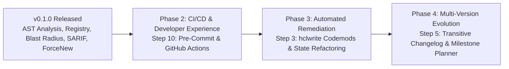

# Strategic Product Roadmap

This document outlines the strategic future development roadmap for `terraform_ast`, focusing on automated refactoring, developer ecosystem integration, and multi-version upgrade planning.

---

## 🗺️ Roadmap Overview

---

## 🚀 Future Milestones

### P0 — Core Analysis Quality & Trust

**Target Milestone**: `v0.2.0`  
**Focus**: *Accuracy, signal quality, and enterprise adoption*

**Delivery status**: Complete for this milestone. The implementation adds Terraform JSON scanning, module meta-argument handling, variable validation/nullability and provider-alias comparisons, confidence-scored findings, content-fingerprint inspection caching, and Terragrunt consumer scanning. Dynamic Terragrunt input expressions are explicitly reported as incomplete analysis. Every package is covered at 100% statement level by unit tests, and each untrusted-input parser has a seeded fuzz target asserting a real invariant.

#### Objectives
- **Broader Terraform Coverage**:
  - Expand AST parsing and diffing to handle `dynamic` blocks, `for_each` / `count`, `locals`, validation blocks, provider aliases, and nested expression-heavy configs.
  - Reduce false negatives across real-world modules and improve analysis fidelity.
- **Semantic Compatibility Detection**:
  - Move beyond naming and type checks to reason about effective semantics: optional vs required inputs, nullability, computed values, object-shape compatibility, and map/list/set conversion risk.
  - Distinguish truly breaking changes from cosmetic or low-risk adjustments.
- **Confidence Scoring & Severity Tuning**:
  - Add confidence levels and risk classification to each finding to help users prioritize the highest-impact issues.
  - Reduce noise from low-confidence warnings while surfacing critical upgrade hazards clearly.
- **Expanded Blast Radius Analysis**:
  - Include Terragrunt layouts, workspace overlays, generated configs, and multi-environment inheritance in downstream impact analysis.
  - Improve the utility of consumer-impact reporting for platform and infrastructure teams.
- **Performance & Incremental Caching**:
  - Add file-level cache invalidation, parallel scanning, and incremental AST reuse to speed up large monorepo evaluations.
  - Improve developer responsiveness in CI and pre-commit workflows.

---

### P1 — Operational Remediation & Safe Upgrade Guidance

**Target Milestone**: `v0.3.0`  
**Focus**: *Actionable fixes and safer rollout decisions*

**Delivery status**: Core scope delivered: policy gates, safe-pin rationale, remediation guidance, and a preview-only removed-argument patch generator. Interactive explainability and broader remediation coverage remain future work.

#### Objectives
- **Auto-Remediation Suggestions**:
  - Generate exact fix guidance for missing arguments, removed inputs, type mismatches, and broken output delegation.
  - Emit suggested code snippets and patch-ready remediation steps to accelerate upgrades.
- **Safe Pin Recommendation Engine**:
  - Compute the minimum or recommended safe version to pin to, along with rationale and upgrade path guidance.
  - Support teams that need an operational answer rather than just a lint-style report.
- **Policy-Driven Rule Sets**:
  - Allow organizations to define custom compatibility policies (for example, “block any removed input” or “allow only minor version bumps”).
  - Turn `tfastdiff` into a policy-enforced upgrade gate rather than a passive reporter.
- **Guided UX & Explainability**:
  - Add an interactive audit mode that explains why each issue is breaking and what action to take next.
  - Reduce the learning curve for operators and module maintainers.

---

### P2 — Developer Workflow & Automation

**Target Milestone**: `v0.4.0`  
**Focus**: *Integration into developer workflows and CI/CD automation*

**Delivery status**: Core integration delivered: pre-commit hook metadata, a Docker-based GitHub Action, and a reusable audit workflow that emits SARIF and upserts a PR summary. Marketplace publication and the <300ms pre-commit fast path remain future work.

#### Objectives
- **Step 10: Pre-Commit Hook & GitHub Action Packaging**:
  - Deliver official `.pre-commit-hooks.yaml` integration allowing platform teams to run `tfastdiff` as a pre-commit check before pushing code.
  - Fast-path verification: leverage shallow clones and cached AST representations to keep pre-commit execution times under 300ms.
- **GitHub Actions Packaging**:
  - Provide a turnkey composite action (`action.yml`) available on GitHub Marketplace.
  - Seamless integration with GitHub Code Scanning by auto-exporting and uploading SARIF reports (`--format sarif`).
- **Interactive Pull Request Commenting**:
  - Automated PR bot comments detailing:
    - Executive summary and safety verdict badge (`SAFE_TO_UPDATE`, `BREAKING_CHANGES`, `CRITICAL_HAZARDS`).
    - Collapsible Markdown tables of removed inputs and widened constraints.
    - Blast-radius summary of all affected internal environments.
  - Enforce zero breaking changes in production branches via `--exit-code`.
- **Automation & Integration Enhancements**:
  - Improve GitHub/GitLab PR reporting, add richer JSON schema output, and strengthen SARIF metadata for direct scanning integration.
  - Make the tool easier to plug into CI/CD and compliance workflows.

---

### P3 — Automated Remediation & Long-Horizon Upgrade Planning

**Target Milestone**: `v0.5.0`  
**Focus**: *Codemods, migration support, and multi-version planning*

**Delivery status**: Partial. Multi-version analysis is available for Git tags and Registry releases, and `--fix-preview` generates a non-mutating patch for removed wrapper arguments. State-migration synthesis, changelog/release-note correlation, and the remaining codemod transformations are not implemented.

#### Objectives
- **Step 3: Automated Migration Codemod Generator (`hclwrite`)**:
  - Leverage `github.com/hashicorp/hcl/v2/hclwrite` to programmatically rewrite wrapper modules and root consumer modules without stripping user comments or altering whitespace conventions.
  - Automatically insert missing required inputs with commented TODO placeholders or recommended defaults.
  - Transform deprecated variable names and map legacy outputs to their new upstream counterparts.
- **State Migration Script Synthesis**:
  - When upstream modules refactor internal resource names or move resources into child submodules, generate corresponding `terraform state mv` shell scripts and Terraform `moved {}` blocks (Terraform 1.1+).
  - Prevent accidental resource destruction and recreation during complex state realignments.
- **Interactive CLI Fix Mode**:
  - Introduce `tfastdiff --fix` to interactively preview unified diffs (`git diff`) and apply fixes in-place.
- **Step 5: Multi-Version Changelog Aggregator & Upgrade Path Planner**:
  - Enable planning across major version leaps (e.g. upgrading Google GKE module directly from `v25.0.0` to `v31.0.0`, or AWS EKS from `v18.0.0` to `v20.0.0`).
  - Scan all intermediate semver tags, resolving each successive diff:
    $$\Delta(\text{v25} \to \text{v31}) = \sum_{i=25}^{30} \Delta(\text{v}_i \to \text{v}_{i+1})$$
  - Surface deprecation warnings that occurred in intermediate releases before attributes were completely dropped.
- **Changelog & GitHub Releases Integration**:
  - Query upstream Git tags and release notes to cross-reference AST differences with documented breaking changes and migration notices.
  - Link AST findings directly to relevant upstream PRs and GitHub Release URLs.
- **Phased Upgrade Milestone Generation**:
  - Automatically compute intermediate "safe harbor" versions where breaking changes are minimized, enabling teams to stage upgrades in smaller, lower-risk deployments.

---

## 📊 Summary Matrix

| Priority | Milestone | Feature Area | Primary Value | Key Technology |
| :--- | :--- | :--- | :--- | :--- |
| **P0** | **v0.2.0** | **Core Analysis Quality** | Improve correctness, risk signal, and trust in findings | AST analysis, semantic diffing, caching |
| **P1** | **v0.3.0** | **Operational Remediation** | Turn findings into decisive safe-upgrade guidance | Policy rules, remediation suggestions, explainability |
| **P2** | **v0.4.0** | **Developer Workflow Automation** | Prevent regressions before merge in real engineering workflows | Pre-commit hooks, GitHub Actions, SARIF |
| **P3** | **v0.5.0** | **Automated Migration & Upgrade Planning** | Enable codemods and phased multi-version modernization | `hclwrite`, semver graphs, migration tooling |
