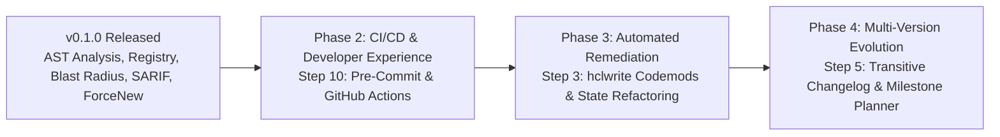

# Strategic Product Roadmap

This document outlines the strategic future development roadmap for `terraform_ast`, focusing on automated refactoring, developer ecosystem integration, and multi-version upgrade planning.

---

## 🗺️ Roadmap Overview

---

## 🚀 Future Milestones

### 1. Step 10: Pre-Commit Hook & GitHub Action Packaging

**Target Milestone**: `v0.2.0`  
**Focus**: *Developer Workflow & Automated CI/CD Gates*

#### Objectives
- **Local Developer Ergonomics**:
  - Deliver official `.pre-commit-hooks.yaml` integration allowing platform teams to run `tfastdiff` as a pre-commit check before pushing code.
  - Fast-path verification: leverage shallow clones and cached AST representations to keep pre-commit execution times under 300ms.
- **GitHub Actions Packaging**:
  - Provide a turnkey composite action (`action.yml`) available on GitHub Marketplace.
  - Seamless integration with GitHub Code Scanning by auto-exporting and uploading SARIF reports (`--format sarif`).
- **Interactive Pull Request Commenting**:
  - Automated PR bot comments detailing:
    - Executive summary and safety verdict badge (`SAFE_TO_UPDATE`, `BREAKING_CHANGES`, `CRITICAL_HAZARDS`).
    - Collapsible Markdown tables of removed inputs and widened constraints.
    - Blast-radius summary of all affected internal environments.
  - Enforce zero breaking changes in production branches via `--exit-code`.

---

### 2. Step 3: Automated Migration Codemod Generator (`hclwrite`)

**Target Milestone**: `v0.3.0`  
**Focus**: *Automated Remediation & Zero-Touch Migrations*

#### Objectives
- **AST-Aware HCL Patching**:
  - Leverage `github.com/hashicorp/hcl/v2/hclwrite` to programmatically rewrite wrapper modules and root consumer modules without stripping user comments or altering whitespace conventions.
  - Automatically insert missing required inputs with commented TODO placeholders or recommended defaults.
  - Transform deprecated variable names and map legacy outputs to their new upstream counterparts.
- **State Migration Script Synthesis**:
  - When upstream modules refactor internal resource names or move resources into child submodules, generate corresponding `terraform state mv` shell scripts and Terraform `moved {}` blocks (Terraform 1.1+).
  - Prevent accidental resource destruction and recreation during complex state realignments.
- **Interactive CLI Fix Mode**:
  - Introduce `tfastdiff --fix` to interactively preview unified diffs (`git diff`) and apply fixes in-place.

---

### 3. Step 5: Multi-Version Changelog Aggregator & Upgrade Path Planner

**Target Milestone**: `v0.4.0`  
**Focus**: *Long-Tail Upgrades & Transitive Version Transitions*

#### Objectives
- **Transitive Multi-Version Step Planning**:
  - Enable planning across major version leaps (e.g. upgrading Google GKE module directly from `v25.0.0` to `v31.0.0`, or AWS EKS from `v18.0.0` to `v20.0.0`).
  - Scan all intermediate semver tags, resolving each successive diff:
    $$\Delta(\text{v25} \to \text{v31}) = \sum_{i=25}^{30} \Delta(\text{v}_i \to \text{v}_{i+1})$$
  - Surface deprecation warnings that occurred in intermediate releases before attributes were completely dropped.
- **Changelog & GitHub Releases Integration**:
  - Query upstream Git tags and release notes to cross-reference AST differences with documented breaking changes and migration notices.
  - Link AST findings directly to relevant upstream PRs and GitHub Release URLs.
- **Phased Upgrade Milestone Generation**:
  - Automatically compute intermediate "safe harbor" versions where breaking changes are minimized, enabling teams to stage upgrades in smaller, lower-risk deployments.

---

## 📊 Summary Matrix

| Milestone | Feature Area | Primary Value | Key Technology |
| :--- | :--- | :--- | :--- |
| **v0.2.0** | **Step 10**: Pre-Commit & GitHub Action | Prevent breaking changes before merge | Composite Actions, Pre-Commit, SARIF |
| **v0.3.0** | **Step 3**: `hclwrite` Codemod Engine | Automate 90% of wrapper refactoring work | `hclwrite`, `moved {}` blocks |
| **v0.4.0** | **Step 5**: Multi-Version Upgrade Planner | Safe, structured jumps across multiple major versions | Semver tag graphs, Transitive Diffing |
