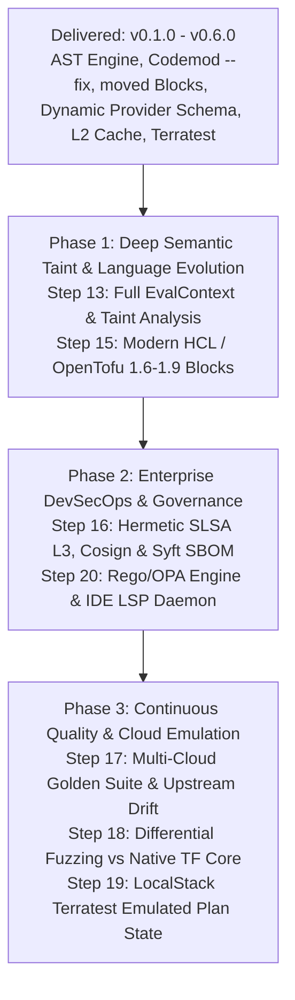

# Strategic Product Roadmap

This document outlines the strategic future development roadmap for `terraform_ast`, focusing on automated refactoring, developer ecosystem integration, and multi-version upgrade planning.

---

## 🗺️ Roadmap Architecture

---

## 🚀 Active Future Milestones

### Milestone 1 — Deep Semantic Taint & Language Evolution

**Target Milestone**: `v0.7.0`  
**Focus**: *HCL EvalContext, variable dependency taint analysis, and modern Terraform/OpenTofu language constructs*

#### Objectives
- **Step 13: Full Evaluation Context & HCL Variable Dependency Taint Analysis**:
  - Build an embedded HCL evaluation engine (`hcl.EvalContext`) with pure implementations of standard Terraform built-in functions (`concat`, `merge`, `lookup`, `try`, `can`, `coalesce`, `element`, `jsondecode`).
  - Resolve dynamic Terragrunt expressions and wrapper variable delegations that currently trigger `AnalysisIncomplete`.
  - Perform semantic taint analysis: trace input variables through intermediate `locals` and child module blocks to precisely identify whether an upstream breaking change reaches an active resource attribute or remains dead code.
  - *Quality & Verification Gate*:
    - Fuzz Testing: `FuzzEvalContextExpressions` fuzzing complex, deeply nested, and circular HCL expressions.
    - Terratest: Real-world fixtures validating dynamic Terragrunt modules (`test/fixtures/terragrunt_dynamic_consumer`) with byte-exact golden comparisons.

- **Step 15: OpenTofu & Modern Terraform 1.6–1.9 AST Feature Support**:
  - Expand AST parser (`pkg/ast`) and diff comparator (`pkg/diff`) to provide first-class support for modern declarative language constructs:
    - `removed {}` blocks (Terraform 1.7+ & OpenTofu 1.6+): Distinguish between destructive resource removals and soft resource lifecycles (`destroy = false`).
    - `check {}` blocks (Terraform 1.5+) and continuous assertion blocks.
    - Custom provider functions (`function "..." {}` introduced in Terraform 1.8+).
    - Client-side state encryption configuration blocks (OpenTofu 1.7+).
    - Programmatic `import {}` blocks (Terraform 1.5+).
  - Treat graceful attribute deprecations and non-destructive `removed` declarations as non-breaking safe transitions.
  - *Quality & Verification Gate*:
    - Complete Fuzz Coverage: Seeded fuzz tests for every modern block syntax (`FuzzParseModernHCLBlocks`).
    - 100% statement coverage across all AST extraction and diff inspection branches.

---

### Milestone 2 — Enterprise DevSecOps, Supply Chain Security & Governance

**Target Milestone**: `v0.8.0`  
**Focus**: *SLSA Level 3 provenance, Cosign signing, Syft SBOM, and OPA/Rego policy governance*

#### Objectives
- **Step 16: Hermetic SLSA Level 3 Provenance, Cosign Keyless Attestations & Syft SBOM DevSecOps**:
  - Achieve **SLSA Build Level 3** compliance via hermetic, reproducible GitHub Actions builders.
  - Sign container images and standalone binaries with **Sigstore Cosign** using keyless OpenID Connect (OIDC) GitHub identity tokens and transparency log (Rekor) entries.
  - Generate comprehensive Software Bill of Materials (SBOM) in both **CycloneDX** and **SPDX** formats using **Syft** at build time, publishing them as cryptographically attested OCI artifacts.
  - Integrate automated static vulnerability scanning with **Trivy** and **Grype**, enforcing a zero-critical and zero-high CVE gate in CI before image release.
  - *Quality & Verification Gate*:
    - Container DevSecOps Suite (`test/docker`): Programmatically verify Cosign signature integrity, attestation payloads, and SBOM completeness against the built distroless container.
    - Runtime Hardening: Enforce read-only root filesystems (`--read-only`), `no-new-privileges:true`, and strict non-root UID `65532:65532`.

- **Step 20: Rego / OPA & CUE Policy Engine Integration with IDE Language Server Protocol (LSP)**:
  - Upgrade `pkg/policy` from flat JSON threshold gates to a full **Open Policy Agent (OPA / Rego)** and **CUE** evaluation engine.
  - Empower enterprise platform engineering teams to define expressive, context-aware architectural policies (e.g. "disallow any breaking changes in modules tagged `pci-dss`", "require manual review if blast radius spans more than 5 production environments", "forbid provider major version jumps without signed architectural exception").
  - Introduce `tfastdiff daemon` implementing the official **Language Server Protocol (LSP)** for VS Code, Neovim, and JetBrains IDEs.
  - Compute background AST diffs and blast-radius diagnostics within <50ms of saving `.tf` files, surfacing real-time inline warnings and quick-fix codemod actions directly in developer editors.
  - *Quality & Verification Gate*:
    - Policy Unit Suite: 100% statement coverage testing complex Rego rule sets, input mocking, and boundary conditions.
    - LSP Conformance Test: Automated JSON-RPC protocol test suite verifying diagnostic latency, cancellation tokens, and code action responses.

---

### Milestone 3 — Advanced Continuous Quality Verification & Cloud Emulation

**Target Milestone**: `v0.9.0`  
**Focus**: *Multi-cloud golden test matrix, differential compiler fuzzing, and emulated Terratest plan validation*

#### Objectives
- **Step 17: Multi-Cloud Golden Image Test Matrix with Automated Upstream Drift Detection**:
  - Expand the canonical golden test framework (`internal/goldentest`) into an enterprise-wide multi-cloud test matrix spanning:
    - **Google Cloud**: GKE, Cloud Foundation Fabric, VPC, Cloud SQL.
    - **AWS**: EKS, VPC, RDS, IAM.
    - **Azure**: AKS, Virtual Network, PostgreSQL Flexible Server.
  - Deploy a daily scheduled automated workflow that pulls latest releases from the public Terraform Registry, executes `tfastdiff`, and compares findings against canonical golden files.
  - Automatically detect undocumented upstream breaking changes, upstream release retractions, or semantic regressions before platform consumers update.
  - *Quality & Verification Gate*:
    - Byte-exact verification across JSON, Markdown, and SARIF golden baselines with workspace path sanitization (`<WORKSPACE>`).
    - Automated GitHub Issue creation and PR baseline updates when upstream drift is detected.

- **Step 18: Differential Fuzzing Engine against Native HashiCorp & OpenTofu Cores**:
  - Build an automated differential fuzzing harness (`pkg/ast/diff_fuzz_test.go`) combining grammar-based AST synthesis with native Go fuzzing.
  - Simultaneously execute `tfastdiff` AST inspection and official `terraform validate -json` / `tofu validate -json` compilers on generated HCL snippets, automatically flagging discrepancies or false negatives.
  - Implement property-based invariant testing using `pgregory.net/rapid` asserting mathematical algebraic properties:
    - **Identity Invariant**: $\Delta(A \to A) = \emptyset$ (comparing identical versions produces zero breaking changes and zero warnings).
    - **Triangle Inequality & Transitivity**: For any version sequence $A \to B \to C$, the union of stepwise differences must be a superset of the direct difference:
      $$\Delta(A \to B) \cup \Delta(B \to C) \supseteq \Delta(A \to C)$$
  - *Quality & Verification Gate*:
    - Long-running continuous fuzzing job running in CI asserting zero crashes and zero compiler discrepancies across $10^6$ iterations.

- **Step 19: Terratest End-to-End Emulated Cloud Infrastructure Provisioning & Plan State Validation**:
  - Extend `test/terratest` from syntax validation to end-to-end plan state execution using local cloud emulators (**LocalStack** for AWS and **Google Cloud SDK Emulators** / `fake-gcs-server` for GCP).
  - Formally verify runtime safety guarantees:
    - When `tfastdiff` issues a `SAFE_TO_UPDATE` verdict, Terratest runs `terraform plan` against the emulated state and confirms `Plan: 0 to destroy`.
    - When `tfastdiff` flags a recreation hazard (`ForceNew`), Terratest confirms that native Terraform plan output explicitly flags `(forces replacement)` on the targeted resource address.
  - *Quality & Verification Gate*:
    - Fully offline, reproducible Terratest suite executing within containerized CI runners without requiring real cloud credentials or generating cloud costs.

---

## 📦 Delivered Capabilities & Release History

The following roadmap items and milestones have been fully implemented, verified, and delivered with 100.0% statement test coverage:

| Milestone | Delivered Scope | Key Capabilities |
| :--- | :--- | :--- |
| **v0.1.0 – v0.2.0** | **P0: Core Analysis Quality & Trust** | Terraform HCL/JSON AST parser, module meta-arguments (`count`/`for_each`/`providers`), confidence scoring, variable validation & nullability diffing, SHA-256 fingerprint caching, Terragrunt consumer inspection. |
| **v0.3.0** | **P1: Operational Remediation & Safe Pinning** | Semantic policy evaluation engine (`pkg/policy`), safe-pin recommendation engine (`pkg/planner`), actionable remediation guidance, and preview patch synthesis. |
| **v0.4.0** | **P2: Developer Workflow & Automation** | Pre-commit hook configuration (`.pre-commit-hooks.yaml`), Docker-based GitHub Action (`action.yml`), SARIF v2.1.0 output formatting for GitHub Code Scanning, and automated PR comment summaries. |
| **v0.5.0** | **P3: Automated Migration Codemods & Planner** | In-place refactoring (`--fix`) and preview (`--fix-preview`) via `hclwrite`, automatic `moved {}` block synthesis, missing required input injection, and multi-version transitive Git tag upgrade path planner. |
| **v0.6.0** | **P4: Dynamic Schema & High-Performance Scaling** | Attribute-level dynamic provider schema ForceNew hazard detection (`DynamicHazardRegistry`, `terraform providers schema -json`), parallel AST worker pools (`InspectModulesParallel`), and persistent L2 content-addressable disk cache (`--cache-dir`). |

---

## 📊 Future Roadmap Summary Matrix

| Milestone | Target | Feature Area | Primary Value | Key Technology |
| :--- | :--- | :--- | :--- | :--- |
| **v0.7.0** | Future | **Semantic Taint & Language Evolution** | Deep expression evaluation and modern HCL/OpenTofu syntax | `hcl.EvalContext`, taint analysis, modern HCL blocks |
| **v0.8.0** | Future | **Enterprise DevSecOps & Governance** | Cryptographic supply chain verification and IDE real-time feedback | SLSA L3, Cosign, Syft SBOM, OPA/Rego, LSP Daemon |
| **v0.9.0** | Future | **Continuous Quality & Cloud Emulation** | Upstream drift detection, differential fuzzing, and offline plan validation | Golden matrix, differential fuzzing, LocalStack Terratest |
