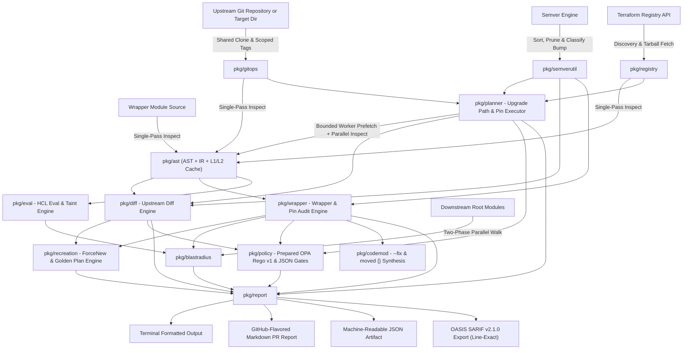
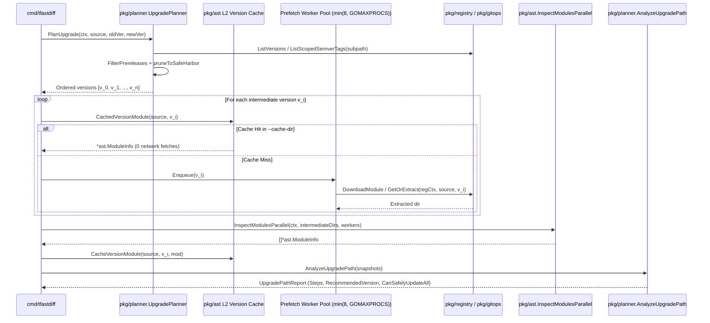

# Architecture & Design Specification

## Overview

`terraform_ast` (`tfastdiff`) is a production-grade static analysis tool written in Go. It compares the Abstract Syntax Tree (AST) and top-level configuration metadata of Terraform modules—specifically focusing on wrappers for enterprise modules like **Google GKE** (`terraform-google-modules/kubernetes-engine/google`) and **AWS EKS** (`terraform-aws-modules/eks/aws`)—against upstream releases.

The tool provides automated compatibility verification, identifying breaking changes, type constraint shifts, removed outputs, and safe version pinning boundaries before code is merged or deployed.



---

## Core Packages

### 1. `pkg/ast` (Single-Pass AST Inspection, IR & Multi-Tier Cache)
- **Engine**: Built on `github.com/hashicorp/terraform-config-inspect/tfconfig` (`LoadModuleFromFile`) and `github.com/hashicorp/hcl/v2/hclparse`.
- **Capabilities**:
  - **Single-Pass Parsing (`parseAndEnrichModule`)**: Reads and parses each `.tf` and `.tf.json` file once per uncached inspection, feeding the parsed `*hcl.File` into both `tfconfig.LoadModuleFromFile` and deep HCL enrichment (`enrichFromHCLFiles`). Retains parsed AST bodies (`ParsedBodies map[string]*hclsyntax.Body`) to eliminate redundant re-parsing in downstream evaluators.
  - **In-Memory Overlay Inspection (`InspectSource`)**: Applies in-memory file overlays directly during AST parsing (`inspectOverlay`) without creating temporary directories or staging file copies on disk, accelerating LSP buffer diagnostics.
  - **Metadata & Enrichment**: Extracts variables (types, defaults, `nullable`, `validation` rules, `deprecated`, source positions), outputs (types, `value` expressions, sensitivity, `module.*` delegations), module calls (forwarded inputs, raw expressions, `count`, `for_each`), managed/data resources (`provider` aliases, `count`, `for_each`, `lifecycle` flags, `provisioner` blocks, `triggers`, `triggers_replace`, `keepers`, destructive toggles, top-level attributes), `provider` block configurations (`region`, `project`, `assume_role`), `backend {}` / `cloud {}` configuration, and modern Terraform/OpenTofu blocks (`moved {}`, `removed {}`, `check {}`, `import {}`, `function {}`, `encryption {}`).
  - **L1 In-Memory & L2 Persistent Disk Cache (`cache.go`)**: Computes a pooled SHA-256 content fingerprint across module files, serves in-memory cache hits via zero-unmarshal struct cloning (`cloneModuleInfo`), and persists `<sha256>.json` entries (including versioned `source@version` snapshots via `CachedVersionModule` / `CacheVersionModule`) when `--cache-dir` is configured.
  - **Deep Type Compatibility**: Evaluates nested `object({ ... })` schemas and primitive/collection type transitions (`string`, `number`, `bool`, `list` → `set`, `any` widening vs narrowing).

### 2. `pkg/semverutil` (Semantic Versioning & Tag Lifecycle)
- **Engine**: Powered by `golang.org/x/mod/semver`.
- **Capabilities**:
  - Canonicalizes version strings (ensuring standard `v` prefix).
  - Determines semver bump transitions: `MAJOR` (breaking), `MINOR` (features), `PATCH` (fixes), `DOWNGRADE`, `IDENTICAL`, and `INVALID`.
  - Filters non-semver tags and sorts the remainder deterministically in ascending order.
  - **Constraint Range Analysis (`ParseConstraintRange`)**: Computes the closed/open interval of allowed versions (`MinVersion`, `MaxVersion`, `Exclusions`) for provider requirements, identifying upper-bound major narrowings (e.g. `< 6.0` to `< 5.0`) and `0.x` minor bumps as breaking changes.

### 3. `pkg/gitops` (Git Operations & Version Extraction)
- **Engine**: Powered by `github.com/go-git/go-git/v5`.
- **Capabilities**:
  - Clones remote repositories with shallow clone optimization (`--depth 1`) or inspects local Git checkouts in-place.
  - Normalises Terraform VCS module sources before cloning: strips the `git::` prefix and expands the `github.com/` and `bitbucket.org/` shorthands into `https://<host>/<path>.git`, so every source the classifier routes here reaches go-git as a cloneable URL.
  - Parses the module's position inside a repository: `//subdir` selects the directory handed back for inspection and `?ref=` pins the revision when the CLI's version flags are absent (an explicit flag wins), so a module inside a repository is analysed at the revision and location its source names. A missing or escaping subdirectory is an error, never a silent inspection of the repository root.
  - `IsGitURL` is the single predicate for "this source must be cloned", shared by the CLI and the upgrade planner.
  - A thread-safe in-memory `RepositoryCache` (`gitops.GlobalCache`) keeps one shared clone per repository, so repeated tag evaluations and multi-version upgrade paths re-clone from the local copy instead of re-downloading. Extracted versions are memoised per source and ref, and everything is released by `Clear()` when the run ends.
  - Extracts all semantic version tags from Git references.
  - Checks out specific tags, branches, or commits into isolated staging directories for AST comparison.

### 4. `pkg/registry` (Terraform Registry Protocol Client)
- **Capabilities**:
  - `IsRegistrySource` and `ParseRegistrySource` agree on exactly one grammar (`namespace/name/provider`, optionally hostname-prefixed) and reject empty or URL-metacharacter components.
  - VCS and local sources are never registry addresses: `git::`, `git@`, any URL scheme (`git://`, `ssh://`, `file://`, `http(s)://`), the `github.com/` and `bitbucket.org/` shorthands Terraform expands into git URLs, and the `.git` repository suffix are all rejected by both functions.
  - Refuses link-local and unspecified addresses (`169.254.0.0/16`, `fe80::/10`, and `0.0.0.0/8`) on every connection, redirect, and `X-Terraform-Get` follow-up.
  - `X-Terraform-Get` archive extraction rejects entries that escape the destination directory.
  - Resolves available module versions and downloads release tarballs, retrying transient failures with exponential backoff.

### 5. `pkg/diff` (Upstream Diff Comparator & Safe-Pin Recommender)
- **Capabilities**:
  - Compares two versions of an upstream module across interface declarations, internal resources, child module calls, lifecycle gates, and modern HCL blocks.
  - Categorizes differences with source positions (`Pos`) and evidence-based confidence scores (`[1, 10]`):
    - **Breaking Changes**: Unmigrated resource address shifts (`AddressShift`), removed child modules (`ModuleCall`), child module source changes or major bumps (`ModuleCallSource`), child module version constraint bumps (`ModuleCallVersion`), child module indexing shifts (`ModuleCallIndex`), child module cardinality reductions (`ModuleCallCount`, `ModuleCallForEach`), instance cardinality reductions (`ResourceCount`, `ResourceForEach`), resource-body `ForceNew` attribute modifications (`ResourceForceNew`, including schema-driven `requires_replace`), triggers/keepers modifications (`ResourceTriggers`), destruction protection disabled or accelerators enabled (`DestructiveAttribute`), provider block modifications (`ProviderConfig`, `ProviderConfigAdded`, `ProviderConfigRemoved`), cloud backend changes (`StateBackendChange`, including `backend`/`cloud` transitions), data-source selector drift (`DataSelector`), locals drift feeding `ForceNew` attributes (`LocalValue`), precondition/postcondition changes (`PreconditionModified`, `PostconditionModified`), import provider changes (`ImportBlockProvider`), removed inputs/outputs/resources (`Variable`, `Output`, `Resource`), newly required inputs without defaults (`VariableRequirement`), changed variable defaults (`VariableDefault`), narrowed type constraints (`VariableType`, `OutputType`), disallowed `null` (`VariableNullability`), output value changes paired with type/sensitivity shifts (`OutputValue`), provider source changes (`ProviderSource`), provider major version upgrades (`ProviderMajorUpgrade`), resource provider/alias reassignments (`ResourceProvider`), new required provider aliases (`ProviderConfigurationAlias`), destructive `removed { destroy = true }` blocks (`RemovedDestroy`), removed `moved {}` state migrations (`StateMigrationRemoved`), and removed `lifecycle { prevent_destroy }`.
    - **New Features**: Newly introduced optional inputs with defaults, new outputs, new managed/data resources, new child module calls, new `moved {}` migrations, soft `removed { destroy = false }` blocks, and newly added `check`, `import`, `function`, or `encryption` blocks.
    - **Warnings**: Widened types (`list(string)` → `set(string)`), output `value` expression changes (`OutputValue`), validation rule changes (`VariableValidation`), check assertion modifications (`CheckBlockModified`), import ID changes (`ImportBlockModified`), local value or data selector drift (`LocalValue`, `DataSelector`), sensitive/deprecation transitions, non-major provider constraint updates, removed or updated `required_version` (`TerraformCore`), narrowed `lifecycle { ignore_changes }`, removed `create_before_destroy`, and removed `check`, `import`, or `removed` blocks.
  - Directly attaches computed `AddressShifts` to `DiffReport` to avoid redundant multi-pass recomputation.
  - Computes high-level safety verdicts (`SAFE`, `BREAKING_CHANGES`, `WARNINGS_ONLY`, `DOWNGRADE`) and populates `SafePinVersion` and `SafePinRationale`.

### 6. `pkg/recreation` (ForceNew Destruction & Golden Plan Verification Engine)
- **Capabilities**:
  - Encodes infrastructure destruction heuristics for immutable cloud resources (GKE cluster name, project ID, location, region, network, subnetwork and secondary subnet CIDR blocks; AWS EKS cluster name, VPC ID and cluster IP family; Azure AKS cluster name, resource group, location and DNS prefix).
  - Ships built-in `requires_replace` catalogs for AWS (`hashicorp/aws`) and Google Cloud (`hashicorp/google`, `hashicorp/google-beta`) resources in addition to AzureRM, Kubernetes, and Cloudflare, so zero-configuration runs detect common AWS/GCP recreation hazards.
   - Auto-discovers provider schemas (`AutoDiscoverSchemas`) from `required_providers` or ingests `terraform providers schema -json` dumps (`LoadProviderSchema`) to build a `DynamicHazardRegistry` of `requires_replace` attributes. Schema files and descriptors are memoized in memory by file path, mtime, and size to avoid redundant disk I/O.
  - **Golden Plan & Pin-Update Execution Plan Verification**:
    - Ingests Terraform plan JSON (`terraform show -json <planfile>`) via `--golden-plan` or automated autodiscovery (`golden-plan.json`, `golden_plan.json`, `tfplan.json`, `plan.json`, `.terraform/golden-plan.json`, `.terraform/tfplan.json`).
    - Flattens and normalizes planned resources across `resource_changes`, top-level `resources`, and hierarchical `planned_values.root_module`.
    - Correlates planned resources against `ForceNew` immutable arguments, unmigrated address shifts (`IsRecreation: true`), and direct replacement actions (`["delete", "create"]`).
    - Surfaces confirmed hazards across text, Markdown, JSON, and SARIF reports, revoking `CanSafelyUpdate` when a pin update triggers resource replacement.

### 7. `pkg/blastradius` (Parallel Downstream Consumer & Environment Scanner)
- **Capabilities**:
  - Executes a **two-phase parallel directory walk** (`discoverCallSites`): collects candidate `.tf`, `.tf.json`, and `terragrunt.hcl` paths in lexical order, then processes them across a bounded worker pool (`min(8, GOMAXPROCS)`) while preserving deterministic `(file, block)` ordering.
  - Pre-filters `.tf` files with a fast byte scan (`bytes.Contains`) before parsing, parses each file once, and lazily extracts `module.<name>.<output>` references from the already-parsed `*hclsyntax.Body` using token-boundary regex matching.
  - Pre-indexes wrapper audit issues (`buildAuditIndex`) once before evaluating call sites, avoiding $O(\text{call sites} \times \text{issues})$ rescanning.
  - Applies **evidence-gated hazard attribution**: attributes `MissingRequiredInput` to a consumer only when the wrapper exposes that variable, fires `RecreationHazards` only when the input is confirmed changed in the audit/upstream diff or registered in `DynamicHazardRegistry`, scores `AnalysisIncomplete` separately as `MEDIUM`, and emits `RiskDistribution` counts by risk level (`CRITICAL`, `HIGH`, `MEDIUM`, `LOW`).

### 8. `pkg/wrapper` (Wrapper Compatibility & Pin Analyzer)
- **Capabilities**:
  - Audits a wrapper module against a target upstream module and optional pinned baseline (`pinnedMod`), with wrapper, target, and pinned modules inspected concurrently in CLI wrapper mode.
  - Traces wrapper variable delegations across renamed variables using `call.InputExpressions` to catch type incompatibilities and nullability discrepancies.
  - Detects wrapper-specific breakages (`PassedRemovedInput`, `MissingRequiredInput`, `TypeMismatch`, `BrokenOutputDelegation`) and folds upstream breaking and warning counts from `UpstreamDiff` into `TotalBreaking` and `TotalWarnings` (`UpstreamBreaking`, `UpstreamWarnings`), preserving the safety equivalence $\text{TotalBreaking} = 0 \iff \text{CanSafelyUpdate}$.
  - Recommends exact version pinning syntax (`RecommendedPin`, `SafePinVersion`, `SafePinRationale`) and produces verdicts `SAFE_TO_PIN`, `WARNINGS_ONLY`, `UPSTREAM_BREAKING_CHANGES_DETECTED`, `BREAKING_CHANGES_DETECTED`, or `DOWNGRADE_DETECTED`.

### 9. `pkg/ast` Intermediate Representation (IR) & State Graph Theory
- **The "Static AST Fallacy"**: Traditional Terraform static checkers compare module interfaces (variables and outputs). In the Terraform execution engine, however, state persistence is keyed strictly by **hierarchical instance addresses** (`module.vpc.aws_subnet.this["public"]`). If an internal module refactoring converts a singleton resource to an indexed one (`count` or `for_each`), switches `count` ↔ `for_each`, or changes submodule nesting, interface types remain identical while `terraform apply` destroys and recreates existing cloud resources.
- **Canonical Address Model (`ResourceAddress`)**:
  - Full hierarchical address decomposition: `[ModulePath].[Mode].[Type].[Name][[IndexKey]]`, recording `count` and `for_each` instance modes on `ResourceDef`, `DataResourceDef`, and `ModuleCallDef` (`Mode == "module"`).
- **Evaluation Graph (`EvaluationGraph`) & Deterministic Shift Detection**:
  - `DetectAddressShifts(oldMod, newMod)` scores candidate pairings deterministically across resource type, label, index mode (`count`/`for_each`), and module path.
  - Transitions covered by an upstream or wrapper `moved {}` block (`MovedBlocks`) have `IsRecreation` suppressed (`false`), while unmitigated renames, index transitions, or deletions are flagged with `IsRecreation: true`.

### 10. `pkg/codemod` (Automated Code Remediation & State Migration)
- **Capabilities**:
  - In-place AST refactoring with `hclwrite` preserving comments, formatting, and file structure.
  - Removes obsolete module-call arguments (`ApplyRemovedInputs`) and injects newly required upstream inputs (`AddMissingInputs`) using safe typed cty literals (`cty.StringVal` for `string`, `cty.BoolVal` for `bool`, `cty.NumberIntVal` for `number`), refusing with exit code 2 when a complex type requires manual input.
  - Automated `moved {}` block synthesis: `SynthesizeMovedBlocksForShifts` maps detected AST address shifts into Terraform 1.1+ `moved {}` blocks while stripping synthetic index markers (`[count]`, `[for_each]`) and skipping addresses already covered by upstream or wrapper `MovedBlocks` (`CoveredMovedAddresses`).

### 11. `pkg/policy` (Prepared Open Policy Agent OPA & Rego v1 Governance)
- **Engine**: Official Open Policy Agent Go SDK (`github.com/open-policy-agent/opa/v1/rego`).
- **Capabilities**:
  - Compiles and prepares Rego queries once per `RegoPolicy` (`rego.PrepareForEval` cached on `RegoPolicy`) and reuses the prepared query across multi-step upgrade paths.
  - Memoizes marshalled report maps in memory keyed by report pointer (`uintptr`), avoiding duplicate serialization during policy evaluation.
  - Evaluates standard OPA Rego policies (`deny`, `violation`, `violations`, `warn`) and JSON policies against structured findings (`input.breaking_changes`, `input.bump_type`, `input.blast_radius`, `input.report`).
  - Fail-closed security architecture: compile errors or unknown rule blocks fail explicitly.

### 12. `pkg/report` (Multi-Format Reporting & Line-Exact SARIF Exporter)
- **Capabilities**:
  - Renders both direct diffs and wrapper audits (including `UpstreamDiff` breaking changes, address shifts, recreation hazards, taint traces, blast radius, and golden plan verifications) with full parity across Terminal Text, GitHub-Flavored Markdown (`### Resource Address Shifts`), JSON, and **OASIS SARIF v2.1.0**.
  - Emits real 1-based declaration line numbers (`Pos.Line`) in SARIF `physicalLocation.region.startLine` and advertises rules `TF-DIFF-BREAKING-CHANGE`, `TF-DIFF-WARNING`, `TF-ADDRESS-SHIFT`, `TF-RECREATION-HAZARD`, `TF-WRAPPER-ISSUE`, `TF-UPSTREAM-BREAKING-CHANGE`, `TF-TAINT-REACHABLE`, and `TF-BLAST-RADIUS-CONSUMER`.

### 12a. `pkg/visualize` (Deterministic SVG State-Graph Renderer)
- **Capabilities**:
  - Renders byte-stable SVG diagrams of before/after state address graphs and overlay transition graphs from `EvaluationGraph` and `DetectAddressShifts`.
  - Pure SVG 1.1 with no external CSS or JavaScript; colour-coded node/edge fates (removed, added, retained, migrated).
  - CLI integration via `--svg-before`, `--svg-after`, and `--svg-transition`.

### 13. `pkg/planner` — Plan Executor for Pin Updates & Multi-Version Upgrade Paths
- **Purpose**: Computes and executes step-by-step upgrade plans between a current version pin (`--old-version`) and a target version (`--new-version`), identifying every intermediate release transition and determining the highest contiguous "safe harbor" version pin.
- **Execution Pipeline**:
  1. **Version Discovery & Monorepo Subpath Scoping (`UpgradePlanner.PlanUpgrade`)**:
     - For Terraform Registry modules (`namespace/name/provider` or `//submodule`), queries `RegistryClient.ListVersions`.
     - For Git repositories (including monorepos with `//subpath`), reuses the shared clone in `gitops.GlobalCache` and calls `gitops.ListScopedSemverTags(repo, subpath)` to resolve both standard `vX.Y.Z` tags and subpath-prefixed tags (e.g. `modules/gke/v1.2.0`).
  2. **Safe-Harbor Candidate Pruning (`pruneToSafeHarbor`)**:
     - Filters prereleases (unless endpoints are prereleases), bounds candidates strictly within `(fromVersion, toVersion)`, and groups intermediate versions by `MAJOR.MINOR` series—retaining each `.0.0` major boundary and the latest patch release of each minor line.
  3. **Persistent Version Cache Lookup (`ast.CachedVersionModule`)**:
     - Before network retrieval, checks `--cache-dir` for a cached `*ast.ModuleInfo` keyed by `sha256("version:" + source + "@" + version) + ".json"`. Cached steps require zero network fetches and zero archive extractions on repeated CI runs.
  4. **Bounded Worker-Pool Concurrent Prefetch (`analyzeUpgradePathVersions`)**:
     - Uncached intermediate versions are prefetched concurrently via a bounded worker pool (`min(8, GOMAXPROCS)`) governed by the shared whole-operation `registryContext` timeout budget. Cancelled or failed fetches clean up temporary `tfastdiff_upgrade_step_*` directories immediately via deferred handlers.
  5. **Parallel AST Inspection & Cache Write-Back (`ast.InspectModulesParallel`)**:
     - All prefetched intermediate directories are inspected concurrently in single-pass mode and persisted via `ast.CacheVersionModule`.
  6. **Contiguous Safe-Pin Evaluation & Policy Enforcement (`AnalyzeUpgradePath`)**:
     - Evaluates `diff.Compare` across each adjacent pair `(v_i, v_{i+1})` to produce `UpgradeStep` records.
     - Advances `RecommendedVersion` through every contiguous step where `CanSafelyUpdate == true` and halts at the first breaking boundary ($v_{\text{from}}$ of the first breaking step), guaranteeing **INV-5** ($\text{CanSafelyUpdateAll} \implies \text{RecommendedVersion} = v_{\text{target}}$, otherwise $v_{\text{from}}$ of the first breaking transition).
     - Evaluates prepared JSON and OPA Rego policies across every step in the path.



### 14. `pkg/eval` (HCL Expression Evaluator, Terragrunt Resolver & Taint Engine)
- **Capabilities**:
  - Provides hermetic `hcl.EvalContext` implementations of Terraform and Terragrunt built-in functions (`merge`, `concat`, `lookup`, `coalesce`, `find_in_parent_folders`, `read_terragrunt_config`, `get_env`, `get_terragrunt_dir`).
  - Evaluates Terragrunt `include` chains and `locals` blocks to resolve dynamic `inputs` maps for downstream blast-radius analysis.
  - Traces input variable taint (`AnalyzeVariableTaint`) through `locals`, `module` inputs, resource attributes, and `output` expressions.

### 15. `pkg/lsp` (Debounced Language Server Protocol Daemon)
- **Capabilities**:
  - Implements JSON-RPC 2.0 over stdio (`tfastdiff daemon` / `--lsp`) with full `initialize`, `textDocument/didOpen`, `didChange`, `didSave`, `codeAction`, `workspace/executeCommand`, `shutdown`, and `exit` lifecycle support.
  - Applies configurable leading-edge diagnostic debouncing (`DebounceWindow`, default `200ms`, configurable via `initializationOptions.debounceMs`) and caches per-file overlay AST inspections (`cachedAST`) keyed by buffer text so bursts of editor keystrokes do not re-stage or re-parse unchanged buffers.

---

## Container Architecture & DevSecOps Hardening

The repository provides a production-grade, hardened container image designed under strict **DevSecOps** principles:

```
+-------------------------------------------------------------------------+
| Builder Stage (golang:alpine)                                           |
|  - CGO_ENABLED=0 (static compilation)                                   |
|  - Dependency caching with 'go mod verify'                              |
|  - Compiler flags: -trimpath (prevents host path disclosure)            |
|  - Linker flags: -ldflags="-s -w -extldflags '-static'" (strip symbols) |
+-------------------------------------------------------------------------+
                                    |
                                    v (copy statically-linked binary)
+-------------------------------------------------------------------------+
| Final Stage (gcr.io/distroless/static-debian12:nonroot)                 |
|  - Ultra-minimal footprint (~5.7 MB)                                    |
|  - Non-root user: USER 65532:65532 (UID/GID nonroot)                    |
|  - Attack surface elimination: NO shell (/bin/sh), NO package manager   |
|  - Read-only root filesystem compatible (--read-only)                   |
|  - OCI Standard Annotations (org.opencontainers.image.*)                |
|  - Context hygiene: .dockerignore excludes tests, caches, credentials   |
+-------------------------------------------------------------------------+
```

### DevSecOps Controls
1. **Multi-Stage Build**: Isolates full Go compiler toolchain and development dependencies in the builder stage. The final runtime container contains only the compiled binary and root CA certificates.
2. **Distroless Base (`gcr.io/distroless/static-debian12:nonroot`)**: Completely removes shells (`/bin/sh`, `/bin/bash`), package managers (`apk`, `apt`), and common binaries (`curl`, `wget`), neutralizing command injection and remote execution vectors.
3. **Hardened Binary Compilation**:
   - `CGO_ENABLED=0`: Produces a fully self-contained static binary without glibc dependencies.
   - `-trimpath`: Strips local file system paths from stack traces to prevent source directory leakage.
   - `-ldflags="-s -w"`: Strips symbol tables and DWARF debugging information, reducing binary size and hindering reverse engineering.
4. **Least Privilege Execution**: Explicitly configured to execute as unprivileged user `65532:65532`, preventing container breakout vulnerabilities.
5. **Read-Only Root Filesystem Ready**: Capable of executing under `--read-only` rootfs with `--security-opt no-new-privileges:true`.

