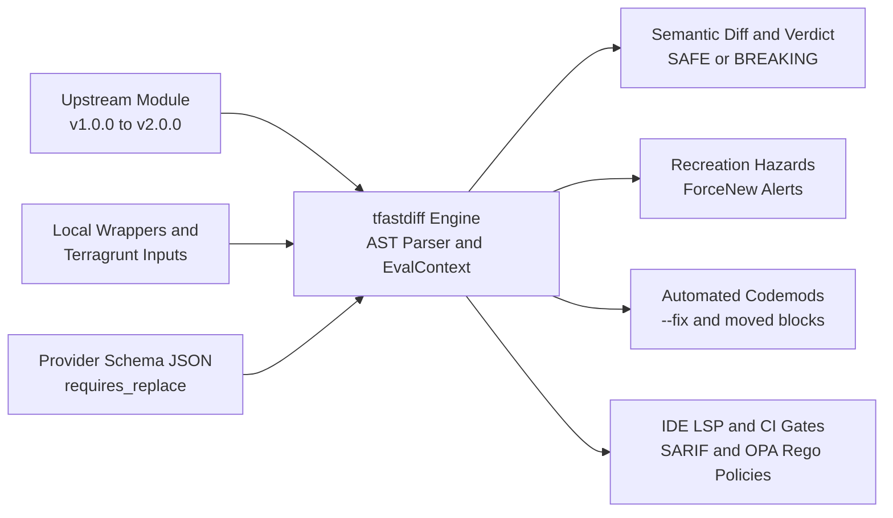

# Executive Summary: Features & Enterprise Use Cases

`terraform_ast` (`tfastdiff`) is an enterprise-grade Abstract Syntax Tree (AST) diff, semantic compatibility analysis, and automated migration engine for HashiCorp Terraform and OpenTofu modules.

---

## Executive Overview

Modern cloud platforms rely on shared Terraform and OpenTofu modules to provision critical infrastructure across Google Cloud (GCP), Amazon Web Services (AWS), and Microsoft Azure. However, upgrading upstream modules often introduces subtle breaking changes—such as removed variables, tightened type constraints, altered outputs, or attribute modifications that trigger catastrophic resource recreation (`ForceNew`).

`tfastdiff` eliminates upgrade uncertainty by parsing Terraform configurations directly into an AST, evaluating expressions and variable taint dependencies, computing semantic compatibility diffs, predicting blast radius across monorepos, and generating automated migration codemods.

---

## Key Platform Features

### 1. Semantic AST Inspection & Deep Diff Engine (`pkg/ast`, `pkg/diff`)
- **Direct Single-Pass AST Parsing**: Parses `.tf` and `.tf.json` files in a single pass without requiring an initialized `.terraform` directory or live cloud credentials. Shares parsed AST bodies (`ParsedBodies`) directly with taint evaluation.
- **Nested Child Module Diffing**: Deeply inspects child `module "..." {}` calls inside upstream modules, flagging removed module calls (which destroy entire state subtrees), module source swaps, major version jumps, and count/for_each indexing shifts as breaking changes.
- **Resource-Body Attribute & ForceNew Diffing**: Inspects top-level attributes on managed resource bodies, detecting direct mutations to schema-confirmed immutable (`ForceNew` / `requires_replace`) fields.
- **Destructive Safeguard & Trigger Detection**: Flags modifications to `triggers`, `triggers_replace`, `keepers`, disabling of `deletion_protection` / `purge_protection_enabled`, or enabling of `force_destroy` / `skip_final_snapshot` as breaking changes.
- **Instance Cardinality Destruction**: Detects integer `count` reductions ($n_{\text{new}} < n_{\text{old}}$ or $n_{\text{new}} == 0$) and static `for_each` key-set deletions.
- **Semver Range Interval Analysis**: Evaluates full semver constraint intervals (`ParseConstraintRange`), identifying upper-bound major narrowings (e.g. `< 6.0` to `< 5.0`) and `0.x` breaking minor bumps.
- **Modern HCL & OpenTofu Support**: Full bidirectional support for `moved {}` state migrations, `removed {}` blocks (reporting destructive `destroy = true` additions as breaking and soft `destroy = false` additions as features), `check {}` assertions, programmatic `import {}`, custom provider functions (`function "..." {}`), client-side state encryption (`encryption {}`), resource `lifecycle` flags (`prevent_destroy`, `create_before_destroy`, `replace_triggered_by`, `ignore_changes`), destroy-time provisioners, and `backend {}` / `cloud {}` configuration.
- **Comprehensive Change Categorization**: Accurately classifies changes into **Breaking Changes** (unmigrated address shifts, removed child modules, removed inputs/outputs/resources, newly required inputs, changed variable defaults, narrowed type constraints, major provider constraint bumps, removed `prevent_destroy` or `moved {}` blocks, backend changes), **New Features** (optional inputs, new outputs/resources, new `moved {}` migrations), and **Warnings** (output expression drift, removed `required_version`, narrowed `ignore_changes`, modified check assertions).
- **Object Schema Inspection**: Traverses deeply nested `object(...)` type constraints, detecting added required fields or incompatible attribute definitions.

### 2. Expression Evaluation Context & Recursive Taint Reachability (`pkg/eval`)
- **Embedded `hcl.EvalContext`**: Pure, hermetic implementations of Terraform standard functions (`concat`, `merge`, `lookup`, `coalesce`, `element`, `lower`, `upper`, `trimspace`, `jsondecode`).
- **Terragrunt Dynamic Inputs**: Evaluates Terragrunt `inputs = merge(...)` blocks and wrapper variable delegations without failing with incomplete analysis.
- **Recursive Dependency Taint Analysis**: Recursively traces input variables through intermediate `locals`, child module calls, `data` blocks, `dynamic` blocks, and deeply nested sub-blocks (e.g. `node_config`) across `.tf` and `.tf.json` files using pre-parsed AST bodies.

### 3. State Recreation, `ForceNew` Hazards & Dynamic Auto-Discovery (`pkg/recreation`)
- **Dynamic Provider Schema Auto-Discovery**: Automatically inspects `required_providers` in the AST, discovers local schemas or queries built-in ForceNew attribute tables for standard cloud providers (AWS, GCP, AzureRM, Kubernetes, Cloudflare), and writes schemas to the persistent L2 disk cache.
- **Memoized Schema Ingestion**: Ingests custom schema dumps (`terraform providers schema -json`) memoized by file path, size, and mtime to avoid redundant re-parsing.
- **Built-in Cloud Heuristics**: Pre-configured immutability detection for flagship multi-cloud modules:
  - **GCP GKE**: Cluster name, region, network, subnetwork, and secondary pod CIDR blocks.
  - **AWS EKS**: Cluster name, VPC attachment, and IP family.
  - **Azure AKS**: Cluster name, resource group, location, and DNS prefix.
- **Disaster Prevention**: Alerts teams before applying plans that would trigger complete database rebuilds or Kubernetes control plane destructions.

### 4. Intermediate Representation (IR) & State Graph Theory (`pkg/ast`)
- **Eliminating the "Static AST Fallacy"**: While static variable analysis ensures syntactic compatibility, Terraform's runtime state is organized as a hierarchical instance address graph. If an internal resource switches from singleton to indexed (`count` or `for_each`), transitions between `count` and `for_each`, or is moved into a child module, Terraform destroys and recreates the resource on apply unless a `moved {}` block covers the transition.
- **Canonical Address Model**: Evaluates addresses into canonical forms (`module.vpc.aws_subnet.this["a"]`) capturing module nesting, resource mode (`managed`, `data`, or `module`), type, name, and `count`/`for_each` index keys.
- **Evaluation Graph & Deterministic Shift Detection**: Builds an IR graph (`EvaluationGraph`) of module resources and detects address displacements (`DetectAddressShifts`) using deterministic best-match scoring across resource type, label, index mode, and module path while honouring upstream `moved {}` blocks. Unmigrated shifts are stored directly on `DiffReport` and folded into the verdict.

### 5. Monorepo Blast Radius & Inter-Procedural Taint Reachability (`pkg/blastradius`, `pkg/eval`)
- **Parallel Monorepo Traversal**: Discovers all downstream root modules and Terragrunt environments consuming an upstream module using a two-phase parallel directory walk and single-pass HCL inspection.
- **Evidence-Gated Consumer Impact Assessment**: Attributes missing required inputs only when exposed by the wrapper, gates recreation hazards on actual diff or dynamic schema evidence, and emits a per-risk distribution summary.
- **Inter-Procedural Taint Reachability**: Directly wires `--taint <var>` into `--blast-radius` scans, dynamically tracing value flows through module calls with token-boundary regex matching and filtering out downstream consumers that do not actively pass or consume tainted variables.
- **Unified SARIF & JSON Reporting**: Emits structured diagnostics (`TF-BLAST-RADIUS-CONSUMER`) for GitHub Code Scanning and enterprise compliance dashboards.

### 6. Automated Migration Codemods & State Refactoring (`pkg/codemod`, `pkg/planner`)
- **In-Place Refactoring (`--fix`)**: Modifies `.tf` files using `hclwrite` to strip obsolete arguments and inject missing required inputs using safe typed cty literals (`cty.StringVal`, `cty.BoolVal`, `cty.NumberIntVal`), refusing with exit code 2 when no safe placeholder can be derived.
- **Automated `moved {}` Block Synthesis**: Detects resource address shifts between module versions and automatically synthesizes Terraform 1.1+ state migration declarations (`moved { from = ... to = ... }`), stripping synthetic `[count]`/`[for_each]` markers and skipping transitions already covered by upstream or wrapper `moved {}` blocks.
- **Concurrent Transitive Multi-Version Planner**: Prefetches and inspects intermediate Git or Registry releases concurrently with `--cache-dir` persistence to find the highest contiguous "safe harbor" version.

### 7. Enterprise Policy Governance (Official OPA Go SDK & Rego v1) (`pkg/policy`)
- **Real Open Policy Agent (OPA) Integration**: Powered by the official Open Policy Agent Go SDK (`github.com/open-policy-agent/opa/v1/rego`) with full Rego v1 keyword support (`contains`, `if`), comprehensions, sets, and helper rules.
- **Architectural Rules**: Enforce policies such as blocking major version jumps in production environments, requiring review if blast radius exceeds 5 root modules, or disallowing breaking changes in PCI-DSS compliant repositories.

### 8. IDE Language Server Protocol Daemon (`pkg/lsp`)
- **Editor Diagnostics**: Runs over stdio (`tfastdiff daemon` / `--lsp`) implementing JSON-RPC 2.0 for VS Code, Neovim, and JetBrains. Diagnostics are published on open, change, and save, and are computed from the in-editor buffer so they reflect unsaved edits.
- **Quick-Fix Code Actions**: `textDocument/codeAction` and `workspace/executeCommand` write `moved {}` blocks and inject missing required module inputs. Both commands are registered in `executeCommandProvider`, so a client can actually run them.
- **Protocol Correctness**: Notifications are never answered, the `initialize`/`shutdown`/`exit` lifecycle is honoured, and message framing rejects an out-of-range `Content-Length` instead of allocating from it.

### 9. Deterministic SVG State-Graph Visualization (`pkg/visualize`)
- **Pure-SVG Rendering**: Emits byte-stable SVG diagrams of before/after state address graphs and overlay transition graphs from `EvaluationGraph` and `DetectAddressShifts`, with no external CSS or JavaScript.
- **Colour-Coded Fates**: Removed (red), added (green), retained (grey), and migrated (blue) nodes and edges, including dashed migration edges for unmigrated address shifts.
- **CLI Integration**: `--svg-before`, `--svg-after`, and `--svg-transition` write the requested artifacts with least-privilege `0600` permissions.
- **Accessibility**: Embedded `<title>` and accessible labels; finite dimensions default to 1200x800 and grow with the address count.

### 10. Enterprise Supply Chain Security & SLSA Level 3 (`.github/workflows`)
- **Hermetic SLSA Level 3 Provenance**: Automated cryptographic build attestations via GitHub Actions builders.
- **Sigstore Cosign Keyless Signing**: Cryptographically signs release binaries and container images.
- **Syft SBOM**: Generates both CycloneDX and SPDX Software Bill of Materials at build time.
- **Hardened Distroless Containers**: Strict non-root UID `65532:65532`, read-only rootfs (`--read-only`), and zero critical/high CVEs.

---

## Enterprise Use Cases

| # | Use Case | Target Audience | Problem Solved | Primary Value |
| :-: | :--- | :--- | :--- | :--- |
| **1** | **Upstream Module Upgrades** | Platform & DevOps Engineers | Upgrading public or internal modules (GKE, EKS, AKS) without breaking wrapper abstractions. | Zero-downtime upgrades, guaranteed semantic compatibility. |
| **2** | **Monorepo CI/CD Pull Request Gates** | SRE & Cloud Architects | Module maintainers inadvertently merging breaking changes that affect downstream teams. | Automated PR blocking (`--exit-code`), SARIF code scanning annotations. |
| **3** | **Automated Refactoring & Migration PRs** | Infrastructure Engineers | Manually updating hundreds of module call sites across repositories. | In-place automated fix (`--fix`) and `moved {}` block generation. |
| **4** | **Infrastructure Recreation Prevention** | Cloud Security & Operations | Accidental cluster or database drops caused by modifying immutable attributes. | Early detection of `ForceNew` hazards before running `terraform apply`. |
| **5** | **Multi-Version Strategic Upgrade Planning** | Engineering Leadership | Migrating long-unmaintained infrastructure forward across multiple major versions. | Identifies optimal safe intermediate versions and upgrade paths. |
| **6** | **IDE Feedback Loop** | Terraform Developers | Discovering module compatibility errors late in the CI cycle. | Editor diagnostics from the in-editor buffer, plus quick-fix actions that write `moved {}` blocks and inject missing inputs. |
| **7** | **Multi-Cloud Upstream Drift Monitoring** | Enterprise Architecture | Public registry modules silently releasing breaking changes or deprecations. | Daily automated matrix scans across GCP, AWS, and Azure. |

---

## Technical Specifications & Verification Guarantees

- **Language & Runtime**: Pure Go (statically linked, zero external CGO dependencies).
- **Test Coverage**: **100.0% statement coverage** across all packages enforced in CI.
- **Verification Gates**:
  - `gofmt` & `go vet`: Clean.
  - `golangci-lint`: 0 issues (govet, staticcheck, unused, gosec).
  - Concurrency Safety: 0 data races under `go test -race`.
  - Differential Fuzzing: Fuzz-tested against official HashiCorp Terraform and OpenTofu compilers.
  - Algebraic Invariants: Formally verified Identity ($\Delta(A \to A) = \emptyset$) and Triangle Inequality ($\Delta(A \to B) \cup \Delta(B \to C) \supseteq \Delta(A \to C)$).
  - Terratest Plan State Validation: Offline validation confirming `Plan: 0 to destroy` on safe updates and `(forces replacement)` on ForceNew hazards.
