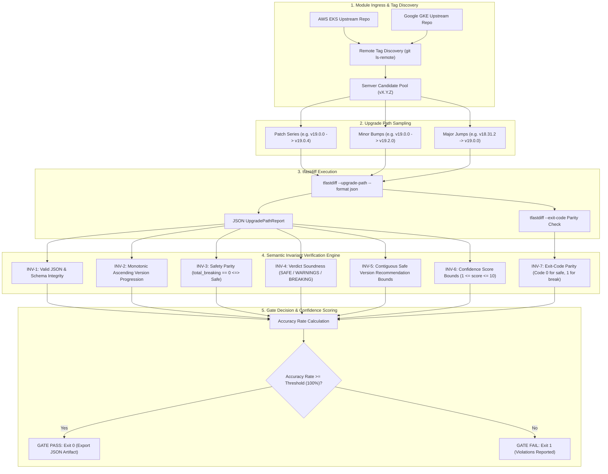
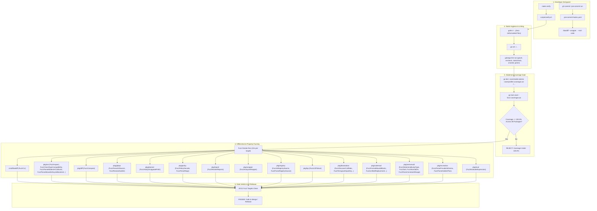
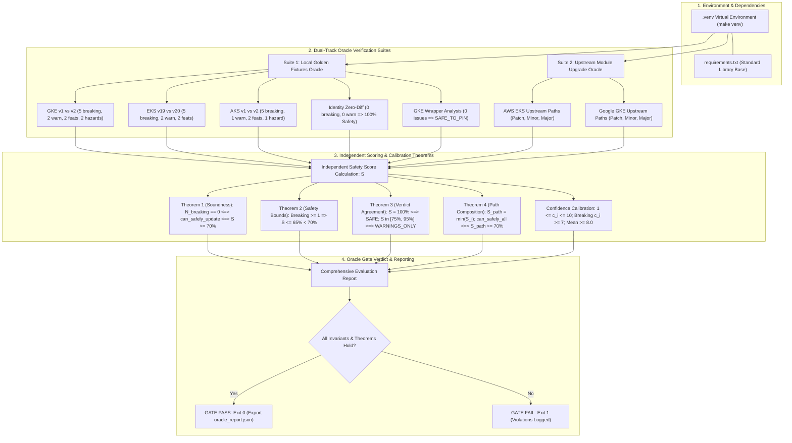

# Quality & Accuracy Gates Specification

This document details the quality assurance, verification, and accuracy governance architecture of `terraform_ast` (`tfastdiff`).

The system employs two foundational verification gates:
1. **The Pre-Commit & Verification Quality Gate**: An invariant pipeline enforcing code formatting, static security scanning, 100.0% statement coverage, and continuous differential fuzzing before merge.
2. **The Upgrade Path Accuracy Gate Engine**: An end-to-end empirical verification engine evaluating real-world AWS EKS and Google GKE upstream module releases across random and structured version paths to validate semantic correctness, safe version boundaries, exit codes, and confidence scoring.

---

## 1. Upgrade Path Accuracy Gate Engine

The Upgrade Path Accuracy Gate ([`scripts/validate_upgrade_accuracy.sh`](file:///home/rsd/REPOS/terraform_ast/scripts/validate_upgrade_accuracy.sh)) validates `tfastdiff` against live upstream releases of enterprise Terraform modules.

It exercises multi-step version paths across **AWS EKS** (`terraform-aws-modules/terraform-aws-eks`) and **Google GKE** (`terraform-google-modules/terraform-google-kubernetes-engine`), asserting mathematical and semantic invariants over the generated Abstract Syntax Tree (AST) comparison graph.



### Invariant Rules Enforced

| Rule ID | Name | Semantic Definition |
| :--- | :--- | :--- |
| **INV-1** | Schema Integrity | Output parses as valid JSON adhering to `UpgradePathReport` with non-empty `steps`. |
| **INV-2** | Monotonic Ordering | For all steps $i$, $v_{from, i} < v_{to, i}$ in strict semver ascending order. |
| **INV-3** | Safety Equivalence | $\text{total\_breaking} = 0 \iff \text{can\_safely\_update} = \text{true}$. |
| **INV-4** | Verdict Soundness | Verdict $\in \{\text{"SAFE"}, \text{"WARNINGS\_ONLY"}, \text{"BREAKING\_CHANGES"}, \text{"DOWNGRADE"}\}$. |
| **INV-5** | Recommendation Bounds | If $\text{can\_safely\_update\_all} = \text{true}$, $\text{recommended} = \text{target}$. If false, $\text{recommended} = v_{from}$ of the first breaking step. |
| **INV-6** | Confidence Score Bounds | For all findings, $1 \le \text{confidence\_score} \le 10$. Breaking findings must satisfy $\text{confidence\_score} \ge 7$. |
| **INV-7** | Exit-Code Parity | `--exit-code` produces exit code `0` if all transitions are safe, and code `1` if breaking changes exist. |

### Execution

```bash
# Run validation with default settings (3 paths per module, 100.0% threshold)
make accuracy-gate

# Run directly with customized sampling and artifact export
./scripts/validate_upgrade_accuracy.sh \
  --samples 5 \
  --min-accuracy 100.0 \
  --seed 1337 \
  --output /tmp/accuracy_report.json
```

---

## 2. Pre-Commit & Verification Quality Gate

The quality gate ensures that every commit, pull request, and release artifact maintains clean formatting, strict static analysis, complete statement coverage, and fuzz resilience.

The gate is implemented through [`scripts/verify.sh`](file:///home/rsd/REPOS/terraform_ast/scripts/verify.sh) and integrated directly into git pre-commit hooks ([`.pre-commit-hooks.yaml`](file:///home/rsd/REPOS/terraform_ast/.pre-commit-hooks.yaml)) and GitHub Actions CI ([`.github/workflows/ci.yml`](file:///home/rsd/REPOS/terraform_ast/.github/workflows/ci.yml)).



### Quality Gate Stages

1. **Source Formatting (`gofmt`)**: Rejects any commit with unformatted Go files.
2. **Static Analysis (`go vet`)**: Validates Go idioms, type alignments, and struct tags.
3. **Multi-Linter Security Gate (`golangci-lint`)**:
   - `govet`: Compiler correctness and shadow variable detection.
   - `errcheck`: Ensures zero unhandled error returns.
   - `staticcheck`: Static code analysis and deprecation warnings.
   - `unused`: Rejects dead code and unreferenced package symbols.
   - `gosec`: AST-level security vulnerability scanning (CWE-compliant).
4. **100.0% Statement Coverage Gate**:
   - Evaluated atomically via `go test -covermode=atomic -coverprofile=... ./...`.
   - Rejects the build if a single statement across all packages remains uncovered.
5. **Universal Fuzz Testing Across All Packages**:
   - Executes fuzz testing across all 31 native Go fuzz targets spanning every package in the repository (`cmd/tfastdiff`, `pkg/ast`, `pkg/blastradius`, `pkg/codemod`, `pkg/diff`, `pkg/eval`, `pkg/gitops`, `pkg/lsp`, `pkg/planner`, `pkg/policy`, `pkg/recreation`, `pkg/registry`, `pkg/report`, `pkg/semverutil`, `pkg/wrapper`).

6. **Pre-Commit Hook (`.pre-commit-hooks.yaml`)**:
   - Executes `tfastdiff --wrapper . --exit-code` on wrapper directories to catch backward-incompatible changes before code is staged or pushed.

---

## 3. Independent Python Verification Oracle

The Independent Python Verification Oracle ([`scripts/oracle_verify.py`](file:///home/rsd/REPOS/terraform_ast/scripts/oracle_verify.py)) executes within an isolated, reproducible virtual environment (`.venv`) to perform decoupled verification of detection accuracy, confidence score distributions, and safety score calibration theorems.

### Architecture & Calibration Flow



### Safety Score Formulation & Calibration Rules

The oracle computes an independent safety score $S \in [0.0, 100.0\%]$ for each transition:

$$S = \max\left(0.0, 100.0 - 35.0 \cdot N_{\text{breaking}} - \min(25.0, 5.0 \cdot N_{\text{warnings}}) - 15.0 \cdot N_{\text{hazards}}\right)$$

Where the scoring guarantees the following calibration theorems:
1. **Safety Soundness**: $N_{\text{breaking}} = 0 \iff \text{can\_safely\_update} = \text{true} \iff S \ge 70.0\%$.
2. **Definitive Breaking Penalty**: Any transition with $N_{\text{breaking}} \ge 1$ satisfies $S \le 65.0\% < 70.0\%$.
3. **Pure Backward Compatibility**: $N_{\text{breaking}} = 0 \land N_{\text{warnings}} = 0 \iff S = 100.0\% \iff \text{verdict} = \text{"SAFE"}$.
4. **Non-Breaking Warnings**: $N_{\text{breaking}} = 0 \land N_{\text{warnings}} > 0 \iff S \in [75.0\%, 95.0\%] \iff \text{verdict} = \text{"WARNINGS\_ONLY"}$.
5. **Multi-Step Upgrade Path Composition**: For an upgrade path composed of steps $(s_1, s_2, \dots, s_k)$, the composite path safety score is $S_{\text{path}} = \min_{1 \le i \le k} S(s_i)$, and $\text{can\_safely\_update\_all} = \text{true} \iff S_{\text{path}} \ge 70.0\%$.

### Execution Targets

```bash
# Set up shared Python virtual environment (.venv)
make venv

# Execute full independent oracle suite (builds binary, invokes oracle, exports JSON report)
make oracle

# Run oracle directly with custom parameters
.venv/bin/python3 scripts/oracle_verify.py \
  --samples 3 \
  --min-accuracy 100.0 \
  --min-confidence 8.0 \
  --min-safety 70.0 \
  --output oracle_report.json
```

