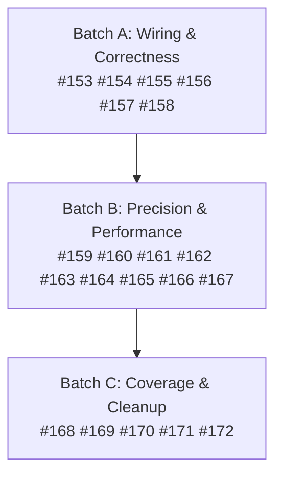

# Strategic Product Roadmap — Pass 9

**Scope:** 20 numbered improvement items (`#153` – `#172`) covering analysis **accuracy**, analysis **performance**, test coverage, and an expanded taxonomy of **destructive changes** that must be classified as breaking.

**Status:** Planned. Items are derived from a deep static audit after the Pass 8 delivery, focusing on incomplete wiring of newly added capabilities, dead entry points, correctness bugs in the new code, and missing regression coverage.

---

## 0. How this pass was produced

Pass 9 was produced by reading every non-test Go source file in `cmd/`, `pkg/`, and `internal/`, running `deadcode`, `golangci-lint`, and `govulncheck`, and cross-referencing the Pass 8 items against the actual code. Several Pass 8 capabilities (schema-driven ForceNew, `ParseConstraintRange`, moved-block normalization, registry-aware hazards) were added but not wired into production entry points.

Baseline verified before writing this document:

| Check | Result |
| :--- | :--- |
| `go build ./...` | clean |
| `go vet ./...` | clean |
| `golangci-lint run ./...` | 0 issues |
| `go test ./...` | all packages ok |
| Working tree | clean |

### Delivery history (unchanged record)

| Pass | Items | Delivered |
| :--- | :--- | :--- |
| Pass 1 | `#1` – `#36` | Core analysis quality, dead code, build/release hygiene |
| Pass 2 | `#37` – `#70` | Reproduced false negatives, LSP protocol conformance, cache safety |
| Pass 3 | `#71` – `#76` | IR evaluation graph, OPA v1, cross-module taint, differential verification |
| Pass 4 | `#77` – `#90` | Registry subpaths, monorepo tags, golden-plan verification |
| Pass 5 | `#91` – `#110` | Resource/modern-block diffing, single-pass AST cache, concurrent upgrade prefetch, LSP debounce |
| Pass 6 | `#111` – `#130` | Detection blind spots, semantic/wrapper precision, performance/caching |
| Pass 7 | `#131` – `#132` | SVG state-graph rendering, AWS/GCP ForceNew hazard catalog |
| Pass 8 | `#133` – `#152` | Schema-driven diffing, module/provider/cloud deep diffing, taint precision, cache/LSP correctness |
| **Pass 9** | **`#153` – `#172`** | **Planned: wiring, dead-code removal, correctness fixes, coverage, and taxonomy widening** |

---

## 1. What the analysis found

### 1.1 Wiring gaps

- **Schema-driven ForceNew is inactive in production.** `cmd/tfastdiff/main.go:909` calls `diff.Compare(oldInfo, newInfo, oldVersion, newVersion)` without `dynamicRegistry`, so the `HazardLookup` path added in `#133` never runs in direct compare mode. `pkg/wrapper/analyzer.go:116-122` has no registry parameter, so `report.UpstreamDiff` at `:359` never receives schema hazards. `pkg/planner/analysis.go:69` also omits the lookup.
- **`ParseConstraintRange` is still unused.** `pkg/semverutil/semver.go:157` is test-only; `pkg/diff/diff.go:1743` and `:616` still use ad-hoc `majorFromConstraint`/`upperBoundMajor`.
- **Moved-block normalization is not applied in codemod.** `pkg/codemod/apply.go:262` and `:287` build keys from raw strings; only `pkg/ast/ir.go:346` uses `normalizeMovedKey`.
- **Terragrunt call sites still use a synthetic module name.** `pkg/blastradius/scanner.go:478`/`:481` key `OutputsReferenced` by `filepath.Base(filepath.Dir(path))`.

### 1.2 Correctness bugs in new code

- **`cloud {}` overwrites `Backend`.** `pkg/ast/inspect.go:815-817` assigns both `info.Cloud` and `info.Backend`, so the two cannot be distinguished when both appear, and `pkg/diff/diff.go:1047` transition detection is order-dependent.
- **JSON taint is not AST-based for pre-parsed input.** `pkg/eval/taint.go:58-96` skips disk `.tf.json` files entirely when `preParsed` is supplied; the JSON path relies on substring scanning instead of traversal.
- **Provider removal severity is misclassified.** `pkg/diff/diff.go:1477-1485` reports removed provider blocks as `SeverityBreaking` (`ProviderConfigRemoved`), while the intended taxonomy distinguishes configuration loss (warning) from target shift (breaking).
- **ForceNew promotion uses fragile substring matching.** `pkg/diff/diff.go:1399-1405` and `:1506-1512` use `strings.Contains` instead of traversal-exact references.
- **Wrapper local tracing is shallow.** `pkg/wrapper/analyzer.go:219-274` resolves only one level of `var.*` inside locals and does not resolve `module.*` roots or nested locals.
- **`for_each` changes are always breaking.** `pkg/diff/diff.go:1239-1250` and `:1822-1833` make no warning-vs-breaking distinction, even for reformatting or widening.
- **Precondition/postcondition changes are always warnings.** `pkg/diff/diff.go:1366-1388` never promotes removed/weakened conditions that guard ForceNew attributes.

### 1.3 Dead entry points

`deadcode` reports unused production-reachable candidates: `enrichFromHCLFiles`, `ParseResourceAddress`, `BuildEvaluationGraph`, `BuildEvalContext`, `AnalyzeHazards`, `AnalyzeWrapperHazards`, `DynamicHazardRegistry.LookupHazard`, `ParseConstraintRange`, `inspectModuleVersion`, `RunDaemon`. Some are intended public API; others should be removed or wired.

### 1.4 Missing coverage

- No tests exercise `diff.Compare` with a `HazardLookup` in CLI, wrapper, or planner paths.
- `pkg/ast/pass5_test.go:471` locks the old cloud-in-`Backend` behavior.
- `pkg/eval/eval_test.go:436` validates JSON only via substring scanning.
- No tests cover Terragrunt attribution after `ModuleName` changes or moved-block dedup with non-normalized whitespace.

### 1.5 Performance opportunities

- `pkg/diff/diff.go:1399-1413` and `:1506-1512` repeatedly scan managed resources inside per-resource loops (O(n²)).
- `pkg/policy/rego.go:271-286` marshals the report twice on cache misses (once for hash, once for map).
- `pkg/ast/cache.go:220-223` returns an un-cloned `ModuleInfo` on disk-cache hits, allowing shared mutable state across callers.

---

## 2. The 20 improvement items

| ID | Class | Pri | Item |
| :--- | :--- | :--- | :--- |
| `#153` | Accuracy | P0 | Wire `DynamicHazardRegistry` into `diff.Compare` in CLI, wrapper, and planner |
| `#154` | Accuracy | P0 | Replace ad-hoc version heuristics with `ParseConstraintRange` in diff |
| `#155` | Accuracy | P0 | Make `cloud {}` and `backend {}` fully distinct fields (no overwrite) |
| `#156` | Accuracy | P0 | Classify provider-block removal as warning, addition as breaking |
| `#157` | Accuracy | P0 | Distinguish `for_each` reformatting/widening (warning) from shrinkage (breaking) |
| `#158` | Accuracy | P0 | Promote removed/weakened pre/postconditions guarding ForceNew to breaking |
| `#159` | Accuracy | P1 | Traversal-exact ForceNew promotion for data sources and locals |
| `#160` | Accuracy | P1 | Multi-level local and `module.*` root tracing in wrapper analysis |
| `#161` | Accuracy | P1 | AST-based JSON taint for pre-parsed and disk inputs |
| `#162` | Accuracy | P1 | Apply moved-block normalization in codemod deduplication |
| `#163` | Accuracy | P1 | Terragrunt call-site attribution via parsed module label |
| `#164` | Accuracy | P1 | Wire or remove dead entry points (`ParseConstraintRange`, `LookupHazard`, etc.) |
| `#165` | Performance | P1 | Clone `ModuleInfo` on disk-cache hits |
| `#166` | Performance | P1 | Single-pass report map computation in `EvaluateRego` |
| `#167` | Performance | P1 | Precompute reference sets for ForceNew promotion |
| `#168` | Accuracy | P1 | Tests for registry-aware `diff.Compare` and separate `Cloud` |
| `#169` | Accuracy | P1 | Tests for JSON taint pre-parsed and nested-block reachability |
| `#170` | Accuracy | P2 | Tests for Terragrunt attribution and moved-block dedup |
| `#171` | Performance | P2 | Remove unused legacy helpers (`enrichFromHCLFiles`, `BuildEvalContext`, etc.) |
| `#172` | Accuracy | P2 | Include module-call and provider/cloud deltas in golden-plan verification |

---

## 3. Item detail

### `#153` — Wire `DynamicHazardRegistry` into `diff.Compare` (Accuracy, P0)

**Gap.** `cmd/tfastdiff/main.go:909`, `pkg/wrapper/analyzer.go:359`, and `pkg/planner/analysis.go:69` call `diff.Compare` without a registry, so `#133` is inert.

**Change.** Thread `dynamicRegistry` through `runCompareMode`, `AnalyzeWrapper` (new parameter), and upgrade-path analysis; pass it as the hazard lookup. Update golden tests to optionally supply a registry.

**Acceptance.** A schema-confirmed `requires_replace` attribute changed in direct compare mode reports `ResourceForceNew`; wrapper `RecreationHazards` include registry descriptors.

### `#154` — Replace ad-hoc version heuristics with `ParseConstraintRange` (Accuracy, P0)

**Gap.** `pkg/semverutil/semver.go:157` is unused; diff uses `majorFromConstraint`/`upperBoundMajor`.

**Change.** Implement interval comparison in `pkg/diff/diff.go` using `ParseConstraintRange` for provider constraints and module-call versions; classify upper-bound major drops, `0.x` minor bumps, and `!=` exclusions.

**Acceptance.** `ParseConstraintRange` becomes reachable; fuzz target added; narrowings report exact excluded range.

### `#155` — Make `cloud {}` and `backend {}` fully distinct (Accuracy, P0)

**Gap.** `pkg/ast/inspect.go:815-817` overwrites `Backend` with the cloud config.

**Change.** Populate `Cloud` only; keep `Backend` for `backend {}`; update `pkg/ast/pass5_test.go:471` to assert `info.Cloud`. Transition detection in diff keys off presence of each field independently.

**Acceptance.** A module with both `backend {}` and `cloud {}` (invalid but parseable) keeps both; cloud-only modules have `Backend == nil`.

### `#156` — Classify provider-block removal as warning (Accuracy, P0)

**Gap.** `pkg/diff/diff.go:1477-1485` reports `ProviderConfigRemoved` as breaking.

**Change.** Report removed provider blocks as `Warnings` (`ProviderConfigRemoved`), added blocks as `BreakingChanges` (`ProviderConfigAdded`), attribute changes as breaking (`ProviderConfig`).

**Acceptance.** Removing a provider block yields a warning; adding one yields breaking.

### `#157` — Distinguish `for_each` reformatting from shrinkage (Accuracy, P0)

**Gap.** `pkg/diff/diff.go:1239-1250` and `:1822-1833` always mark `for_each` changes breaking.

**Change.** Compare parsed key sets when both expressions are static collections; report shrinkage as breaking (`ResourceForEach`), reformatting/widening as warning.

**Acceptance.** `for_each = toset(["a","b"])` → `toset(["a","b"])` (reordered) reports a warning; key removal reports breaking.

### `#158` — Promote removed/weakened pre/postconditions (Accuracy, P0)

**Gap.** `pkg/diff/diff.go:1366-1388` always warns.

**Change.** When a removed/weakened condition references a ForceNew attribute, emit `BreakingChanges` (`PreconditionModified`/`PostconditionModified`); otherwise warn.

**Acceptance.** Removing a precondition guarding `cidr_block` reports breaking.

### `#159` — Traversal-exact ForceNew promotion (Accuracy, P1)

**Gap.** `pkg/diff/diff.go:1399-1405` and `:1506-1512` use `strings.Contains`.

**Change.** Build a reference index mapping `local.<name>`/`data.<type>.<name>` to managed attributes; promote only on exact traversal matches.

**Acceptance.** O(n) reference index; no false promotions from substring matches.

### `#160` — Multi-level local and `module.*` root tracing (Accuracy, P1)

**Gap.** `pkg/wrapper/analyzer.go:219-274` resolves one level of locals.

**Change.** Resolve locals recursively to underlying `var.*`/`module.*` roots; handle `coalesce`/`try` arguments; register mappings for all roots.

**Acceptance.** A local derived from another local that derives from `var.x` is type-checked.

### `#161` — AST-based JSON taint (Accuracy, P1)

**Gap.** `pkg/eval/taint.go:58-96` skips JSON when pre-parsed; JSON path uses substring scanning.

**Change.** Parse `.tf.json` into `hcl.Body` via `hclparse` and traverse attributes; handle pre-parsed JSON bodies; record affected attributes as `type.name.attr`.

**Acceptance.** Pre-parsed JSON bodies are honored; nested-block reachability is recorded.

### `#162` — Moved-block normalization in codemod (Accuracy, P1)

**Gap.** `pkg/codemod/apply.go:262` and `:287` use raw keys.

**Change.** Use `normalizeMovedKey` (from `pkg/ast`) in codemod deduplication and synthesis.

**Acceptance.** Moved blocks differing only in whitespace are deduplicated.

### `#163` — Terragrunt attribution via parsed module label (Accuracy, P1)

**Gap.** `pkg/blastradius/scanner.go:478`/`:481` use directory base name.

**Change.** Parse the Terragrunt `terraform { source = ... }` label or nearest module name and key outputs by it.

**Acceptance.** Existing blast-radius tests pass; renamed arguments are attributed correctly.

### `#164` — Wire or remove dead entry points (Accuracy, P1)

**Gap.** `deadcode` lists unused helpers.

**Change.** Either expose `ParseConstraintRange`, `BuildEvaluationGraph`, `LookupHazard` via production entry points or remove them; document intentional public API.

**Acceptance.** `deadcode ./...` reports only intentionally public helpers.

### `#165` — Clone `ModuleInfo` on disk-cache hits (Performance, P1)

**Gap.** `pkg/ast/cache.go:220-223` returns un-cloned info.

**Change.** Call `cloneModuleInfo` on disk-cache hits before returning.

**Acceptance.** Concurrent callers cannot mutate shared cached state.

### `#166` — Single-pass report map in `EvaluateRego` (Performance, P1)

**Gap.** `pkg/policy/rego.go:271-286` marshals twice.

**Change.** Marshal once, compute hash from the same bytes, unmarshal into the map.

**Acceptance.** ≥20% reduction in `B/op` on cache misses.

### `#167` — Precompute reference sets (Performance, P1)

**Gap.** O(n²) scans in ForceNew promotion.

**Change.** Precompute `map[localName]map[attr]bool` and `map[dataKey]...` once per comparison.

**Acceptance.** Upgrade-path benchmarks show reduced allocations.

### `#168` — Tests for registry-aware diff and separate Cloud (Accuracy, P1)

**Gap.** No tests exercise these paths.

**Change.** Add unit tests with a `HazardLookup` and cloud-only modules.

**Acceptance.** New tests pass and lock behavior.

### `#169` — Tests for JSON taint (Accuracy, P1)

**Gap.** `pkg/eval/eval_test.go:436` only substring-checks.

**Change.** Add tests for pre-parsed JSON bodies and nested-block reachability.

**Acceptance.** New tests pass.

### `#170` — Tests for Terragrunt attribution and moved dedup (Accuracy, P2)

**Gap.** No coverage.

**Change.** Add regression tests.

**Acceptance.** New tests pass.

### `#171` — Remove unused legacy helpers (Performance, P2)

**Gap.** `enrichFromHCLFiles`, `BuildEvalContext`, etc. are dead.

**Change.** Remove or gate behind exported API; update tests.

**Acceptance.** `deadcode` clean; tests pass.

### `#172` — Golden-plan verification includes module/provider/cloud deltas (Accuracy, P2)

**Gap.** Golden-plan verification does not include new delta categories.

**Change.** Extend `scripts/oracle_verify.py` and golden fixtures to assert module-call version/cardinality, provider add/remove, and cloud transition findings.

**Acceptance.** Oracle verification passes with extended assertions.

---

## 4. Expanded destructive-change taxonomy (Pass 9 additions)

Pass 8 established Classes I–VIII. Pass 9 widens the scope with severity distinctions, cloud/provider lifecycle, and condition-guarded attributes, adding **Class IX (Severity & Condition Calibration)**:

| Class | Change | Severity | Status before Pass 9 | Item |
| :--- | :--- | :--- | :--- | :--- |
| **II.13** | Schema-confirmed `requires_replace` attribute changed (wired in production) | **Breaking (recreation)** | Inert (registry not passed) | `#153` |
| **IV.14** | `terraform { cloud {} }` vs `backend {}` fully distinguished | **Breaking (state backend move)** | Overwritten | `#155` |
| **IV.15** | Provider block removed (configuration loss) | **Warning** | Misclassified breaking | `#156` |
| **IV.16** | Provider block added (target shift) | **Breaking** | Breaking (unchanged) | `#156` |
| **V.12** | `for_each` reformatting/widening | **Warning** | Always breaking | `#157` |
| **V.13** | `for_each` key removal | **Breaking** | Always breaking | `#157` |
| **II.14** | Removed precondition guarding a ForceNew attribute | **Breaking** | Always warning | `#158` |
| **II.15** | Weakened postcondition on a ForceNew attribute | **Breaking** | Always warning | `#158` |
| **V.14** | Data-source selector drift with exact ForceNew reference | **Breaking if ForceNew** | Substring heuristic | `#159` |
| **V.15** | Local drift through nested locals/module roots | **Breaking if ForceNew** | One-level resolution | `#160` |
| **VI.9** | `.tf.json` variable usage via AST traversal | **Reachability** | Substring scanning | `#161` |
| **VII.7** | Nested module-call version bump (interval-based) | **Breaking** | Regex heuristic | `#154` |
| **VII.8** | Nested module-call `for_each` shrinkage | **Breaking** | Always breaking | `#157` |
| **VIII.5** | Moved-block dedup with non-normalized whitespace | **Correctness** | Raw keys | `#162` |
| **VIII.6** | Terragrunt output attribution via synthetic name | **Correctness** | Directory base | `#163` |
| **IX.1** | Cloud/backend shared mutable state | **Correctness** | Un-cloned disk hit | `#165` |
| **IX.2** | Rego report map double marshal | **Performance** | Two passes | `#166` |
| **IX.3** | ForceNew promotion O(n²) | **Performance** | Repeated scans | `#167` |

---

## 5. Delivery sequence

---

## 6. Definition of done

Every item satisfies the Pass 6 Definition of Done, plus:

1. **Wiring.** Schema-driven ForceNew, `ParseConstraintRange`, and moved-block normalization are reachable from production entry points.
2. **Correctness.** `cloud {}` and `backend {}` are distinct; removed provider blocks are warnings; `for_each` and preconditions distinguish warning vs breaking.
3. **Performance.** Disk-cache hits are cloned; Rego marshals once; ForceNew promotion is O(n).
4. **Coverage.** New tests lock registry-aware diff, separate Cloud, JSON taint, Terragrunt attribution, and moved dedup.