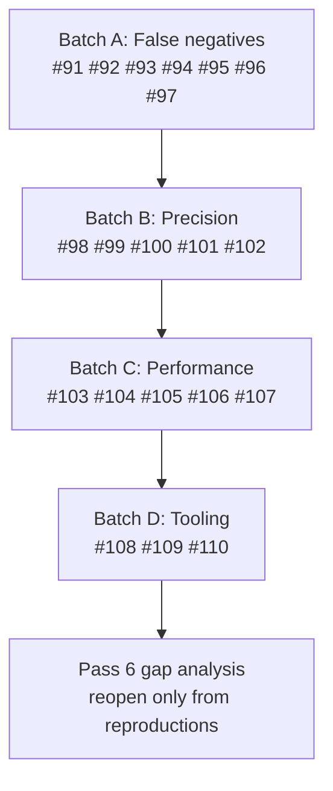

# Strategic Product Roadmap — Pass 5

**Scope:** 20 numbered improvement items (`#91` – `#110`) covering analysis **accuracy**, analysis **performance**, and an expanded taxonomy of **destructive changes** that must be classified as breaking.

**Status:** Delivered (`#91` – `#110` complete). Items are ordered by delivery batch, not by ID.

---

## 0. How this pass was produced

Pass 5 was produced by reading every non-test Go source file in `cmd/`, `pkg/`, and `internal/`, then
constructing reproductions against a locally built `bin/tfastdiff`. Nothing below is inferred from
documentation; every gap carries a file/line citation or a command transcript.

Baseline verified before writing this document:

| Check | Result |
| :--- | :--- |
| `go build ./...` | clean |
| `go vet ./...` | clean |
| `go test ./pkg/diff/... ./pkg/ast/... ./pkg/blastradius/... ./pkg/report/... ./pkg/wrapper/...` | all `ok` |
| `test/fixtures/*` | contains **no** `moved {}`, `removed {}` or `check {}` block — the newest HCL constructs are exercised only by struct literals in unit tests, never by a parsed fixture |
| Working tree | clean |

### Delivery history (unchanged record)

| Pass | Items | Delivered |
| :--- | :--- | :--- |
| Pass 1 | `#1` – `#36` | Core analysis quality, dead code, build/release hygiene |
| Pass 2 | `#37` – `#70` | Reproduced false negatives, LSP protocol conformance, cache safety |
| Pass 3 | `#71` – `#76` | IR evaluation graph, OPA v1, cross-module taint, differential verification |
| Pass 4 | `#77` – `#90` | Registry subpaths, monorepo tags, golden-plan verification |
| **Pass 5** | **`#91` – `#110`** | **This document** |

---

## 1. What the analysis found

Three families of problem, in descending severity.

### 1.1 Detection blind spots — the tool reports SAFE for destructive transitions

Reproductions (all run as `bin/tfastdiff --old <old> --new <new> --format json`):

**R1 — identity violation.** Two byte-identical directories, each holding a soft `removed` block and a
`check` block:

```
verdict SAFE  break 0  warn 0  feat 1
features [('SoftRemovedBlock', 'aws_s3_bucket.legacy')]
```

`Δ(A -> A)` must be empty. `pkg/diff/diff.go:548-560` walks **`newMod.RemovedBlocks` only** and never
compares against `oldMod.RemovedBlocks`, so a pre-existing soft `removed` block is re-reported as a
new feature on every run. The identity property test at `pkg/diff/algebra_test.go:40-46` asserts
`Verdict`, `TotalBreaking` and `TotalWarnings` but **not** `TotalNewFeatures`, and none of its eight
fixtures contains a `removed` block — so the invariant is stated in the comment and not enforced by
the assertion set.

**R2 — an upstream declaring destruction is reported as SAFE.** `new` adds `removed {}` for a bucket
(`destroy` defaults to `true` in Terraform 1.7+):

```
verdict SAFE  break 0  warn 0  feat 0
```

`pkg/diff/diff.go:550-559` emits a finding only when `!rb.Destroy`. The destructive case emits
nothing at all.

**R3 — silent behavioural drift.** `old` declares `variable "region" { default = "us-east-1" }`,
`new` declares `default = "eu-west-1"`; `old` has a `check` block, `new` does not; the output value
expression changes; the resource body changes:

```
verdict SAFE  break 0  warn 0  feat 0
Summary: SAFE TO UPDATE: 100% backward-compatible transition from  to .
```

`VariableDef.Default` (`pkg/ast/types.go:21`) is captured by the inspector but never compared —
`pkg/diff/diff.go` contains no reference to `oldVar.Default` — and the output `value` expression is not
captured at all: `OutputDef` has no value field, and the `output` enrichment
(`pkg/ast/inspect.go:440-465`) only extracts `module.*` traversals for output delegation.

**R4 — `count`/`for_each` transitions are invisible.** A module changing `count = 2` on a resource to
`for_each = toset([...])`, while also changing the state backend bucket/region, provider region and
`default_tags`, dropping `required_version = ">= 1.5.0"`, removing `lifecycle { prevent_destroy }`,
and moving the provider constraint `~> 4.0` → `~> 6.0` produces:

```
verdict WARNINGS_ONLY  break 0  warn 1
warnings [('ProviderRequirement', 'aws', "constraint updated from '~> 4.0' to '~> 6.0'")]
address_shifts absent
```

`pkg/ast/inspect.go:429-430` discards `count`/`for_each`/`providers`/`depends_on` during enrichment,
`pkg/ast/ir.go:127-131` builds addresses with no `IndexKey`, and no code path parses `backend`,
`provider`, `lifecycle` or `terraform.required_providers` major-bump semantics. `docs/features.md`
section 4 claims singleton ↔ indexed transitions are detected; they are not.

**R5 — blast radius flags every consumer CRITICAL.** A synthetic monorepo, 3000 root modules each
passing `name = "prod<i>"` and `project_id` to a wrapper:

```
scanned 3000  highest CRITICAL  safe_all False
risk dist Counter({'CRITICAL': 3000})
sample: recreation_hazards = ["name (Resource names are immutable ...)"]
        missing_required_inputs = ["ip_range_pods","ip_range_services","network","subnetwork"]
```

Two independent defects:

* `pkg/blastradius/scanner.go:659-664` flags a **recreation hazard for any passed input whose bare
  name matches** `genericHazards` (`pkg/recreation/heuristics.go:127-140` = `name`, `location`,
  `region`) — with no evidence that the attribute changed. Nearly every Terraform module passes one
  of those names, so the risk score has no discriminating power and `--exit-code` is permanently 1.
* `pkg/blastradius/scanner.go:609-615` attributes `MissingRequiredInput` issues (whose targets are
  **upstream** inputs the wrapper itself never declares) to the **consumer** for not passing them.
  The wrapper is at fault; the consumer cannot pass an input the wrapper does not expose.

### 1.2 Reporting and gate integrity — findings that never reach a consumer

* **`UpstreamDiff` is JSON-only.** `RenderWrapperText` (`pkg/report/report.go:185`), `RenderWrapperMarkdown`
  (`:260`) and `RenderWrapperSARIF` (`pkg/report/sarif.go:244`) never reference `res.UpstreamDiff`.
  A wrapper whose verdict is `UPSTREAM_BREAKING_CHANGES_DETECTED` therefore renders a text, Markdown
  and SARIF report containing **zero** breaking-change details, and `total_breaking` stays `0` while
  `can_safely_update` is `false` — inverting the equivalence documented as INV-3 in `docs/gates.md`,
  which is today asserted only over upgrade-path reports and never over wrapper reports.
* **SARIF always cites line 1.** `DifferenceItem` (`pkg/diff/models.go:18-27`) carries no `Pos`,
  although `VariableDef`, `OutputDef` and `ModuleCallDef` all do; `sarifResult` (`pkg/report/sarif.go:270-272`)
  hard-codes `startLine: 1`. Every code-scanning result lands on line 1 of the module path.
* **Missing SARIF rules.** Address shifts, taint reachability and upstream breaking changes have no
  SARIF rule at all, so three of the tool's strongest signals never reach GitHub Code Scanning.
* **Markdown drops findings.** `RenderMarkdown(r)` takes no `Findings`, so `--format markdown` loses
  `address_shifts` in compare mode; the wrapper Markdown renderer takes `Findings` but only uses
  `RecreationHazards` and `GoldenPlan`.
* **`--fix` does not apply the remediation it reports.** `MissingRequiredInput` is reported as
  breaking, but `codemod.AddMissingInputs` is reachable only from the LSP
  (`pkg/lsp/server.go:624`); `cmd/tfastdiff/main.go:511` calls `ApplyRemovedInputs` alone, although
  the previous roadmap listed "missing required input injection" as delivered under `--fix`.
* **Confidence is a constant.** `scoreConfidence` (`pkg/diff/diff.go:100-119`) assigns `9` to every
  breaking change and `9`/`8`/`7`/`6` by category to warnings. The oracle's "mean confidence ≥ 8.0"
  gate is therefore satisfied by construction, not by evidence.

### 1.3 Performance

Measured on this machine with `bin/tfastdiff`:

| Workload | Wall time |
| :--- | :--- |
| 300 tiny consumer modules (≈120 B each), `--blast-radius` | 0.021 s |
| 3000 tiny consumer modules | 0.153 s |
| 50 consumer modules totalling **7.1 MB** of HCL (≈14 000 lines each) | **1.629 s** |

Redundant work found in the code:

| Where | Cost |
| :--- | :--- |
| `pkg/ast/inspect.go:178-192,305` | Every uncached `Inspect` reads the whole module **three** times: `moduleFingerprint` (`pkg/ast/cache.go:28-51`) hashes full file contents, `tfconfig.LoadModule` parses, `enrichFromHCLFiles` re-reads and re-parses every file with a fresh `hclparse.Parser` |
| `pkg/ast/cache.go:178-211` | `cacheModule` runs `json.Marshal` on **every** inspection, including pure in-memory hits with no disk cache configured; a hit then re-runs `json.Unmarshal` (`:141`) |
| `pkg/blastradius/scanner.go:250,257,515` | Every `.tf` file in the walk is parsed **twice** — `hclsyntax.ParseConfig` at `:250`, then `extractModuleReferences` parses the same bytes again — and `refs` is computed before any check that the file contains a `module` block |
| `cmd/tfastdiff/main.go:318,390,431` | Wrapper mode inspects wrapper → target → pinned **serially**, although `ast.InspectModulesParallel` already exists and is used for two-dir compare (`:732`) |
| `cmd/tfastdiff/main.go:918-935` | Upgrade-path intermediate versions are **downloaded one at a time**; only the subsequent inspection is parallel (`:938`) |
| `pkg/lsp/server.go:230,456` + `pkg/ast/inspect.go:35-52` | Every `didChange` creates a temp directory, copies all `.tf` files, runs a full inspection and deletes the directory — with no debounce and no reuse of unchanged sibling files |
| `pkg/policy/rego.go:249-255` | `rego.New(...).Eval(...)` rebuilds and recompiles the policy module on **every** call, once per upgrade-path step (`cmd/tfastdiff/main.go:776-786`) |
| `pkg/blastradius/scanner.go:601-631` | `evaluateCallSiteImpact` rescans the full `audit.Issues` slice for every call site — O(call sites × issues) |

---

## 2. The 20 improvement items

| ID | Class | Pri | Item |
| :--- | :--- | :--- | :--- |
| `#91` | Accuracy | P0 | Diff managed resources and data sources |
| `#92` | Accuracy | P0 | Instance-graph fidelity: `count`/`for_each`, index keys, nested module paths, deterministic address pairing |
| `#93` | Accuracy | P0 | Modern-block symmetry: `removed { destroy = true }` is breaking, identity holds, removals are detected |
| `#94` | Accuracy | P0 | Parse and honour `moved {}` blocks |
| `#95` | Accuracy | P0 | Compare variable defaults and output value expressions |
| `#96` | Accuracy | P0 | Blast radius: evidence-gated hazards and correct attribution |
| `#97` | Accuracy | P0 | Report parity for `UpstreamDiff` across every renderer and gate |
| `#98` | Accuracy | P1 | Provider and core constraint semantics |
| `#99` | Accuracy | P1 | SARIF precision: real regions and rules for every finding class |
| `#100` | Accuracy | P1 | Evidence-based confidence scoring |
| `#101` | Accuracy | P1 | Destructive-argument and lifecycle value analysis |
| `#102` | Accuracy | P1 | Close the remediation loop: `--fix` injects missing required inputs |
| `#103` | Performance | P1 | Single-pass module inspection with a cheap fingerprint and marshal-once cache |
| `#104` | Performance | P1 | Parallel wrapper-mode inspection |
| `#105` | Performance | P1 | Concurrent upgrade-path prefetch with a shared archive cache |
| `#106` | Performance | P1 | Blast-radius scan: parse once, pre-filter candidates, index issue lookups |
| `#107` | Performance | P1 | Parallel directory walk for blast radius |
| `#108` | Performance | P1 | LSP: debounce and incremental overlay staging |
| `#109` | Performance | P2 | Prepare OPA policies once per run |
| `#110` | Performance | P2 | Performance budget gate: benchmarks in CI |

---

## 3. Item detail

### `#91` — Diff managed resources and data sources (Accuracy, P0)

**Gap.** `ModuleInfo.ManagedResources` and `DataResources` are populated (`pkg/ast/inspect.go:261-289`)
and consumed by the IR, but `diff.Compare` (`pkg/diff/diff.go:41-51`) never looks at them. A resource
that disappears, changes type, or is reassigned to another provider alias produces an empty interface
diff; only `DetectAddressShifts` sees part of it, and only when it runs.

**Change.** Add `compareResources(oldMod, newMod, report)` to `diff.Compare`: removed managed/data
resource → `BreakingChanges` (`Category: "Resource"`); added resource → `NewFeatures`; resource type
or `provider`/alias reassignment → `BreakingChanges` (`Category: "ResourceProvider"`). Derive
`IsRecreation` from `ast.DetectAddressShifts` so a renamed resource is reported once, not twice.

**Acceptance.** Fixture pair with a removed resource yields `TotalBreaking >= 1`; identity diff of a
resource-bearing module yields zero findings in all four buckets; every new branch covered by
`scripts/verify.sh`.

### `#92` — Instance-graph fidelity (Accuracy, P0)

**Gap.** `pkg/ast/inspect.go:429-430` explicitly skips `count`, `for_each`, `providers` and
`depends_on`; `ExtractResourceAddresses` (`pkg/ast/ir.go:119-149`) never sets `IndexKey`. Consequences:
singleton ↔ indexed, `count` → `for_each`, `for_each` key-set changes and `count` reductions are all
invisible, and the pairing loop (`pkg/ast/ir.go:215-222`) matches a vanished address to the **first**
same-type new address in sorted order — an invented, non-deterministic mapping presented as fact.

**Change.**
1. Record `count`/`for_each` presence and raw expression on `ResourceDef` and `ModuleCallDef`.
2. Populate `IndexKey`/instance metadata in the address model so `aws_instance.web[0]` and
   `aws_instance.web["a"]` are distinguishable from `aws_instance.web`.
3. Replace first-match pairing with deterministic best-match scoring (type, label, module path,
   expression similarity); when no candidate scores above a threshold, report
   `OldAddress → (unknown)` with `IsRecreation: true` and a `confidence` field instead of inventing a
   target. Include `ModulePath` in the comparison so a resource moved into a child module is
   classified as a move, not as a deletion.

**Acceptance.** Repro R4 reports an address shift for `count = 2` → `for_each`; a module moved into
`module.x` is classified `relocated`; pairing is stable across 100 randomized key orders (property
test); identity diff reports zero shifts.

### `#93` — Modern-block symmetry (Accuracy, P0)

**Gap.** `compareModernBlocks` (`pkg/diff/diff.go:548-619`) reports only *additions*, and for
`removed` blocks only the non-destructive case. Three consequences, all reproduced above: R1 identity
violation for `removed`, R2 an upstream declaring `destroy = true` reported as `SAFE`, and R3 removal
of `check`/`function`/`import`/`encryption` blocks reported as nothing.

**Change.**
1. Key every modern-block comparison on **both** directions (old set vs new set), matching the fix
   already applied to `import`/`encryption` in `#39`.
2. A `removed` block that is new in `newMod` with `Destroy == true` → `BreakingChanges`,
   `Category: "RemovedDestroy"` ("upstream declares this address will be destroyed").
3. A `removed` block that disappears → `Warnings` (destruction path no longer declared).
4. Removal of a `check` block → `Warnings` (validation regression); removal of a custom `function`
   or of an `encryption` block → `BreakingChanges` (callers referencing it fail; state encryption
   stops applying); removal of an `import` block → `Warnings`.

**Acceptance.** Repro R1 → `TotalNewFeatures == 0`; repro R2 → `TotalBreaking == 1`, verdict
`BREAKING_CHANGES`; the identity property test additionally asserts
`assert.Empty(t, report.NewFeatures)`.

### `#94` — Parse and honour `moved {}` (Accuracy, P0)

**Gap.** `moved` is absent from the enrichment block schema (`pkg/ast/inspect.go:330-339`), so
upstream-shipped state migrations are invisible. Two failure modes: an address shift that upstream
already mitigates with `moved {}` is still reported as ForceNew recreation, and `--fix` synthesises a
**duplicate** `moved.tf` for a migration that already exists.

**Change.** Add `MovedBlockDef{From, To, Pos}` to `ModuleInfo`; compare old/new sets in
`compareModernBlocks` (new upstream `moved` → `NewFeatures`; removed upstream `moved` →
`BreakingChanges` with `Category: "StateMigrationRemoved"`); suppress `IsRecreation` in
`DetectAddressShifts` when a `moved` block covers the transition, and have
`codemod.SynthesizeMovedBlocksForShifts` skip addresses already covered.

**Acceptance.** Fixture pair where `new` ships `moved {}` for a renamed resource yields
`IsRecreation == false` and `--fix` writes no duplicate block; removing a `moved` block from `new`
yields a breaking finding.

### `#95` — Compare defaults and output values (Accuracy, P0)

**Gap.** Repro R3: `VariableDef.Default` is captured but never compared, and the output `value`
expression is not captured at all (`OutputDef` has no `Value` field), so upstream silently changes
behaviour for every caller that relies on a default or on an output's computation.

**Change.**
1. Capture the output `value` expression text in `enrichFromHCLFiles` (`output` case,
   `pkg/ast/inspect.go:440-465`).
2. In `compareVariables`, compare `Default` with a canonical form (literal values normalised,
   expressions compared after whitespace folding): changed default → `BreakingChanges` when the
   wrapper/caller does **not** pass the input (blast radius already knows which inputs are passed —
   see `#96`), otherwise `Warnings` (`Category: "VariableDefault"`).
3. Changed output `value` expression → `Warnings` (`Category: "OutputValue"`), promoted to
   `BreakingChanges` when the declared output type or `sensitive` also changes.

**Acceptance.** Repro R3 yields `TotalBreaking >= 1`; a caller that explicitly passes the input is
downgraded to a warning (false-positive control); identity still holds.

### `#96` — Blast radius: evidence and attribution (Accuracy, P0)

**Gap.** Repro R5: 3000/3000 consumers `CRITICAL`. Causes are `pkg/blastradius/scanner.go:659-664`
(name-only hazard lookup, no evidence the attribute changed) and `:609-615` (upstream-only
`MissingRequiredInput` targets attributed to consumers).

**Change.**
1. Fire a recreation hazard for a consumer only when the attribute is **actually part of the diff**
   (a `DifferenceItem` on that name in `res.UpstreamDiff`/`res.Issues`) or is confirmed by
   `DynamicHazardRegistry` for a resource the wrapper declares; a bare `genericHazards` name match
   with no changed input is downgraded to `LOW` and reported as "watch", not as a hazard.
2. Attribute `MissingRequiredInput` to a consumer only when the **wrapper declares** that input and
   the consumer omits it; otherwise the finding belongs to the wrapper audit alone.
3. Require `AnalysisIncomplete` to be scored separately from `CRITICAL` so incomplete evaluation never
   inflates the risk distribution.
4. Emit a risk distribution summary (`counts by risk`) so a user can see discrimination at a glance.

**Acceptance.** On the R5 corpus, `highest_risk` is no longer uniformly `CRITICAL`; a consumer that
passes only inert inputs scores `LOW`; a consumer that genuinely passes a removed input or a changed
immutable attribute still scores `CRITICAL`; `--exit-code` returns 0 for the inert corpus and 1 for
the seeded-breaking corpus.

### `#97` — Report parity for `UpstreamDiff` (Accuracy, P0)

**Gap.** `UpstreamDiff` reaches only JSON. Text, Markdown and SARIF renderers omit it, and
`WrapperCompatibilityReport.TotalBreaking`/`TotalWarnings` exclude it, so
`can_safely_update = false` coexists with `total_breaking = 0` — the documented INV-3 equivalence
fails for every `UPSTREAM_BREAKING_CHANGES_DETECTED` report.

**Change.** Render an `UPSTREAM BREAKING CHANGES (n):` section in `RenderWrapperText`,
`RenderWrapperMarkdown` and a `TF-UPSTREAM-BREAKING-CHANGE` rule in `RenderWrapperSARIF`; add
`UpstreamBreaking`/`UpstreamWarnings` counters **and** fold them into `TotalBreaking`/`TotalWarnings`
(keeping the sub-counts for detail); assert `total_breaking == 0 <=> can_safely_update` over wrapper
reports in the accuracy gate.

**Acceptance.** A wrapper report with upstream breakage renders the same finding count in text,
Markdown, JSON and SARIF; `total_breaking > 0` whenever `verdict == "UPSTREAM_BREAKING_CHANGES_DETECTED"`.

### `#98` — Provider and core constraint semantics (Accuracy, P1)

**Gap.** `~> 4.0` → `~> 6.0` is a generic warning at confidence 7 (`pkg/diff/diff.go:466-478`); a
provider major migration routinely forces resource replacement and state/provider-address migration.
Conversely, `required_version` is only reported when the new constraint is **non-empty**
(`pkg/diff/diff.go:404`), so deleting `required_version = ">= 1.5.0"` is silent.

**Change.** Parse both constraints with `semverutil`, classify provider constraint transitions as
`major`/`minor`/`patch`/`widened`/`narrowed`/`removed`; a major bump or a source change →
`BreakingChanges` (`Category: "ProviderMajorUpgrade"`) carrying the migration note; a removed
`required_version` → `Warnings` (`Category: "TerraformCore"`); keep narrowing as a warning with the
specific excluded versions named.

**Acceptance.** Repro R4 reports a breaking provider-major finding in addition to the existing
warning; deleting `required_version` produces a warning; constraint-only-noise cases (whitespace,
ordering of a multi-constraint list) produce nothing.

### `#99` — SARIF precision (Accuracy, P1)

**Gap.** `sarifResult` hard-codes `startLine: 1` (`pkg/report/sarif.go:270-272`) because
`DifferenceItem` has no `Pos`, although `VariableDef.Pos`, `OutputDef.Pos` and `ModuleCallDef.Pos`
exist. No rule exists for address shifts, taint, or upstream breakage.

**Change.** Add `Pos tfconfig.SourcePos` to `DifferenceItem` and `WrapperIssue`, populated from the
old (removed) or new (added) declaration; emit real `startLine`; add rules
`TF-ADDRESS-SHIFT`, `TF-TAINT-REACHABLE`, `TF-UPSTREAM-BREAKING-CHANGE`; emit one result per address
shift with the old artifact URI and line. Drop `Locations` only when no position can be resolved, and
say so in the message rather than defaulting to line 1.

**Acceptance.** `grep -c '"startLine": 1'` over SARIF from a fixture diff is less than the result
count; a removed variable points at its declaration line; `gosec`/SARIF schema validation still pass.

### `#100` — Evidence-based confidence (Accuracy, P1)

**Gap.** Confidence is a constant (`pkg/diff/diff.go:100-119`, `pkg/wrapper/analyzer.go:358-367`).
The oracle gate "mean confidence ≥ 8.0" is satisfiable by the constant alone, so the number carries no
information for a consumer ranking findings.

**Change.** Score from evidence: +3 provider-schema-confirmed `requires_replace`; +3 structural
identity (removed symbol, absent symbol); +2 parsed-literal value comparison; +1 heuristic name match
(`genericHazards`); −1 when the finding depends on unevaluated dynamic input. Clamp to `[1,10]`,
require `>= 7` for breaking as INV-6 already does, and document the table in
`docs/testing_methodology.md`.

**Acceptance.** No category keeps a fixed score; a schema-confirmed hazard scores strictly higher than
a bare name match; INV-6 still holds on the accuracy gate; the oracle report shows a spread rather
than a spike.

### `#101` — Destructive-argument and lifecycle value analysis (Accuracy, P1)

**Gap.** The diff is entirely **name-based**. Toggles that control destruction are carried in
*values* and in blocks no code path parses: `lifecycle { prevent_destroy / create_before_destroy /
replace_triggered_by / ignore_changes }`, `deletion_protection`, `force_destroy`, `triggers`,
`provisioner` blocks (especially `when = destroy`), and `backend {}` configuration. Repro R4 confirms
the `prevent_destroy` removal is silent.

**Change.** Extend `enrichFromHCLFiles` with schemas for `resource`/`data`/`module`/`terraform`
sub-blocks; record `lifecycle` flags, provisioner presence and `when`, backend type and its literal
attributes, and `triggers`. Compare them: removing `prevent_destroy`/`deletion_protection` →
`BreakingChanges`; adding `replace_triggered_by` or a destroy-time provisioner → `BreakingChanges`;
`ignore_changes` narrowing → `Warnings`; `backend` bucket/key/region change → `BreakingChanges`
(`Category: "StateBackendChange"`).

**Acceptance.** Repro R4 (minus the provider/core parts handled by `#98`) yields
`TotalBreaking >= 2`; a backend key change is reported for a root module; a fixture with no
lifecycle/provisioner blocks is unchanged.

### `#102` — Close the remediation loop (Accuracy, P1)

**Gap.** `codemod.AddMissingInputs` is reachable only from the LSP (`pkg/lsp/server.go:624`).
`--fix` (`cmd/tfastdiff/main.go:504-544`) removes obsolete arguments but never inserts the required
ones it just reported, so a user must hand-edit the file the tool diagnosed.

**Change.** In `runWrapperMode`, collect `MissingRequiredInput` issues from `res.Issues`, map them to
placeholder values from the upstream variable's `Default`/type, and call `codemod.AddMissingInputs`;
mirror it in `--fix-preview` with a unified diff. Refuse (exit 2) when no safe placeholder can be
derived rather than writing `null` into a required input.

**Acceptance.** `--fix` on a wrapper missing a required input writes the argument and the subsequent
audit reports `MissingRequiredInput == 0`; `--fix-preview` changes no files; the value-fallback
failure path returns 2 with an actionable message.

### `#103` — Single-pass inspection (Performance, P1)

**Gap.** Each uncached `Inspect` reads the module three times and parses it twice (§1.3), and
`cacheModule` marshals JSON even when no disk cache is configured.

**Change.** Parse once: reuse the `hclparse.Parser` output already produced by `enrichFromHCLFiles`
for the enrichment pass, or derive both `tfconfig`-level and enrichment-level facts from one file
read; make `moduleFingerprint` a stat-based fast path (`name + size + mtime`) that falls back to full
content hashing only when a stat-derived key is absent or the stat set changed; skip
`json.Marshal` when neither the in-memory nor the disk cache will be written.

**Acceptance.** Benchmark `BenchmarkInspectModule` shows a ≥30 % reduction in `B/op` and `ns/op` on a
30-file module; a cache hit still invalidates on content change with equal mtime+size (test writes the
same size with different bytes and asserts a miss); behavior of `Inspect` is unchanged on all
fixtures.

### `#104` — Parallel wrapper-mode inspection (Performance, P1)

**Gap.** Wrapper, target and pinned inspections run serially (`cmd/tfastdiff/main.go:318,390,431`).

**Change.** Inspect wrapper and target concurrently; once the target version is known, inspect the
pinned version concurrently with the wrapper inspection. Keep registry downloads on their own
goroutines (they are I/O bound) with the existing context cancellation.

**Acceptance.** Wall time for wrapper mode with two local fixture modules drops; ordering of reports
is unchanged (assert against golden files); `-race` clean.

### `#105` — Concurrent upgrade-path prefetch (Performance, P1)

**Gap.** `cmd/tfastdiff/main.go:918-935` resolves each intermediate version sequentially; only the
later `InspectModulesParallel` call is concurrent. For a 20-step path at ~300 ms per registry fetch,
the dominant term is serial network time. Extracted archives are discarded afterwards, so a second
run repeats every download.

**Change.** Prefetch intermediate versions with a bounded worker pool (default
`min(8, GOMAXPROCS)`) feeding the existing parallel inspection; add a content-addressed archive cache
under `--cache-dir` keyed `source@version` so a repeated CI run starts from disk; keep
`registry-timeout` as a whole-operation bound by deriving a per-fetch deadline from the remaining
context budget.

**Acceptance.** A mock registry with 100 ms latency and 12 intermediate versions completes prefetch
in `≤ 2 × latency × ceil(12/pool)`; a second run performs zero network fetches; cancellation during
prefetch leaves no temp directories (assert empty `tfastdiff_upgrade_step_*`).

### `#106` — Blast-radius scan internals (Performance, P1)

**Gap.** Every `.tf` file is parsed twice and reference extraction runs even for files that contain no
`module` block (`pkg/blastradius/scanner.go:250,257,515`); `evaluateCallSiteImpact` rescans all
issues per call site (`:601-631`).

**Change.** Parse each file once and derive both block structure and `module.x.y` references from the
same `*hclsyntax.Body`; pre-filter with a cheap byte scan for `module`/`inputs`/`terragrunt` before
parsing; reuse one `hclparse.Parser` per walk instead of per file; index `audit.Issues` by
`(category, target)` once before the loop.

**Acceptance.** Benchmark on the 7.1 MB corpus shows ≥35 % wall-time reduction; call-site discovery
output is byte-identical to today's (golden compare on `test/fixtures/downstream_consumer`); no
behavior change in risk scores.

### `#107` — Parallel directory walk (Performance, P1)

**Gap.** `filepath.WalkDir` in `discoverCallSites` reads and parses files on one goroutine.

**Change.** Two-phase walk: collect candidate paths on the walker, then process them through a
bounded worker pool preserving deterministic ordering by sorting results on `(file, block position)`
before returning. Respect the existing skip rules (`.terraform`, `vendor`, dot-directories) and
propagate the first read error.

**Acceptance.** Output ordering is identical across 20 runs (determinism test); wall time on the
7.1 MB corpus improves; `RACE=1 make test` is clean.

### `#108` — LSP debounce and incremental overlay (Performance, P1)

**Gap.** Every `didChange` stages a temp directory and re-inspects the whole module
(`pkg/ast/inspect.go:35-52`, `pkg/lsp/server.go:456`) with no debounce — O(module size) per keystroke.

**Change.** Debounce diagnostics (default 200 ms, configurable via `initializationOptions`); reuse
the last inspection for unchanged sibling files by caching per-file parse results keyed on content
hash, staging only the edited file into an in-memory overlay instead of copying the directory; publish
only when the diagnostic set actually changes.

**Acceptance.** A burst of 100 `didChange` notifications for the same document results in ≤ 5
inspections; diagnostics content is unchanged for a saved document; a save-only client still works
(existing test preserved).

### `#109` — Prepare OPA policies once (Performance, P2)

**Gap.** `EvaluateRegoArbitrary` calls `rego.New(...).Eval(...)` per invocation
(`pkg/policy/rego.go:249-255`), i.e. recompiles the policy for every upgrade-path step and re-marshals
the full report for every call (`pkg/policy/rego.go:196`).

**Change.** Prepare the query once per `RegoPolicy` (`rego.PrepareForEval`) with the prepared object
stored on the policy, cache the marshalled report map per `DiffReport` pointer, and reuse both across
the step loop; keep the fail-closed behaviour on compile errors.

**Acceptance.** A 20-step upgrade path with one Rego file shows ≥50 % lower policy-eval time in a
benchmark; identical violation sets before/after (golden compare); compile-error path still fails
closed.

### `#110` — Performance budget gate (Performance, P2)

**Gap.** `scripts/verify.sh` gates correctness (format, vet, lint, 100 % coverage, fuzz) but nothing
stops a performance regression; the measurements in §1.3 are ad hoc.

**Change.** Add `TestBenchmark*` benchmarks for `ast.Inspect`, `diff.Compare`,
`blastradius.ScanDirectory*` and `report.Render*`, plus a `make perf` target running
`go test -bench . -benchtime=... -count=5` with `benchstat`, storing a checked-in baseline for the
three fixture corpora and failing on a >15 % regression in `ns/op`; wire it into CI as a non-blocking
job for the first release, blocking afterwards.

**Acceptance.** `make perf` runs in CI, the baseline is committed, and a deliberate 2× slowdown in a
seeding commit is caught by the gate.

---

## 4. Expanded destructive-change taxonomy

The current destructive-change vocabulary is effectively two things: immutable-attribute hazards
(`pkg/recreation`) and resource address shifts (`pkg/ast/ir.go`). This pass widens the definition of
**breaking** to the classes below. Severity is assigned per class, and each class names the roadmap
item that implements it.

### Class I — State address displacement (destroy + recreate)

| # | Change | Severity | Status today | Item |
| :--- | :--- | :--- | :--- | :--- |
| I.1 | Resource label rename at the same type | Breaking (recreation) | Detected, arbitrary pairing | `#92` |
| I.2 | Resource type change at the same label | Breaking (recreation) | Detected, arbitrary pairing | `#92` |
| I.3 | Resource moved into/out of a child module | Breaking (recreation) | Reported as "removed"; module path ignored | `#92` |
| I.4 | Singleton ↔ indexed: `count` added/removed, `count` ↔ `for_each` | Breaking (recreation) | **Not detected** | `#92` |
| I.5 | `for_each` key-set removal or `count` reduction (instance loss) | Breaking (destruction) | **Not detected** | `#92` |
| I.6 | Nested `module { source }` swap inside the upstream module | Breaking (all child addresses) | **Not detected** (`ModuleCalls` unused by `diff`) | `#91`, `#92` |
| I.7 | Loss of an upstream `moved {}` migration | Breaking (state migration missing) | **Not detected** | `#94` |

### Class II — Immutable-attribute (ForceNew) changes

| # | Change | Severity | Status today | Item |
| :--- | :--- | :--- | :--- | :--- |
| II.1 | Wrapper input mapped to a `requires_replace` attribute | Breaking | Detected, but name-keyed → CRITICAL flood | `#96`, `#100` |
| II.2 | Resource-body attribute change on a `requires_replace` field | Breaking | **Not detected** (resource bodies are never read) | `#91`, `#101` |
| II.3 | Provider major upgrade reclassifying attribute mutability | Breaking | Warning only | `#98` |
| II.4 | `replace_triggered_by` / `triggers` added or narrowed | Breaking | **Not detected** | `#101` |
| II.5 | `ignore_changes` narrowed (previously ignored attrs now applied) | Warning → Breaking if the attribute is ForceNew | **Not detected** | `#101` |

### Class III — Explicit destruction and lifecycle gates

| # | Change | Severity | Status today | Item |
| :--- | :--- | :--- | :--- | :--- |
| III.1 | New `removed { from = … }` with `destroy = true` (Terraform default) | **Breaking — destruction declared** | **Silent** (repro R2) | `#93` |
| III.2 | Soft `removed { destroy = false }` reported on an identity diff | must not be a finding | **False positive** (repro R1) | `#93` |
| III.3 | `lifecycle { prevent_destroy }` removed | Breaking | **Not detected** (repro R4) | `#101` |
| III.4 | `create_before_destroy` removed | Warning (downtime window) | **Not detected** | `#101` |
| III.5 | `deletion_protection` / `force_destroy` input default flipped to permissive | Breaking when the caller does not set it | **Not detected** | `#95`, `#101` |
| III.6 | Destroy-time `provisioner` added or removed | Breaking (side effects change) | **Not detected** | `#101` |

### Class IV — Provider, backend and state-migration changes

| # | Change | Severity | Status today | Item |
| :--- | :--- | :--- | :--- | :--- |
| IV.1 | Provider source change | Breaking | Detected | — |
| IV.2 | Provider constraint **major** bump (`~> 4.0` → `~> 6.0`) | Breaking (schema/state migration) | Warning, confidence 7 | `#98` |
| IV.3 | Resource `provider`/alias reassignment | Breaking | **Not detected** | `#91` |
| IV.4 | `required_version` tightening / **removal** | Warning; Breaking when removed and previously enforced | Removal **silent** (`newCore != ""` guard) | `#98` |
| IV.5 | `backend {}` type or bucket/key/region change | Breaking (state location moves) | **Not detected** | `#101` |
| IV.6 | `encryption {}` key provider change or removal (OpenTofu) | Breaking; removal = encryption off | Addition only; removal **silent** | `#93` |
| IV.7 | New required `configuration_aliases` | Breaking | Detected | — |

### Class V — Silent behaviour changes (no interface change)

| # | Change | Severity | Status today | Item |
| :--- | :--- | :--- | :--- | :--- |
| V.1 | Variable `default` value change | Breaking if the caller omits the input, else Warning | **Silent** (repro R3) | `#95` |
| V.2 | Output `value` expression change | Warning; Breaking if type/sensitivity changes | **Not detected** (`OutputDef` has no value) | `#95` |
| V.3 | Validation rule tightened to reject previously valid input | Warning → Breaking when a literal comparison proves rejection | Warning only | `#95`, `#100` |
| V.4 | Wrapper-passed input **value** change reaching an immutable attribute | Breaking | Names compared only | `#96`, `#101` |
| V.5 | Data-source selector change (`most_recent`, filters) feeding replacements | Warning → Breaking on resource association | **Not detected** | `#91` |
| V.6 | `locals` change feeding a resource argument | Warning (with taint trace when `--taint` is set) | Not detected in `diff` | `#95`, `#101` |

### Class VI — Validation and operational regressions

| # | Change | Severity | Status today | Item |
| :--- | :--- | :--- | :--- | :--- |
| VI.1 | `check {}` assertion removed or weakened | Warning | **Silent** (repro R3) | `#93` |
| VI.2 | Custom `function {}` removed (callers fail at plan) | Breaking | **Silent** | `#93` |
| VI.3 | `import {}` block removed | Warning (re-import required) | **Silent** | `#93` |
| VI.4 | `removed {}` block removed (destruction path undeclared again) | Warning | **Silent** | `#93` |

**Severity policy.** One rule governs the whole table: a finding is `BREAKING` iff applying the new
version to an unchanged caller changes what Terraform would create, update-in-place, or destroy; it is
`WARNING` when the change alters behaviour a caller can observe but does not move state; it is a
`NEW_FEATURE` only when it strictly adds capability. Class V.1 and II.5 are decided per caller, using
the blast-radius input set, so a value change that a caller overrides is never reported as breaking —
that is the false-positive control keeping `#95` from regressing into the `#96` failure mode.

---

## 5. Delivery sequence



| Batch | Items | Rationale |
| :--- | :--- | :--- |
| A — False negatives | `#91`–`#97` | Each item starts from a reproduction that currently reports `SAFE`; these are the changes that stop silent destruction |
| B — Precision | `#98`–`#102` | Improves what a reported finding says and whether it should have been reported |
| C — Performance | `#103`–`#107` | Removes duplicated work; measurable against the §1.3 baseline |
| D — Tooling | `#108`–`#110` | Sustains A–C after delivery |

---

## 6. Definition of done

Every item, without exception:

1. **Reproduction → regression test.** The reproduction in §1.3/§1 is committed as a test that fails
   on today's tree and passes after the change (Pass 2 standing rule, item 3).
2. **100 % statement coverage**, both module-wide and per package, enforced by `scripts/verify.sh:40-57`.
3. **Reachability.** Any new exported symbol is reachable from a production entry point
   (`cmd/tfastdiff` or `pkg/lsp`), verified with a reachability tool over `./cmd/...`.
4. **Fuzz target** added for every new parser (`moved`, `lifecycle`, `backend`, `count`/`for_each`),
   bringing the target count above the current 29 (`docs/gates.md` still says 28 — correct it in the
   same change).
5. **Fixture coverage.** At least one committed fixture under `test/fixtures/` contains `moved {}`,
   `removed {}`, `check {}`, `count`, `for_each`, `lifecycle` and `backend` — today none does.
6. **Invariant strengthening.** `Δ(A -> A)` additionally asserts zero new features; INV-3
   (`total_breaking == 0 <=> can_safely_update`) is asserted over wrapper reports as well as upgrade
   paths.
7. **Performance items** land with a benchmark and are measured against the §1.3 baseline via `#110`.
8. **Documentation** (`docs/cli_usage.md`, `docs/features.md`, `README.md`) is updated in the same
   change; any claim found unimplemented during Pass 5 analysis is corrected — in particular the
   `docs/features.md` section 4 claim about singleton ↔ indexed detection, and the `--fix` claim about
   missing required input injection (`#102`).
9. **No emoji** anywhere in sources, fixtures, goldens, documentation or workflow files; typographic
   arrows (`→`, `↔`) remain permitted.

## 7. Standing rules carried forward

1. 100 % statement coverage is necessary but **not sufficient**. Pair it with a reachability check.
2. **A green report is not the same as a correct report.** Coverage proves a line ran; it cannot prove
   the line reached the verdict. Every Pass 5 false negative (R1–R5) sat behind a fully covered
   function.
3. **Any analysis that cannot complete must say so**, and a missing input must surface as a failure,
   not as silence.
4. **Every gate must consume every finding.** `#97` and `#99` exist because three renderers silently
   dropped a finding class that the verdict had already acted on.
5. **A verdict with no discriminating power is a false negative in disguise.** `#96` exists because a
   risk score that marks 100 % of consumers `CRITICAL` teaches its users to ignore it.
