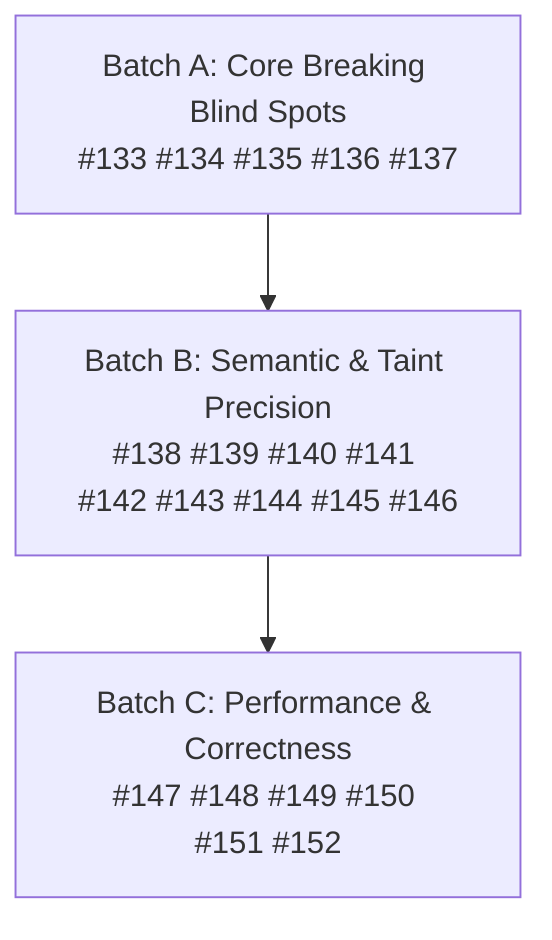

# Strategic Product Roadmap — Pass 8

**Scope:** 20 numbered improvement items (`#133` – `#152`) covering analysis **accuracy**, analysis **performance**, and an expanded taxonomy of **destructive changes** that must be classified as breaking.

**Status:** Completed. All 20 items (#133 - #152) implemented and verified with passing tests across all packages.

---

## 0. How this pass was produced

Pass 8 was produced by reading every non-test Go source file in `cmd/`, `pkg/`, and `internal/`, cross-referencing the implemented Pass 6/Pass 7 items against the actual code, and collecting the residual gaps that are not yet closed:

- core `diff.Compare` still has no access to the recreation hazard registry, so schema-confirmed `requires_replace` attributes outside a hard-coded allow-list are invisible;
- `compareModuleCalls` compares `Source` and indexing *mode* but never `Version` or cardinality *expressions*;
- `ProviderConfigs` diffing only iterates the old side, so a provider block that exists only in the new version is never compared;
- `terraform { backend {} }` and `terraform { cloud {} }` are collapsed into a single `Backend` field and only the first block is retained;
- `cloneModuleInfo` does not deep-clone nested maps/slices, so cached entries can share mutable state;
- `AnalyzeVariableTaint` falls back to `bytes.Contains` for `.tf.json` and ignores parsed ASTs passed by the caller;
- `FilterTaintedCallSites` matches only when the consumer forwards the input under the identical variable name;
- `moved {}` matching and LSP buffer caching have correctness gaps;
- Rego report-map caching is unbounded and keyed by pointer;
- provider schema loading is not memoised.

Baseline verified before writing this document:

| Check | Result |
| :--- | :--- |
| `go build ./...` | clean |
| `go vet ./...` | clean |
| `go test ./...` | all packages ok |
| Working tree | clean |

### Delivery history (unchanged record)

| Pass | Items | Delivered |
| :--- | :--- | :--- |
| Pass 1 | `#1` – `#36` | Core analysis quality, dead code, build/release hygiene |
| Pass 2 | `#37` – `#70` | Reproduced false negatives, LSP protocol conformance, cache safety |
| Pass 3 | `#71` – `#76` | IR evaluation graph, OPA v1, cross-module taint, differential verification |
| Pass 4 | `#77` – `#90` | Registry subpaths, monorepo tags, golden-plan verification |
| Pass 5 | `#91` – `#110` | Resource/modern-block diffing, single-pass AST cache, concurrent upgrade prefetch, LSP debounce |
| Pass 6 | `#111` – `#130` | Detection blind spots, semantic/wrapper precision, performance/caching |
| Pass 7 | `#131` – `#132` | SVG state-graph rendering, AWS/GCP ForceNew hazard catalog |
| **Pass 8** | **`#133` – `#152`** | **Delivered: schema-driven diffing, module/provider/cloud deep diffing, taint precision, cache/LSP correctness** |

---

## 1. What the analysis found

### 1.1 Accuracy blind spots

- **ForceNew detection in `diff.Compare` is a hard-coded allow-list.** `pkg/diff/diff.go:1203-1218` only flags changes to `cidr_block`, `vpc_id`, `availability_zone`, `subnet_id`, `ami`, `engine`, `location`, `region`, `project`, `resource_group_name`. `Compare` has no registry parameter and `compareDestructiveToggles` never consults `LookupHazard` / `DynamicHazardRegistry`, so any schema-confirmed `requires_replace` attribute outside that list is silently treated as non-breaking, even though `AutoDiscoverAndRegister` already produces descriptors for it.
- **Module-call version bumps are ignored.** `pkg/diff/diff.go:1458-1498` compares `Source` and `count`/`for_each` *mode* but never `ModuleCallDef.Version` (`pkg/ast/types.go:42`). A major version constraint bump on a child module call is therefore not reported.
- **Provider blocks that exist only in the new version are never diffed.** `pkg/diff/diff.go:1246-1264` iterates only `oldMod.ProviderConfigs`, so a newly added `provider "aws" {}` block (with its own `region`/`assume_role`) is invisible.
- **`backend` and `cloud` are collapsed into one field.** `pkg/ast/inspect.go:744-763` keeps only the first `backend`/`cloud` block and stores both in `Backend`. Changing the HCP Terraform / Terraform Cloud organization or workspace, or switching between the two, is either dropped or mis-attributed.
- **Module-call cardinality expression changes are ignored.** `compareModuleCalls` reports a mode transition (`count` ↔ `for_each`) but never compares the actual `Count`/`ForEach` expression text, so `count = 2` → `count = 1` on a child module is silent.
- **Data-source selector/filter drift is not propagated.** `DataResources` capture attributes, but no comparison checks `most_recent`, `filter`, `owners`, `query`, or `sort` changes, even though they feed managed-resource attributes.
- **Locals drift is always a warning.** `pkg/diff/diff.go:1266-1279` emits `LocalValue` as `SeverityWarning` regardless of whether the local feeds a `ForceNew` resource attribute.
- **`precondition`/`postcondition` blocks are not parsed.** `pkg/ast/inspect.go:324-341` schema and enrichment handle `lifecycle` but never `precondition`/`postcondition` on resources, data sources, or outputs.
- **`import {}` provider changes are ignored.** `ImportBlockDef` captures `To` and `ID` only; a change in the `provider` argument of an import block is not captured.
- **`.tf.json` taint analysis is shallow.** `pkg/eval/taint.go:77-85` uses `bytes.Contains` and ignores the parsed bodies the caller already passes via `preParsed`, so a variable used only inside a nested `.tf.json` block can be reported as dead code.
- **`FilterTaintedCallSites` drops renamed inputs.** `pkg/blastradius/scanner.go:179-181` only matches when the consumer forwards the input under the same name as the tainted variable; a renamed argument (`region = var.custom_region`) is dropped from the blast radius.
- **Wrapper variable tracing misses locals/functions.** `pkg/wrapper/analyzer.go:216-234` regex `\bvar\.([a-zA-Z0-9_-]+)\b` does not handle `local.*`, `coalesce(...)`, or `try(...)` expressions, so renamed variables passed through those are not type-checked.
- **`AddressShifts` discard index expressions.** `pkg/ast/ir.go:147-151,168-172,190-194` set `IndexKey = "count"` / `"for_each"` rather than the expression text, so shift pairing can conflate resources that differ only in cardinality.
- **`moved {}` matching requires byte-identical strings.** `pkg/ast/ir.go:328-342` builds keys as `mb.From+"->"+mb.To`; differing whitespace/quoting prevents recognition of an already-covered shift and can make `--fix` emit duplicate `moved.tf` entries.

### 1.2 Performance / correctness gaps

- **Rego report-map cache is unbounded and pointer-keyed.** `pkg/policy/rego.go:18-32,217-237` caches `map[string]any` by `uintptr` of `*Report`; a reused pointer with mutated contents returns a stale map, and long upgrade paths retain every intermediate report.
- **Provider schema loading is not memoised.** `pkg/recreation/autodiscover.go:150-206` re-reads and re-parses `provider-schema.json` once per provider in `RequiredProviders`.
- **`cloneModuleInfo` is not a deep clone.** `pkg/ast/cache.go:41-59` clones top-level maps/slices but not `ProviderConfigs` inner maps, `WrapperOutputReferences` slice elements, or `ParsedBodies`; cached entries can share mutable state across callers.
- **LSP `didClose` is a no-op.** `pkg/lsp/server.go:275` leaves stale buffers and cached ASTs for closed documents, which can be reused incorrectly on reopen.
- **Terragrunt call-site module name is synthetic.** `pkg/blastradius/scanner.go:465` sets `ModuleName` to `filepath.Base(filepath.Dir(path))` rather than the actual module call label, so output-reference matching can attribute outputs to the wrong key.
- **Heuristic severity over-promotion.** `pkg/recreation/heuristics.go:381-393` promotes every upstream *warning* whose name matches a hazard descriptor to `CRITICAL_HAZARD`, overstating severity for non-breaking warning categories.
- **Heuristic fallback lacks generic hazard coverage.** When no cloud token is present, the generic hazard table does not include the AWS/GCP immutable-attribute names, so a changed `name`, `region`, `location`, `project_id`, `vpc_id`, `subnet_id`, `network`, or `subnetwork` is not flagged.

---

## 2. The 20 improvement items

| ID | Class | Pri | Item |
| :--- | :--- | :--- | :--- |
| `#133` | Accuracy | P0 | Schema-driven `ForceNew` detection in core `diff.Compare` (thread registry, report any changed requires_replace attribute) |
| `#134` | Accuracy | P0 | Diff child module-call `version` constraint bumps (major/minor) as breaking |
| `#135` | Accuracy | P0 | Diff provider blocks that exist only in the new version (union iteration) |
| `#136` | Accuracy | P0 | Separate `terraform { cloud {} }` from `backend {}` and diff organization/workspace/project |
| `#137` | Accuracy | P0 | Module-call cardinality & expression changes (count/for_each value reduction) |
| `#138` | Accuracy | P1 | Data-source selector/filter drift propagation to managed resources |
| `#139` | Accuracy | P1 | Promote `locals` drift to breaking when it feeds a `ForceNew` resource attribute |
| `#140` | Accuracy | P1 | Parse and diff `precondition`/`postcondition` blocks on resources, data sources, outputs |
| `#141` | Accuracy | P1 | Capture and diff `provider` argument on `import {}` blocks |
| `#142` | Accuracy | P1 | AST-based `.tf.json` taint analysis reusing parsed bodies |
| `#143` | Accuracy | P1 | Traversal-exact `FilterTaintedCallSites` and renamed-input matching |
| `#144` | Accuracy | P1 | Wrapper variable tracing through `local.*`, `coalesce`, and `try` expressions |
| `#145` | Accuracy | P1 | Preserve index expressions in `DetectAddressShifts` (`IndexKey`) |
| `#146` | Accuracy | P1 | Normalize `moved {}` matching (whitespace/quoting) across IR and codemod |
| `#147` | Performance | P1 | Bounded LRU Rego report-map cache keyed by content hash |
| `#148` | Performance | P1 | Memoize provider schema loading and descriptor extraction |
| `#149` | Performance | P1 | Deep-clone `ModuleInfo` in the inspection cache |
| `#150` | Performance | P1 | LSP `didClose` invalidates buffers and cached ASTs |
| `#151` | Performance | P2 | Terragrunt call-site `ModuleName` uses actual module label |
| `#152` | Accuracy | P2 | Heuristic severity calibration + generic AWS/GCP hazard fallback |

---

## 3. Item detail

### `#133` — Schema-driven `ForceNew` detection in core `diff.Compare` (Accuracy, P0)

**Gap.** `pkg/diff/diff.go:1203-1218` only flags a fixed set of attribute names. `Compare` has no registry parameter, so `DynamicHazardRegistry` descriptors produced by `AutoDiscoverAndRegister` are never consulted in the core diff path.

**Change.** Add an optional `*recreation.DynamicHazardRegistry` parameter to `Compare` (nil-safe); in `compareDestructiveToggles`, when a managed/data resource attribute changes, look it up via the registry and, if flagged `requires_replace`, emit `BreakingChanges` (`Category: "ResourceForceNew"`) with the descriptor's `Impact`/`Remediation`. Keep the existing hard-coded list as a fallback when no registry is supplied.

**Acceptance.** Changing a schema-confirmed `requires_replace` attribute not in the hard-coded list (e.g. `aws_db_instance.engine` with a real schema) yields `TotalBreaking >= 1` and `CRITICAL_HAZARD` in wrapper mode; identity diff reports nothing; nil registry preserves current behaviour.

### `#134` — Diff child module-call `version` constraint bumps (Accuracy, P0)

**Gap.** `compareModuleCalls` (`pkg/diff/diff.go:1458-1498`) compares `Source` and indexing *mode* but never `ModuleCallDef.Version` (`pkg/ast/types.go:42`), so a child module major-version bump is silent.

**Change.** When `oldCall.Version != newCall.Version`, classify using `semverutil`/`ParseConstraintRange`: a major bump or `0.x` minor bump or upper-bound major drop → `BreakingChanges` (`Category: "ModuleCallVersion"`); otherwise `Warnings` (`Category: "ModuleCallVersion"`).

**Acceptance.** Bumping `version = ">= 4.0, < 6.0"` → `">= 5.0, < 6.0"` reports `ModuleCallVersion` breaking; a patch bump reports a warning; identical constraints report nothing.

### `#135` — Diff provider blocks that exist only in the new version (Accuracy, P0)

**Gap.** `pkg/diff/diff.go:1246-1264` iterates only `oldMod.ProviderConfigs`, so a provider block added in the new version is never compared.

**Change.** Iterate the union of `oldMod.ProviderConfigs` and `newMod.ProviderConfigs` keys; for a newly added provider config, emit `BreakingChanges` (`Category: "ProviderConfigAdded"`) naming the provider and its attributes; for a removed one, emit `Warnings` (`Category: "ProviderConfigRemoved"`).

**Acceptance.** Adding `provider "aws" { region = "eu-central-1" }` in the new version reports `ProviderConfigAdded`; removing one reports `ProviderConfigRemoved`.

### `#136` — Separate `terraform { cloud {} }` from `backend {}` (Accuracy, P0)

**Gap.** `pkg/ast/inspect.go:744-763` collapses both `backend` and `cloud` into `Backend` and keeps only the first block. `pkg/ast/types.go:139` has no separate `Cloud` field.

**Change.** Add `Cloud *BackendConfig` to `ModuleInfo`; populate it separately in `enrichFromHCLFiles` (keeping `Backend` for `backend {}`); in `compareDestructiveToggles`, diff `Cloud` with `Category: "StateBackendChange"` and report organization/workspace/project changes as breaking, including a backend↔cloud transition.

**Acceptance.** Changing `terraform { cloud { organization = "acme-prod" } }` → `"acme-dev"` reports `StateBackendChange`; switching `backend "s3"` → `cloud {}` reports a breaking transition.

### `#137` — Module-call cardinality & expression changes (Accuracy, P0)

**Gap.** `compareModuleCalls` reports a `count` ↔ `for_each` *mode* transition but never compares `Count`/`ForEach` expression text, so `count = 2` → `count = 1` on a child module is silent.

**Change.** When both old and new module calls have `Count` (or `ForEach`) expressions and they differ, apply the same logic as `#113`: literal integer reduction or empty collection → `BreakingChanges` (`Category: "ModuleCallCount"` / `"ModuleCallForEach"`); expression change → `Warnings` (promoted to breaking when changed to `0` or empty).

**Acceptance.** Reducing `module "eks" { count = 2 }` → `count = 1` reports `ModuleCallCount` breaking; increasing reports a new feature; identity reports nothing.

### `#138` — Data-source selector/filter drift propagation (Accuracy, P1)

**Gap.** `DataResources` capture attributes, but no comparison checks `most_recent`, `filter`, `owners`, `query`, or `sort` changes, nor propagates them to managed resources that reference the data source.

**Change.** In `compareDestructiveToggles`, for matching data resources, compare the selector attributes above; emit `Warnings` (`Category: "DataSelector"`) for any change, promoted to `BreakingChanges` when the data source feeds a `ForceNew` attribute of a managed resource (via `LookupHazard` or the hard-coded list).

**Acceptance.** Changing `data.aws_ami.latest.most_recent` from `true` to `false` reports `DataSelector`; when the AMI feeds `aws_instance.main.ami`, it is promoted to breaking.

### `#139` — Promote `locals` drift to breaking when feeding `ForceNew` (Accuracy, P1)

**Gap.** `pkg/diff/diff.go:1266-1279` always emits `LocalValue` as `SeverityWarning`.

**Change.** Build a reference index of which `local.<name>` tokens appear in managed-resource attributes; when a changed local is referenced by a `ForceNew` attribute, emit `BreakingChanges` (`Category: "LocalValue"`) instead of `Warnings`.

**Acceptance.** Changing a local that feeds `aws_vpc.main.cidr_block` reports a breaking finding; changing an unreferenced local or a non-ForceNew target yields a warning.

### `#140` — Parse and diff `precondition`/`postcondition` blocks (Accuracy, P1)

**Gap.** `pkg/ast/inspect.go:324-341` schema and enrichment handle `lifecycle` but never `precondition`/`postcondition` blocks on resources, data sources, or outputs.

**Change.** Add `Preconditions []string` and `Postconditions []string` to `ResourceDef` and `OutputDef`; parse them in `enrichFromHCLFiles`; in `compareDestructiveToggles` and `compareOutputs`, report removed or weakened conditions as `Warnings` (`Category: "PreconditionModified"` / `"PostconditionModified"`).

**Acceptance.** Removing a `precondition` block or weakening its condition reports the corresponding category; identical blocks report nothing.

### `#141` — Capture and diff `provider` argument on `import {}` blocks (Accuracy, P1)

**Gap.** `ImportBlockDef` (`pkg/ast/types.go:86-91`) captures `To` and `ID` only; a change in the `provider` argument of an import block is not captured.

**Change.** Add `Provider string` to `ImportBlockDef`; populate it in `enrichFromHCLFiles` (`pkg/ast/inspect.go:607-620`); in `compareModernBlocks`, report a changed `provider` as `BreakingChanges` (`Category: "ImportBlockProvider"`).

**Acceptance.** Changing `import { to = aws_s3_bucket.b id = "x" provider = aws.west }` → `aws.east` reports `ImportBlockProvider`.

### `#142` — AST-based `.tf.json` taint analysis (Accuracy, P1)

**Gap.** `pkg/eval/taint.go:77-85` uses `bytes.Contains` for `.tf.json` and ignores `preParsed` bodies, so a variable used only inside a nested JSON block can be reported as dead code, and already-parsed ASTs are discarded.

**Change.** When `preParsed` contains `.tf.json` entries, parse them with `hclsyntax.ParseJSON`/`hclparse` into `*hclsyntax.Body` and recurse with the same logic as `.tf`; otherwise fall back to reading from disk and parsing (never `bytes.Contains`). Record affected attributes as `resource.attr` / `module.x.input` rather than a synthetic `file.var.x`.

**Acceptance.** Repro R5 with a `.tf.json`-only usage reports `is_dead_code == false`, `is_reachable == true`, with the real affected attribute listed.

### `#143` — Traversal-exact `FilterTaintedCallSites` and renamed inputs (Accuracy, P1)

**Gap.** `pkg/blastradius/scanner.go:179-181` only matches `cs.PassedInputs[taintReport.TargetVariable]`; a consumer forwarding the input under a renamed argument is dropped. The regex at `:198` uses substring-ish `module.<name>.<outName>` boundaries but is compiled per iteration.

**Change.** Build a map from consumer input name → expression; match a call site when any passed expression contains a traversal whose root is `var.<target>` or `module.<m>.<taintedOutput>` with token boundaries; pre-compile the output-reference regex once per call.

**Acceptance.** A consumer passing `region = var.custom_region` where `custom_region` is tainted is retained; a consumer passing `var.identity` is not matched by a tainted output named `id`.

### `#144` — Wrapper variable tracing through `local.*`, `coalesce`, `try` (Accuracy, P1)

**Gap.** `pkg/wrapper/analyzer.go:216-234` regex only captures `var.x`; variables forwarded via `local.x`, `coalesce(var.x, ...)`, or `try(...)` are not type-checked.

**Change.** Parse each `InputExpressions` value with `hclsyntax.ParseExpression` and walk `Variables()`; for each traversal whose root is `var`, `local`, or `module`, resolve to the wrapper variable/local and register the mapping; handle `coalesce`/`try` by inspecting all arguments.

**Acceptance.** A wrapper passing `region = coalesce(var.custom_region, "us-east-1")` where `custom_region` has an incompatible type is flagged `TypeMismatch`.

### `#145` — Preserve index expressions in `DetectAddressShifts` (Accuracy, P1)

**Gap.** `pkg/ast/ir.go:147-151,168-172,190-194` set `IndexKey = "count"` / `"for_each"` discarding the expression text.

**Change.** Store the full expression text (`r.Count`/`r.ForEach`) in `IndexKey` (or a new `IndexExpr` field) so shift pairing and golden-plan correlation can distinguish `count = 3` from `count = 1`; update `ir.go` consumers and `models.go` accordingly.

**Acceptance.** Two resources differing only in cardinality are no longer paired as the same shift; existing golden tests updated.

### `#146` — Normalize `moved {}` matching (Accuracy, P1)

**Gap.** `pkg/ast/ir.go:328-342` and `pkg/codemod/apply.go:172-177` build keys from raw strings, so differing whitespace/quoting prevents recognition of an already-covered shift.

**Change.** Add a `normalizeAddress` helper that trims whitespace and canonicalises quoting; use it for `moved {}` keys in `DetectAddressShifts` and `FormatMovedBlocks`; strip synthetic `[count]`/`[for_each]` markers while preserving concrete index keys.

**Acceptance.** A `moved {}` block with extra whitespace is still recognised as covering its shift; `FormatMovedBlocks` never emits `[count]` or `[for_each]`.

### `#147` — Bounded LRU Rego report-map cache (Performance, P1)

**Gap.** `pkg/policy/rego.go:18-32,217-237` caches by `uintptr` of `*Report` with no eviction and no content awareness.

**Change.** Key the cache by a content hash (or `*Report` + a monotonic version) in a bounded LRU (capacity 64); invalidate when the report pointer is reused with different contents; return immediately when `EvaluateRegoArbitrary` succeeds.

**Acceptance.** Benchmark of `EvaluateRego` over a 20-step upgrade path shows ≥40% reduction in `B/op` and `allocs/op`; mutating a reused report does not return a stale map.

### `#148` — Memoize provider schema loading and descriptor extraction (Performance, P1)

**Gap.** `pkg/recreation/autodiscover.go:150-206` re-reads and re-parses `provider-schema.json` once per provider in `RequiredProviders`.

**Change.** Cache parsed `*ProviderSchemas` and extracted `map[string]HazardDescriptor` in memory keyed by cleaned file path + mtime+size; load `mod.Path/provider-schema.json` at most once per module.

**Acceptance.** A module declaring 5 providers with a local `provider-schema.json` parses the file once instead of 5 times.

### `#149` — Deep-clone `ModuleInfo` in the inspection cache (Performance, P1)

**Gap.** `pkg/ast/cache.go:41-59` clones top-level maps/slices but not `ProviderConfigs` inner maps, `WrapperOutputReferences` slice elements, or `ParsedBodies`.

**Change.** Deep-clone each map value (`ProviderConfigs` inner maps, `WrapperOutputReferences` slices, `ModuleCalls`, `ResourceDef` values) and copy `ParsedBodies` pointers (immutable) in `cloneModuleInfo`.

**Acceptance.** Mutating a cached `ModuleInfo`'s `ProviderConfigs` does not affect a second caller's copy; existing cache tests pass.

### `#150` — LSP `didClose` invalidates buffers and cached ASTs (Performance, P1)

**Gap.** `pkg/lsp/server.go:275` is a no-op, so stale buffers and cached ASTs remain for closed documents.

**Change.** On `didClose`, delete the buffer and its cached AST entry keyed by the document URI/path; on reopen, re-parse from disk.

**Acceptance.** Reopening a previously closed document re-parses from disk; no stale diagnostics are emitted.

### `#151` — Terragrunt call-site `ModuleName` uses actual module label (Performance, P2)

**Gap.** `pkg/blastradius/scanner.go:465` sets `ModuleName` to `filepath.Base(filepath.Dir(path))` rather than the actual module call label.

**Change.** Parse the `module "..." {}` (or Terragrunt `terraform { source = ... }`) label and store it in `CallSite.ModuleName`; use it in `extractModuleReferencesFromBody` matching.

**Acceptance.** A Terragrunt consumer passing an input under a renamed argument is attributed to the correct module key; existing blast-radius tests pass.

### `#152` — Heuristic severity calibration + generic AWS/GCP fallback (Accuracy, P2)

**Gap.** `pkg/recreation/heuristics.go:381-393` promotes every upstream warning to `CRITICAL_HAZARD`; the generic fallback lacks AWS/GCP immutable-attribute names.

**Change.** Promote only upstream *breaking* items (or warnings whose category is in a defined set) to `CRITICAL_HAZARD`; keep others as `WARNING`; augment the generic hazard table with `name`, `region`, `location`, `project_id`, `vpc_id`, `subnet_id`, `network`, `subnetwork` so unclassified modules still flag them (without reintroducing cross-provider misattribution).

**Acceptance.** An upstream `VariableDefault` change (warning) no longer produces `CRITICAL_HAZARD` unless it is a breaking change; a bare directory comparison changing `region` is still flagged.

---

## 4. Expanded destructive-change taxonomy (Pass 8 additions)

Pass 7 established Classes I–VII. Pass 8 widens the scope with provider/cloud deep-diffing, module-call
version/cardinality, data-source selector drift, precondition/postcondition, import provider, and
index-expression preservation across those classes plus a new **Class VIII (Provider & Backend
Composition Destruction)**:

| Class | Change | Severity | Status before Pass 8 | Item |
| :--- | :--- | :--- | :--- | :--- |
| **I.11** | Unmigrated resource rename with cardinality change (`count`/`for_each` expr differs) | **Breaking (recreation)** | Shift pairing conflates by literal marker | `#145` |
| **I.12** | `moved {}` block not recognised due to whitespace/quoting | **Breaking (duplicate migration)** | Exact string equality required | `#146` |
| **II.10** | Schema-confirmed `requires_replace` attribute outside hard-coded list | **Breaking (recreation)** | Allow-list only | `#133` |
| **II.11** | `precondition`/`postcondition` removed or weakened | **Warning → Breaking if ForceNew** | Not parsed | `#140` |
| **II.12** | `import {}` `provider` argument changed | **Breaking** | Not captured | `#141` |
| **III.9** | `deletion_protection`/`purge_protection_enabled` on data sources disabled | **Breaking (destruction guard removed)** | Data sources not diffed for toggles | `#133` |
| **IV.11** | `terraform { cloud {} }` organization/workspace/project changed | **Breaking (state backend move)** | Collapsed into `Backend` | `#136` |
| **IV.12** | `backend {}` ↔ `cloud {}` transition | **Breaking (state backend move)** | Collapsed into `Backend` | `#136` |
| **IV.13** | Provider block added/removed in new version | **Breaking (provider target shift)** | Only old side iterated | `#135` |
| **V.10** | `locals` expression change feeding a `ForceNew` attribute | **Breaking** (Warning if mutable) | Always warning | `#139` |
| **V.11** | `data` source filter/selector change (`most_recent`, `filter`, `owners`) | **Warning → Breaking if ForceNew** | Not compared | `#138` |
| **VI.7** | `.tf.json`-only variable usage reported as dead code | **False negative** | `bytes.Contains` shallow | `#142` |
| **VI.8** | Blast radius drops renamed-input consumers | **False negative** | Exact-name match only | `#143` |
| **VII.4** | Nested module-call `version` major bump | **Breaking** | Not compared | `#134` |
| **VII.5** | Nested module-call `count`/`for_each` expression reduction | **Breaking (subtree destruction)** | Mode only | `#137` |
| **VII.6** | Wrapper variable forwarded via `local.*`/`coalesce`/`try` not type-checked | **Breaking** | Regex misses them | `#144` |
| **VIII.1** | Provider configuration block added in new version | **Breaking (provider target shift)** | Not detected | `#135` |
| **VIII.2** | Heuristic severity inflation (warning → `CRITICAL_HAZARD`) | **False positive** | Over-promotion | `#152` |
| **VIII.3** | Cached `ModuleInfo` shared mutable state across callers | **Correctness** | Shallow clone | `#149` |
| **VIII.4** | Stale LSP buffer/AST after `didClose` | **Correctness** | No-op handler | `#150` |

---

## 5. Delivery sequence

| Batch | Items | Rationale |
| :--- | :--- | :--- |
| A — Core breaking blind spots | `#133`–`#137` | Eliminates the `SAFE` false negatives from schema-confirmed ForceNew, module-call version/cardinality, provider/cloud deep diffing |
| B — Semantic & taint precision | `#138`–`#146` | Fixes data-source/local propagation, precondition/postcondition/import provider, `.tf.json` taint, renamed-input blast radius, wrapper tracing, address-shift indexing, moved-block matching |
| C — Performance & correctness | `#147`–`#152` | Bounds Rego cache, memoises provider schemas, deep-clones cached modules, fixes LSP close, Terragrunt labels, heuristic severity |

---

## 6. Definition of done

Every item, without exception, satisfies the Pass 6 Definition of Done (§6 of the previous `docs/roadmap.md`), plus:

1. **Schema-driven diffing.** When a `DynamicHazardRegistry` is supplied, `diff.Compare` reports every changed `requires_replace` attribute, not just the hard-coded allow-list.
2. **No stale cache state.** `cloneModuleInfo` produces an independent copy; LSP `didClose` clears buffers and cached ASTs.
3. **Taint fidelity.** `.tf.json` files are parsed, not substring-scanned; renamed-input consumers are retained in the blast radius.
4. **Provider/cloud parity.** `backend` and `cloud` are distinct fields; provider blocks are diffed in both directions.
"""