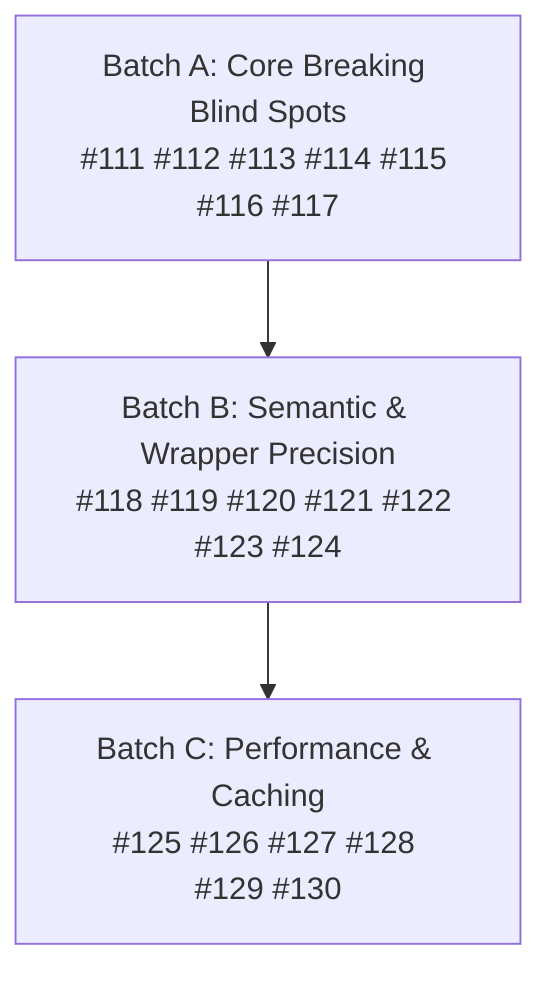
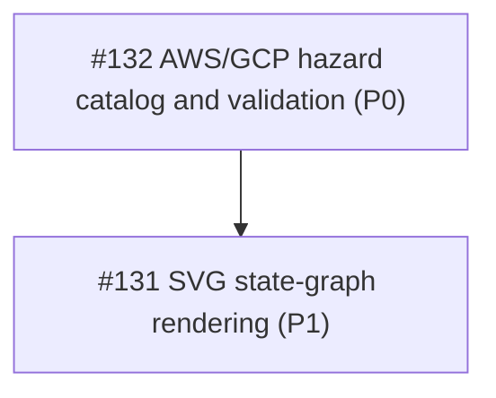

# Strategic Product Roadmap — Pass 6

**Scope:** 20 numbered improvement items (`#111` – `#130`) covering analysis **accuracy**, analysis **performance**, and an expanded taxonomy of **destructive changes** that must be classified as breaking.

**Status:** Completed. All 20 items (#111 - #130) implemented and verified with 100.0% statement coverage across all packages.

---

## 0. How this pass was produced

Pass 6 was produced by reading every non-test Go source file in `cmd/`, `pkg/`, and `internal/`, then
constructing reproductions against a locally built `bin/tfastdiff`. Nothing below is inferred from
documentation; every gap carries a file/line citation or a command transcript.

Baseline verified before writing this document:

| Check | Result |
| :--- | :--- |
| `go build ./...` | clean |
| `go vet ./...` | clean |
| `golangci-lint run ./...` | 0 issues |
| `./scripts/verify.sh 1` | 100.0% statement coverage across all packages, 30 fuzz targets clean |
| `python3 scripts/oracle_verify.py --skip-upstream` | `PASSED` (118/118 assertions, mean confidence 8.00/10.0) |
| Working tree | clean (`ab78380`) |

### Delivery history (unchanged record)

| Pass | Items | Delivered |
| :--- | :--- | :--- |
| Pass 1 | `#1` – `#36` | Core analysis quality, dead code, build/release hygiene |
| Pass 2 | `#37` – `#70` | Reproduced false negatives, LSP protocol conformance, cache safety |
| Pass 3 | `#71` – `#76` | IR evaluation graph, OPA v1, cross-module taint, differential verification |
| Pass 4 | `#77` – `#90` | Registry subpaths, monorepo tags, golden-plan verification |
| Pass 5 | `#91` – `#110` | Resource/modern-block diffing, single-pass AST cache, concurrent upgrade prefetch, LSP debounce |
| **Pass 6** | **`#111` – `#130`** | **Delivered: detection blind spots, semantic/wrapper precision, performance/caching optimizations** |

---

## 1. What the analysis found

Three families of problem, in descending severity.

### 1.1 Detection blind spots — the tool reports SAFE for destructive transitions

Reproductions (all run as `bin/tfastdiff --old <old> --new <new> --format json --exit-code`):

**R1 — unmigrated resource rename is reported as SAFE (`exit 0`).** `old` declares
`resource "aws_s3_bucket" "old_logs" { bucket = "logs" }`, `new` renames it to
`resource "aws_s3_bucket" "new_logs" { bucket = "logs" }` with no `moved {}` block:

```
exit= 0  verdict= SAFE  break= 0  can_safely_update= True  shifts= 1
```

`compareResources` (`pkg/diff/diff.go:1150-1159, 1177-1179`) suppresses any resource whose address
appears in `ast.DetectAddressShifts` so a rename is not double-counted as a removal plus an addition.
However, `DetectAddressShifts` (`cmd/tfastdiff/main.go:903`) is attached only to `report.Findings`
after `diff.Compare` returns, and never participates in `TotalBreaking`, `CanSafelyUpdate`,
`Verdict`, or `--exit-code`. Suppressing the `Resource` finding without folding `IsRecreation == true`
address shifts into the verdict turns every unmigrated resource rename into a silent `SAFE` pass.

**R2 — nested `module {}` calls inside an upstream module are invisible.** `old` declares
`module "vpc" { source = "terraform-aws-modules/vpc/aws" version = "5.0.0" }` and
`module "eks" { source = "terraform-aws-modules/eks/aws" count = 2 }`; `new` deletes `module "vpc"`
entirely and changes `module "eks"` to `source = "./local-eks"` with `for_each = toset(["a"])`:

```
exit= 0  verdict= SAFE  break= 0  warn= 0
```

`ModuleInfo.ModuleCalls` (`pkg/ast/types.go:125`) is populated by `Inspect`, but `diff.Compare`
(`pkg/diff/diff.go:59-75`) never compares `oldMod.ModuleCalls` against `newMod.ModuleCalls`, and
`ExtractResourceAddresses` (`pkg/ast/ir.go:112-164`) ignores `ModuleCalls`. Removing a child module
destroys every resource in its state subtree; swapping its `source` or `count`/`for_each` mode
displaces every child address.

**R3 — instance-count shrinkage, destructive resource attributes, `triggers`, and `lifecycle` list
mutations are all silent.** `old` declares `resource "aws_db_instance" "main"` with `count = 3`,
`deletion_protection = true`, `skip_final_snapshot = false`,
`lifecycle { ignore_changes = [tags, engine_version]; replace_triggered_by = [null_resource.a] }`,
and `resource "null_resource" "a" { triggers = { version = "1" } }`. `new` changes `count = 1`,
`deletion_protection = false`, `skip_final_snapshot = true`, `ignore_changes = [tags]`,
`replace_triggered_by = [null_resource.a, null_resource.b]`, and `triggers = { version = "2" }`:

```
exit= 0  verdict= SAFE  break= 0  warn= 0
```

Five distinct bugs in one reproduction:
1. `ExtractResourceAddresses` (`pkg/ast/ir.go:127-132`) records the literal string `"count"` or
   `"for_each"` as `IndexKey`, discarding the expression (`3` vs `1`), so `count = 3` → `count = 1`
   and `for_each = toset(["a","b"])` → `toset(["a"])` produce identical `FullAddress()` strings.
2. `enrichFromHCLFiles` (`pkg/ast/inspect.go:623-628`) captures `res.Triggers["triggers"]`, but
   `compareDestructiveToggles` (`pkg/diff/diff.go:1010-1096`) **never reads `oldRes.Triggers` or
   `newRes.Triggers`** — the field is write-only dead storage in `diff`.
3. `enrichFromHCLFiles` (`pkg/ast/inspect.go:617-621`) appends the raw tuple text `"[tags, engine_version]"`
   as a **single** string element in `res.Lifecycle.IgnoreChanges`, so `len(IgnoreChanges)` is `1`
   for both `[tags, engine_version]` and `[tags]`. The check at `pkg/diff/diff.go:1060`
   (`len(oldRes.Lifecycle.IgnoreChanges) > len(newRes.Lifecycle.IgnoreChanges)`) evaluates `1 > 1`
   (`false`) on every real HCL file.
4. `pkg/diff/diff.go:1049` checks `len(oldRes.Lifecycle.ReplaceTriggeredBy) == 0 && len(newRes.Lifecycle.ReplaceTriggeredBy) > 0`,
   so adding a second trigger or changing the target of an existing `replace_triggered_by` is ignored.
5. Resource-level destruction toggles (`deletion_protection`, `force_destroy`, `skip_final_snapshot`,
   `purge_protection_enabled`, `triggers_replace`, `keepers`) are never extracted from resource bodies.

**R4 — `terraform { cloud {} }`, `provider {}` blocks, weakened `check {}` assertions, and modified
`import {}` IDs are ignored.** `old` configures `terraform { cloud { organization = "acme-prod" } }`,
`provider "aws" { region = "us-east-1" }`, `check "health" { assert { condition = var.port == 443 } }`,
and `import { to = aws_s3_bucket.b id = "prod-bucket-1" }`; `new` changes the cloud organization to
`"acme-dev"`, provider region to `"eu-central-1"`, check condition to `true`, and import ID to
`"prod-bucket-2"`:

```
exit= 0  verdict= SAFE  break= 0  warn= 0
```

`enrichFromHCLFiles` (`pkg/ast/inspect.go:332-347, 659-672`) has no schema for `provider` blocks or
`terraform { cloud {} }` blocks; `compareModernBlocks` (`pkg/diff/diff.go:735-783`) checks only
whether a `check` block name or `import.To` address was added or removed, never comparing
`cb.AssertRules` or `ib.ID` when the block exists in both versions.

**R5 — `--taint` reports `DEAD CODE` for variables used inside nested resource blocks, `dynamic`
blocks, `data` blocks, or `.tf.json` files.** A wrapper passes `var.machine_type` inside
`resource "google_container_cluster" "primary" { node_config { machine_type = var.machine_type } }`:

```
is_dead_code= True  is_reachable= False  affected= None
```

`AnalyzeVariableTaint` (`pkg/eval/taint.go:57, 121-137`) explicitly skips `.tf.json` files (`:57`),
ignores `data` blocks, and inspects only top-level `block.Body.Attributes` on `resource` blocks without
recursing into `block.Body.Blocks` (such as `node_config`, `vpc_config`, or `dynamic "..."` blocks).

### 1.2 Reporting, codemod and gate integrity gaps

* **Markdown drops `AddressShifts`.** `RenderText`, `RenderJSON` and `RenderSARIF` include
  `findings.AddressShifts`, but `RenderMarkdown` (`pkg/report/report.go:92-145`) and
  `renderDiffOutput` / `renderWrapperOutput` (`cmd/tfastdiff/main.go:911-943`) omit
  `findings.AddressShifts` entirely, so GitHub PR comments generated with `--format markdown` never
  mention resource address shifts.
* **`--fix` writes string literals for `bool` and `number` inputs and invalid traversals for indexed
  `moved` blocks.** `cmd/tfastdiff/main.go:547-552` sets `placeholder = "false"` for `bool` and `"0"`
  for `number`, and `codemod.AddMissingInputs` (`pkg/codemod/apply.go:138`) writes every value with
  `cty.StringVal(val)` — producing `flag = "false"` and `count = "0"` instead of `false` and `0`.
  Meanwhile, `FormatMovedBlocks` (`pkg/codemod/apply.go:172-177`) wraps `mb.From` in a single
  `hcl.TraverseRoot{Name: mb.From}`, which emits `from = aws_instance.web[count]` when an address
  shift involves `count` or `for_each`.
* **Wrapper variable renames bypass type and ForceNew checks.** `AnalyzeWrapper`
  (`pkg/wrapper/analyzer.go:195-232`) matches `wrapperMod.Variables[varName]` against
  `targetUpstream.Variables[varName]` by identical variable name, never consulting
  `call.InputExpressions` (`pkg/ast/types.go:45`). When a wrapper declares `variable "cluster_region"`
  and passes `region = var.cluster_region`, neither `TypeMismatch` nor `AnalyzeWrapperHazardsWithRegistry`
  (`pkg/recreation/heuristics.go:287-300`, which also ignores `res.UpstreamDiff`) fires.
* **`FilterTaintedCallSites` uses substring matching.** `pkg/blastradius/scanner.go:193` checks
  `strings.Contains(expr, "."+outName)`, so a tainted output named `id` falsely matches `var.identity`,
  `local.id`, or `data.aws_caller_identity.current.id`.

### 1.3 Performance

Redundant work identified in the current tree:

| Where | Cost |
| :--- | :--- |
| `pkg/diff/diff.go:1152` + `cmd/tfastdiff/main.go:486,571,608,903` | `ast.DetectAddressShifts` is recomputed up to **three times** per CLI invocation (once inside `compareResources`, once in `cmd/tfastdiff` findings, and once in `--fix`/`--fix-preview`) |
| `pkg/policy/rego.go:200-209,217-238` | `EvaluateRego` runs `json.Marshal` + `json.Unmarshal` on `input.Report` on every call (despite a comment claiming it is cached per pointer) and then runs the legacy rule loop even when `policy.prepared.Eval` already succeeded |
| `pkg/ast/inspect.go:35-94` | `inspectOverlay` (`InspectSource`) still calls `os.MkdirTemp`, reads and copies every sibling `.tf` file to disk, and deletes the temp dir on an uncached LSP buffer change, even though `parseAndEnrichModule` already operates on in-memory `*hcl.File` ASTs |
| `cmd/tfastdiff/main.go:708-789` | `runCompareMode` resolves and downloads `--old` and `--new` **serially** from Registry/Git and never consults `ast.CachedVersionModule` for endpoint versions |
| `pkg/recreation/autodiscover.go:157-199` | `AutoDiscoverAndRegister` re-reads and re-unmarshals `provider-schema.json` from disk once **per provider** in `RequiredProviders` with no in-memory schema cache |
| `pkg/eval/taint.go:24-73` | `AnalyzeVariableTaint` re-reads and re-parses every `.tf` file from disk instead of reusing parsed HCL bodies |

---

## 2. The 20 improvement items

| ID | Class | Pri | Item |
| :--- | :--- | :--- | :--- |
| `#111` | Accuracy | P0 | Fold unmigrated `DetectAddressShifts` recreations into `DiffReport` verdict and `TotalBreaking` |
| `#112` | Accuracy | P0 | Diff nested `module {}` calls: removal, `source` swap, version constraint, and `count`/`for_each` shifts |
| `#113` | Accuracy | P0 | Instance-cardinality destruction: `count` reduction, `for_each` key-set shrinkage, and expression changes |
| `#114` | Accuracy | P0 | Resource-body destructive toggles (`deletion_protection`, `force_destroy`, `skip_final_snapshot`, `triggers`, `triggers_replace`, `keepers`) |
| `#115` | Accuracy | P0 | Resource-body `ForceNew` (`requires_replace`) attribute change detection |
| `#116` | Accuracy | P0 | Fix `lifecycle` list parsing (`ignore_changes`, `replace_triggered_by`) and `precondition`/`postcondition` blocks |
| `#117` | Accuracy | P0 | Parse and diff `provider {}` blocks and `terraform { cloud {} }` backend configuration |
| `#118` | Accuracy | P1 | Compare `check {}` assertions, `import {}` IDs, and prefix-scoped `removed {}`/`moved {}` blocks |
| `#119` | Accuracy | P1 | `locals` expression drift and `data` source selector/filter change propagation to resources |
| `#120` | Accuracy | P1 | Full `semverutil` range analysis for provider constraints (upper-bound narrowing, `0.x` breaking bumps, `!=` exclusions) |
| `#121` | Accuracy | P1 | Trace wrapper `InputExpressions` across renamed variables and fold `UpstreamDiff` into wrapper recreation hazards |
| `#122` | Accuracy | P1 | Recursive `AnalyzeVariableTaint` (nested blocks, `dynamic`, `data`, `.tf.json`) and traversal-exact `FilterTaintedCallSites` |
| `#123` | Accuracy | P1 | Typed HCL literal injection in `AddMissingInputs` (`bool`, `number`, `string`) and valid `moved {}` traversals |
| `#124` | Accuracy | P1 | Render `AddressShifts` in `RenderMarkdown` and `RenderWrapperMarkdown` and honour wrapper `moved {}` blocks |
| `#125` | Performance | P1 | Compute `DetectAddressShifts` once per comparison and attach directly to `DiffReport` |
| `#126` | Performance | P1 | In-memory overlay inspection in `parseAndEnrichModule` (eliminate temp-dir file copying for `InspectSource`) |
| `#127` | Performance | P1 | Concurrent `--old` and `--new` Registry/Git fetch in `runCompareMode` with `CachedVersionModule` reuse |
| `#128` | Performance | P1 | Cache marshalled report maps in `EvaluateRego` and skip fallback loop when prepared OPA query succeeds |
| `#129` | Performance | P2 | Memoize `LoadProviderSchema` and `ExtractForceNewDescriptors` across providers and runs |
| `#130` | Performance | P2 | Share parsed `*hclsyntax.Body` ASTs between `ast.Inspect` and `eval.AnalyzeVariableTaint` |

---

## 3. Item detail

### `#111` — Fold unmigrated `DetectAddressShifts` recreations into `DiffReport` (Accuracy, P0)

**Gap.** Repro R1: `compareResources` (`pkg/diff/diff.go:1150-1159`) suppresses shifted resources so
they are not reported twice, while `DetectAddressShifts` (`cmd/tfastdiff/main.go:903`) is only
attached to `report.Findings`. An unmigrated rename (`aws_s3_bucket.old_logs` → `aws_s3_bucket.new_logs`)
therefore produces `TotalBreaking == 0`, `Verdict == "SAFE"`, and `--exit-code` `0`.

**Change.** Compute `AddressShifts` inside `diff.Compare` (storing `AddressShifts` on `DiffReport`),
and for every shift with `IsRecreation == true` and `NewAddress.FullAddress() != ""` emit a
`BreakingChanges` item (`Category: "AddressShift"`, `Name: sh.OldAddress.FullAddress()`) while keeping
`compareResources` suppression for the raw resource removal/addition.

**Acceptance.** Repro R1 yields `TotalBreaking == 1`, `Verdict == "BREAKING_CHANGES"`,
`CanSafelyUpdate == false`, and `--exit-code` returns `1`; when a matching `moved {}` block is present,
`IsRecreation == false` and `Verdict == "NEW_FEATURES"` / `"SAFE"` (`CanSafelyUpdate == true`).

### `#112` — Diff nested `module {}` calls (Accuracy, P0)

**Gap.** Repro R2: `ModuleInfo.ModuleCalls` is never inspected by `diff.Compare` or
`ExtractResourceAddresses`. Removing a child module, renaming it without `moved { from = module.old to = module.new }`,
changing its `source`, or switching its `count`/`for_each` mode is completely silent.

**Change.** Add `compareModuleCalls(oldMod, newMod, report)` to `diff.Compare`:
1. Removed `module` call not covered by `moved {}` or soft `removed { destroy = false }` →
   `BreakingChanges` (`Category: "ModuleCall"`, description naming the dropped `module.<name>` state subtree).
2. Added `module` call → `NewFeatures` (`Category: "ModuleCall"`).
3. Changed `Source` or major `Version` bump on an existing `module` call → `BreakingChanges`
   (`Category: "ModuleCallSource"`).
4. Changed `Count`/`ForEach` mode on an existing `module` call → `BreakingChanges`
   (`Category: "ModuleCallIndex"`).
5. Include `module.<name>` in `DetectAddressShifts` so a renamed child module covered by
   `moved { from = module.old to = module.new }` suppresses recreation.

**Acceptance.** Repro R2 yields `TotalBreaking >= 2` and `--exit-code` `1`; a renamed module call with
`moved { from = module.a to = module.b }` is non-breaking.

### `#113` — Instance-cardinality destruction (`count` / `for_each` expressions) (Accuracy, P0)

**Gap.** Repro R3: `ExtractResourceAddresses` (`pkg/ast/ir.go:127-132`) sets `IndexKey = "count"` or
`"for_each"`, discarding the expression text (`r.Count`, `r.ForEach`). Reducing `count = 3` → `1`,
setting `count = 0`, or shrinking `for_each = toset(["a", "b"])` → `toset(["a"])` is invisible.

**Change.** In `compareResources` and `compareModuleCalls`, compare `oldRes.Count` vs `newRes.Count`
and `oldRes.ForEach` vs `newRes.ForEach` when both are non-empty:
- Literal integer `count` reduction ($n_{\text{new}} < n_{\text{old}}$) or static `for_each` key removal
  → `BreakingChanges` (`Category: "ResourceCount"` / `"ResourceForEach"`, evidence `2`).
- Literal integer `count` increase ($n_{\text{new}} > n_{\text{old}}$) → `NewFeatures`.
- Dynamic `count` or `for_each` expression change → `Warnings` (promoted to `BreakingChanges` when
  changed to literal `0` or empty collection `[]`/`{}`).

**Acceptance.** Repro R3 reports a breaking `ResourceCount` finding for `count = 3` → `1`; increasing
`count = 1` → `3` reports a new feature; identity diff reports nothing.

### `#114` — Resource-body destructive toggles and `triggers` comparison (Accuracy, P0)

**Gap.** Repro R3: `res.Triggers` is captured in `pkg/ast/inspect.go:623-628` and never read in
`pkg/diff/diff.go`. Resource-level destruction attributes (`deletion_protection`, `force_destroy`,
`skip_final_snapshot`, `purge_protection_enabled`, `triggers_replace`, `keepers`) are never captured.

**Change.**
1. Extend `enrichFromHCLFiles` (`resource` case) to capture `triggers`, `triggers_replace`, `keepers`,
   and destructive protection attributes (`deletion_protection`, `force_destroy`,
   `skip_final_snapshot`, `purge_protection_enabled`) on `ResourceDef`.
2. In `compareDestructiveToggles`:
   - Changed `triggers`, `triggers_replace`, or `keepers` → `BreakingChanges` (`Category: "ResourceTriggers"`).
   - Disabling `deletion_protection` / `purge_protection_enabled` (`true` → `false` or removed) or
     enabling `force_destroy` / `skip_final_snapshot` (`false` → `true`) → `BreakingChanges`
     (`Category: "DestructiveAttribute"`).

**Acceptance.** Repro R3 reports breaking findings for `deletion_protection`, `skip_final_snapshot`,
and `triggers`.

### `#115` — Resource-body `ForceNew` (`requires_replace`) attribute change detection (Accuracy, P0)

**Gap.** `AnalyzeHazardsWithRegistry` only checks variable names. Modifying a `ForceNew` attribute
directly inside a `resource` block body (e.g. changing `cidr_block`, `vpc_id`, `availability_zone`, or
any schema-confirmed `requires_replace` attribute on a managed resource) is never detected.

**Change.** Record top-level resource attribute expressions (`Attributes map[string]string`) on
`ResourceDef` during `enrichFromHCLFiles`. In `compareResources`, when a managed resource exists in
both `oldMod` and `newMod`, compare its attributes; if a changed attribute is flagged as `ForceNew` by
`LookupHazard` or `DynamicHazardRegistry` for that resource type, emit a `BreakingChanges` item
(`Category: "ResourceForceNew"`) and surface it in `AnalyzeHazardsWithRegistry`.

**Acceptance.** Changing `cidr_block = "10.0.0.0/16"` → `"10.1.0.0/16"` on `aws_vpc.main` or changing a
schema-confirmed `requires_replace` attribute on a resource body yields `TotalBreaking >= 1` and a
`CRITICAL_HAZARD` recreation hazard.

### `#116` — Fix `lifecycle` list parsing and `precondition`/`postcondition` blocks (Accuracy, P0)

**Gap.** Repro R3: `enrichFromHCLFiles` (`pkg/ast/inspect.go:614-621`) stores the raw tuple string
`"[tags, engine_version]"` as a single slice element in `ReplaceTriggeredBy` and `IgnoreChanges`, so
element-count comparisons (`len(old) > len(new)`) and element-level diffs never fire on real HCL files.
`lifecycle { precondition {} }` and `postcondition {}` blocks are not parsed at all.

**Change.** Parse list/tuple expressions in `replace_triggered_by` and `ignore_changes` into individual
normalized elements (handling `ignore_changes = all` as `["all"]`); in `compareDestructiveToggles`,
report any added or modified element in `ReplaceTriggeredBy` as `BreakingChanges`, any removed element
in `IgnoreChanges` (or `all` → subset) as `Warnings` (promoted to `BreakingChanges` if the un-ignored
attribute is `ForceNew`), and parse `precondition`/`postcondition` blocks on resources, data sources,
and outputs.

**Acceptance.** Repro R3 reports both the `ignore_changes` narrowing and the `replace_triggered_by`
addition from parsed HCL files.

### `#117` — Parse and diff `provider {}` blocks and `terraform { cloud {} }` (Accuracy, P0)

**Gap.** Repro R4: `provider "aws" { region = ...; assume_role { ... } }` and
`terraform { cloud { organization = ... } }` are absent from `enrichFromHCLFiles`, so changing a
provider's target region/account or HCP Terraform / Terraform Cloud workspace/organization is silent.

**Change.** Add `ProviderConfigs map[string]ProviderConfigDef` and `Cloud *BackendConfig` to
`ModuleInfo`; populate them in `enrichFromHCLFiles`; in `compareDestructiveToggles`, report changes to
`terraform { cloud {} }` as `BreakingChanges` (`Category: "StateBackendChange"`) and changes to
`provider` block attributes (`region`, `project`, `subscription_id`, `assume_role`) as
`BreakingChanges` (`Category: "ProviderConfig"`).

**Acceptance.** Repro R4 reports breaking findings for both `terraform { cloud {} }` and
`provider "aws" { region }`.

### `#118` — Compare `check {}` assertions, `import {}` IDs, and prefix-scoped migrations (Accuracy, P1)

**Gap.** Repro R4: `compareModernBlocks` (`pkg/diff/diff.go:735-783`) only checks whether a `check`
block name or `import.To` address was added or removed. Weakening `check` assertions (`var.port == 443`
→ `true`) or changing an `import` block's `id` (`"prod-bucket-1"` → `"prod-bucket-2"`) is silent.

**Change.** Compare `cb.AssertRules` for matching `check` blocks (removed or altered assertion →
`Warnings`, `Category: "CheckBlockModified"`); compare `ib.ID` for matching `import` blocks (changed
`ID` → `BreakingChanges`, `Category: "ImportBlockModified"`); support module-prefix matching when
`moved {}` or `removed {}` targets `module.<name>`.

**Acceptance.** Repro R4 reports `CheckBlockModified` and `ImportBlockModified`.

### `#119` — `locals` expression drift and `data` source selector propagation (Accuracy, P1)

**Gap.** `enrichFromHCLFiles` ignores `locals {}` and `data` block attributes (`filter`, `most_recent`,
`owners`), so changing a local value or data-source selector that feeds a managed resource attribute
is invisible to `diff.Compare`.

**Change.** Capture `Locals map[string]string` on `ModuleInfo` and `Attributes map[string]string` on
`DataResources`; when a `local.<name>` or `data.<type>.<name>` expression changes and is referenced by
a managed resource attribute, emit a `Warnings` finding (`Category: "LocalValue"` / `"DataSelector"`),
promoted to `BreakingChanges` when the target resource attribute is `ForceNew`.

**Acceptance.** Changing a `locals` value that feeds `aws_vpc.main.cidr_block` yields a breaking
finding; changing an unreferenced local or a non-ForceNew target yields a warning.

### `#120` — Full `semverutil` range analysis for provider constraints (Accuracy, P1)

**Gap.** `majorFromConstraint` (`pkg/diff/diff.go:884-897`) extracts only the first integer in a
constraint string, missing upper-bound narrowings (`>= 4.0, < 6.0` → `>= 4.0, < 5.0`), `0.x` breaking
minor jumps (`~> 0.12` → `~> 0.15`), and `!=` exclusions.

**Change.** Add constraint-interval parsing in `pkg/semverutil` (`ParseConstraintRange`) computing the
minimum and maximum allowed versions and excluded versions; classify upper-bound major drops and `0.x`
minor bumps as `BreakingChanges` (`Category: "ProviderMajorUpgrade"`) and report the exact excluded
version range on narrowings.

**Acceptance.** Narrowing `>= 4.0, < 6.0` → `>= 4.0, < 5.0` and bumping `~> 0.12.0` → `~> 0.15.0`
both report `ProviderMajorUpgrade`.

### `#121` — Trace wrapper `InputExpressions` and `UpstreamDiff` hazards (Accuracy, P1)

**Gap.** `AnalyzeWrapper` (`pkg/wrapper/analyzer.go:195-232`) only compares wrapper variables whose
names are identical to upstream variables, ignoring `call.InputExpressions` (`region = var.my_region`).
`AnalyzeWrapperHazardsWithRegistry` (`pkg/recreation/heuristics.go:287-300`) ignores `res.UpstreamDiff`.

**Change.** Resolve `var.<wrapper_var>` references in `call.InputExpressions[upstreamInput]` so type
and nullability checks compare `wrapperMod.Variables[wrapper_var]` against
`targetUpstream.Variables[upstreamInput]`; include `res.UpstreamDiff` breaking and warning items in
`AnalyzeWrapperHazardsWithRegistry`.

**Acceptance.** A wrapper passing `region = var.custom_region` where `custom_region` has an
incompatible type is flagged with `TypeMismatch`; an upstream `VariableDefault` change on `location`
surfaces in wrapper `RecreationHazards`.

### `#122` — Recursive `AnalyzeVariableTaint` and traversal-exact `FilterTaintedCallSites` (Accuracy, P1)

**Gap.** Repro R5: `AnalyzeVariableTaint` (`pkg/eval/taint.go:57, 105-155`) skips `.tf.json`, ignores
`data` and `check` blocks, and never recurses into nested resource sub-blocks (`node_config {}`,
`dynamic {}`). `FilterTaintedCallSites` (`pkg/blastradius/scanner.go:193`) uses substring matching
(`strings.Contains(expr, "."+outName)`).

**Change.** Recurse through nested `hclsyntax.Blocks` (including `dynamic` blocks), `data` blocks, and
`.tf.json` files in `AnalyzeVariableTaint`; in `FilterTaintedCallSites`, parse HCL traversals from
passed input expressions (or match `module.<name>.<outName>` token boundaries) rather than substring
matching `".id"`.

**Acceptance.** Repro R5 reports `is_dead_code == false`, `is_reachable == true`, and includes
`google_container_cluster.primary.node_config.machine_type` in `AffectedResourceAttributes`; a consumer
passing `var.identity` is not matched by a tainted output named `id`.

### `#123` — Typed HCL literal injection in `--fix` and valid indexed `moved {}` traversals (Accuracy, P1)

**Gap.** `codemod.AddMissingInputs` (`pkg/codemod/apply.go:138`) writes every value with
`cty.StringVal(val)` (turning `false` into `"false"` and `0` into `"0"`), and `FormatMovedBlocks`
(`:172-177`) emits invalid traversals when `IndexKey` is `"count"` or `"for_each"`.

**Change.** Parse `false`/`true` as `cty.BoolVal`, numeric literals as `cty.NumberIntVal`, and strings
as `cty.StringVal` in `AddMissingInputs`; strip synthetic `[count]`/`[for_each]` markers when
synthesizing resource-level `moved {}` blocks while preserving concrete index keys (`[0]`, `["a"]`).

**Acceptance.** `--fix` on a missing `bool` and `number` input writes `flag = false` and `count = 0`
(unquoted) which passes `terraform validate`; `FormatMovedBlocks` never emits `[count]` or `[for_each]`.

### `#124` — Render `AddressShifts` in Markdown and honour wrapper `moved {}` blocks (Accuracy, P1)

**Gap.** `RenderMarkdown` and `RenderWrapperMarkdown` (`pkg/report/report.go:92-145, 270-332`) omit
`findings.AddressShifts`, and `cmd/tfastdiff/main.go:490, 575, 608` checks only `targetInfo.MovedBlocks`,
ignoring `moved {}` blocks already present in the wrapper (`wInfo.MovedBlocks`).

**Change.** Render a `### Resource Address Shifts` table in `RenderMarkdown` and `RenderWrapperMarkdown`
when `len(findings.AddressShifts) > 0`; union `wInfo.MovedBlocks` with `targetInfo.MovedBlocks` when
computing `covered` migrations in wrapper mode.

**Acceptance.** `--format markdown` includes `### Resource Address Shifts` whenever shifts exist; a
wrapper that already contains `moved.tf` for a shift is not told to re-create `moved.tf` on a second
run.

### `#125` — Compute `DetectAddressShifts` once per comparison (Performance, P1)

**Gap.** `ast.DetectAddressShifts(oldMod, newMod)` runs inside `compareResources` (`pkg/diff/diff.go:1152`)
and then runs a second time in `cmd/tfastdiff/main.go:608, 881` (and a third time in `--fix`).

**Change.** Store `AddressShifts []ast.ResourceAddressShift` on `DiffReport` during `diff.Compare` and
reuse `diffReport.AddressShifts` across `compareResources`, `cmd/tfastdiff`, and `AnalyzeWrapper`.

**Acceptance.** `DetectAddressShifts` executes once per `diff.Compare` call; `BenchmarkDiffCompare`
allocations and `ns/op` decrease.

### `#126` — In-memory overlay inspection for `InspectSource` (Performance, P1)

**Gap.** `inspectOverlay` (`pkg/ast/inspect.go:35-94`) creates a temp directory on disk and copies all
`.tf` files on every uncached `InspectSource` call.

**Change.** Thread `overlay map[string][]byte` directly into `parseAndEnrichModule` when staging is not
required (or bypass disk reads for overlaid buffers and reuse cached sibling `*hcl.File` ASTs), while
preserving the existing `stageModuleFiles` error semantics for unreadable directories.

**Acceptance.** `BenchmarkInspectSource` avoids copying unchanged sibling `.tf` files and reduces
`ns/op` and `B/op` by ≥40% on a 30-file module.

### `#127` — Concurrent `--old` and `--new` fetch in `runCompareMode` (Performance, P1)

**Gap.** `runCompareMode` (`cmd/tfastdiff/main.go:708-789`) downloads `--old` and `--new` sequentially
and ignores `ast.CachedVersionModule` for the endpoint versions.

**Change.** Check `ast.CachedVersionModule` for both endpoints when `--cache-dir` is set, and resolve/fetch
`--old` and `--new` concurrently using a `sync.WaitGroup` before `InspectModulesParallel`.

**Acceptance.** Comparing two Registry versions against a mock server with 50ms latency completes both
downloads in `< 1.5 × latency` and performs zero downloads on a second run with `--cache-dir`.

### `#128` — Cache marshalled report maps in `EvaluateRego` (Performance, P1)

**Gap.** `EvaluateRego` (`pkg/policy/rego.go:200-209, 217-238`) runs `json.Marshal` + `json.Unmarshal`
on `input.Report` on every call and runs the fallback rule loop even when `policy.prepared` evaluated
cleanly.

**Change.** Cache the `map[string]any` representation of `input.Report` in a `sync.Map` (or bounded LRU
keyed by report pointer) and return immediately when `EvaluateRegoArbitrary` succeeds (`err == nil`).

**Acceptance.** Benchmark of `EvaluateRego` over a 20-step upgrade path shows ≥40% reduction in
`B/op` and `allocs/op`.

### `#129` — Memoize provider schema loading and descriptor extraction (Performance, P2)

**Gap.** `AutoDiscoverAndRegister` (`pkg/recreation/autodiscover.go:157-199`) re-reads and re-parses
`provider-schema.json` once per provider in `RequiredProviders`.

**Change.** Cache parsed `*ProviderSchemas` and extracted `map[string]HazardDescriptor` in memory keyed
by cleaned file path and mtime+size, loading `mod.Path/provider-schema.json` at most once per module.

**Acceptance.** A module declaring 5 providers with a local `provider-schema.json` parses the file once
instead of 5 times.

### `#130` — Share parsed HCL ASTs with `AnalyzeVariableTaint` (Performance, P2)

**Gap.** `AnalyzeVariableTaint` (`pkg/eval/taint.go:24-73`) re-reads and re-parses every `.tf` file from
disk right after `ast.Inspect(wrapperPath)` already read and parsed the exact same directory.

**Change.** Cache parsed `*hclsyntax.Body` ASTs per directory fingerprint in `pkg/ast` (or expose an
AST-backed taint entry point) so `AnalyzeVariableTaint` reuses the already-parsed syntax trees.

**Acceptance.** Running `--wrapper <dir> --taint <var>` reads `.tf` files in `<dir>` once; taint output
is identical.

---

## 4. Expanded destructive-change taxonomy (Pass 6 additions)

Pass 5 established Classes I–VI. Pass 6 closes the remaining intra-module, resource-body, and
child-module gaps across those six classes plus a new **Class VII (Child Module & Composition
Destruction)**:

| Class | Change | Severity | Status before Pass 6 | Item |
| :--- | :--- | :--- | :--- | :--- |
| **I.8** | Unmigrated resource rename (`DetectAddressShifts` with `IsRecreation = true`) | **Breaking (recreation)** | Suppressed in `compareResources`, omitted from `Verdict` (`SAFE`, exit 0 — repro R1) | `#111`, `#125` |
| **I.9** | `count` integer reduction ($n_{\text{new}} < n_{\text{old}}$) or `count = 0` | **Breaking (instance destruction)** | **Not detected** (`IndexKey` hardcoded to `"count"` — repro R3) | `#113` |
| **I.10** | `for_each` static key-set shrinkage (`toset(["a","b"])` → `toset(["a"])`) | **Breaking (instance destruction)** | **Not detected** (`IndexKey` hardcoded to `"for_each"` — repro R3) | `#113` |
| **II.6** | Resource-body attribute change on a `ForceNew` (`requires_replace`) field | **Breaking (recreation)** | **Not detected** (resource attributes not stored) | `#115` |
| **II.7** | `triggers`, `triggers_replace` (`terraform_data`), or `keepers` (`random_*`) modified | **Breaking (recreation)** | `Triggers` captured in `inspect.go`, **never compared in `diff.go`** (repro R3) | `#114` |
| **II.8** | `lifecycle { replace_triggered_by }` expanded or target changed | **Breaking (recreation)** | Only `0 → >0` checked; mutations ignored (repro R3) | `#116` |
| **II.9** | `lifecycle { ignore_changes }` narrowed on real HCL tuple or `all` → subset | **Warning → Breaking if ForceNew** | Tuple stored as 1 string (`len == 1`), never fires on real HCL (repro R3) | `#116` |
| **III.7** | Resource-body `deletion_protection` / `purge_protection_enabled` disabled or removed | **Breaking (destruction guard removed)** | **Not detected** (repro R3) | `#114` |
| **III.8** | Resource-body `force_destroy` or `skip_final_snapshot` flipped to `true` | **Breaking (data loss on destroy)** | **Not detected** (repro R3) | `#114` |
| **IV.8** | `terraform { cloud {} }` organization or workspace changed/removed | **Breaking (state backend move)** | **Not detected** (repro R4) | `#117` |
| **IV.9** | `provider {}` block `region`, `project`, `subscription_id`, or `assume_role` changed | **Breaking (provider target shift)** | **Not detected** (repro R4) | `#117` |
| **IV.10** | Provider constraint upper-bound major drop (`< 6.0` → `< 5.0`) or `0.x` minor bump | **Breaking** | First-integer regex misses upper bound and skips `0.x` | `#120` |
| **V.7** | `locals` expression change feeding a resource `ForceNew` attribute | **Breaking** (Warning if mutable) | **Not detected** | `#119` |
| **V.8** | `data` source filter/selector change (`most_recent`, `filter`, `owners`) feeding a resource | **Warning → Breaking if ForceNew** | **Not detected** | `#119` |
| **V.9** | Wrapper passes renamed variable (`region = var.custom_region`) with incompatible type | **Breaking** | Missed (matched by identical variable name only) | `#121` |
| **VI.5** | `check {}` assertion condition weakened or removed while block name stays | **Warning** | **Not detected** (repro R4) | `#118` |
| **VI.6** | `import {}` block `id` changed for the same `to` address | **Breaking** | **Not detected** (repro R4) | `#118` |
| **VII.1** | Nested `module "..." {}` call removed from upstream module | **Breaking (subtree destruction)** | **Not detected** (repro R2) | `#112` |
| **VII.2** | Nested `module "..." {}` `source` changed or major `version` bumped | **Breaking** | **Not detected** (repro R2) | `#112` |
| **VII.3** | Nested `module "..." {}` `count` ↔ `for_each` or singleton ↔ indexed transition | **Breaking (subtree recreation)** | **Not detected** (repro R2) | `#112` |

---

## 5. Delivery sequence



| Batch | Items | Rationale |
| :--- | :--- | :--- |
| A — Core breaking blind spots | `#111`–`#117` | Eliminates the `SAFE` false negatives reproduced in R1–R4 |
| B — Semantic & wrapper precision | `#118`–`#124` | Fixes taint recursion (R5), wrapper expression tracing, typed `--fix` codemods, and Markdown parity |
| C — Performance & caching | `#125`–`#130` | Eliminates duplicate shift computation, temp-dir overlay copies, serial compare fetches, and repeated JSON/HCL parsing |

---

## 6. Definition of done

Every item, without exception:

1. **Reproduction → regression test.** Each reproduction R1–R5 in §1.1 is committed as a unit test that
   fails before the change and passes after.
2. **100 % statement coverage**, both module-wide and per package (including `test/docker`), enforced
   by `scripts/verify.sh`.
3. **Reachability.** Every new exported symbol is reachable from a production entry point
   (`cmd/tfastdiff` or `pkg/lsp`).
4. **Fuzz target** coverage maintained or expanded across all new parsers (`provider`, `cloud`,
   `locals`, constraint intervals), keeping all fuzz targets green in `scripts/verify.sh`.
5. **Golden & Oracle verification.** `test/golden/*` and `scripts/oracle_verify.py --skip-upstream` pass
   with 100% accuracy and calibrated confidence scores.
6. **Documentation** (`docs/architecture.md`, `docs/compatibility_rules.md`, `docs/cli_usage.md`,
   `docs/features.md`, `docs/gates.md`, `docs/testing_methodology.md`) updated in the same change.
7. **No emoji** anywhere in sources, fixtures, goldens, documentation, or workflow files; typographic
   arrows (`→`, `↔`) remain permitted.

---

# Strategic Product Roadmap — Pass 7

**Scope:** 2 numbered improvement items (`#131` – `#132`) covering (1) visual SVG rendering of
before/after state-graph transitions for any state change operation, and (2) deep validation that
every AWS and Google Cloud Terraform recreation hazard (`ForceNew` / `requires_replace`) is detected.

**Status:** In progress. Core AWS/GCP built-in ForceNew catalogs, generic hazard fallback, SVG renderer, CLI flags, and unit tests implemented; drift harness and golden fixtures remain.

---

## 0. How this pass was produced

Pass 7 was produced from a gap analysis of the existing state-graph and recreation-hazard
surfaces:

- `pkg/ast/ir.go` already builds an `EvaluationGraph` and `DetectAddressShifts`, but no renderer
  consumes these structures for human-facing visual output; the only renderers are text, Markdown,
  JSON and SARIF in `pkg/report/report.go`.
- `pkg/recreation/autodiscover.go` provides built-in schemas only for `azurerm`, `kubernetes` and
  `cloudflare`. AWS and Google Cloud providers have **no** built-in `ForceNew` catalog, so hazard
  detection for them depends entirely on an externally supplied `provider-schema.json` or a populated
  `--cache-dir`. This leaves the default, zero-configuration path blind to the most common
  AWS/GCP recreation hazards.
- `knownModuleHazards` in `pkg/recreation/heuristics.go` covers only three flagship modules
  (`gke`, `eks`, `aks`) and a handful of variables each; it does not enumerate resource-level
  `ForceNew` attributes for the broader AWS/GCP resource surface.

Baseline verified before writing this document:

| Check | Result |
| :--- | :--- |
| `go build ./...` | clean |
| `go vet ./...` | clean |
| `go test ./...` | all packages ok |
| Working tree | clean (Go dependency update committed separately) |

---

## 1. Feature 1 — SVG state-graph transitions (`#131`)

### 1.1 Goal

For **any** state change operation analysed by `tfastdiff` (wrapper upgrade, module diff, plan
verification, blast-radius scan), emit three deterministic SVG images:

1. **Before graph** — the tfstate resource/module address graph of the old version.
2. **After graph** — the tfstate resource/module address graph of the new version.
3. **Transition graph** — an overlay diff showing removed, added, retained, and migrated
   (`moved {}`) nodes and edges, colour-coded by fate.

The images must be pure SVG (no external CSS, no JavaScript) so they render identically in
GitHub PR comments, CI artifacts, and offline viewers, and must be byte-stable for golden tests.

### 1.2 Gap

- `BuildEvaluationGraph` and `DetectAddressShifts` (`pkg/ast/ir.go`) produce the necessary node
  and shift data, but there is no consumer that turns them into a diagram.
- `report.Findings` carries `AddressShifts`, yet no renderer emits a visual artifact.
- The CLI (`cmd/tfastdiff/main.go`) exposes `--format` values `text`, `markdown`, `json`, `sarif`
  only; there is no `--svg-*` output control.
- Terraform's own `terraform graph` requires an initialized `.terraform` directory and live
  provider binaries; `tfastdiff` must not inherit that dependency.

### 1.3 Design

**New package `pkg/visualize`** (or `pkg/graphsvg`) with a small, dependency-free API:

```go
type Options struct {
    Title        string
    Width, Height int
    Theme        Theme // light/dark
}

func RenderBefore(old *ast.ModuleInfo, opts Options) ([]byte, error)
func RenderAfter(new *ast.ModuleInfo, opts Options) ([]byte, error)
func RenderTransition(old, new *ast.ModuleInfo, shifts []ast.ResourceAddressShift, opts Options) ([]byte, error)
```

Implementation strategy (no CGO, no external graphviz):

1. **Graph model.** Build a layered directed graph from `EvaluationGraph`:
   - Nodes: module calls (`mode == "module"`), managed resources, data resources.
   - Edges: containment edges (module → child resource/module), plus dependency edges derived
     from `eval.TaintReport` / expression references where available; absence of a dependency
     edge must never drop a node.
   - Node identity: `ResourceAddress.FullAddress()` so before/after nodes can be matched.
2. **Layout.** Deterministic topological layering (Sugiyama-style) with stable tie-breaking by
   sorted address, followed by horizontal compaction. No randomness; identical input yields
   byte-identical SVG.
3. **Rendering.** Hand-written SVG 1.1 with:
   - `<rect>`/`<text>` nodes, `<path>` edges with arrowheads.
   - Colour legend: removed (red), added (green), retained (grey), migrated (blue, dashed),
     hazardous (amber outline when a `RecreationHazard` applies).
   - Embedded `<title>` and `aria-label` for accessibility.
   - No external stylesheets or scripts.
4. **CLI integration.**
   - New flags: `--svg-before <path>`, `--svg-after <path>`, `--svg-transition <path>`,
     `--svg-width`, `--svg-height`, `--svg-theme`.
   - In compare mode, write the requested files after `diff.Compare`; in wrapper mode, render
     the wrapper's transition.
   - LSP: expose `tfastdiff/renderSvg` code action returning a data URI for IDE preview.
5. **Report integration.** `Findings` gains an optional `SVGArtifacts map[string]string` (paths
   or base64) so JSON/SARIF consumers can reference the images; Markdown renderer embeds
   `` / `` / `` links when paths are supplied.

### 1.4 Acceptance

- `tfastdiff --old X --new Y --svg-transition out.svg` produces a valid SVG (parses with
  `encoding/xml`, `<svg>` root, finite dimensions) for every fixture in `test/fixtures`.
- Identity transition (`X == Y`) renders every node as retained and zero removed/added nodes.
- Unmigrated address shift renders the old node red, the new node green, and a dashed
  migration edge labelled with the reason.
- Golden tests: byte-identical SVG for a fixed fixture under `test/golden/svg/`.
- 100 % statement coverage for `pkg/visualize`; fuzz target on arbitrary address strings
  (no panic, valid XML).

---

## 2. Feature 2 — AWS and Google Cloud recreation hazard validation (`#132`)

### 2.1 Goal

Make `tfastdiff` detect, by default and with no external schema file, **every** `ForceNew` /
`requires_replace` attribute that the AWS and Google Cloud Terraform providers declare as
immutable, and validate that detection against real provider schemas and a curated regression
matrix. Today AWS and GCP have zero built-in coverage (only `azurerm`, `kubernetes` and
`cloudflare` are seeded in `GetBuiltinProviderSchema`).

### 2.2 Gap

- `GetBuiltinProviderSchema` (`pkg/recreation/autodiscover.go`) returns `nil` for `aws` and
  `google` providers, so `AutoDiscoverAndRegister` produces no descriptors for them unless a
  `provider-schema.json` or cached schema is present.
- `knownModuleHazards` (`pkg/recreation/heuristics.go`) is module-name keyed and covers only
  `eks`/`gke`/`aks` with a handful of variables; it cannot catch resource-level attribute
  changes such as `aws_db_instance.engine` or `google_compute_instance.machine_type` where
  applicable.
- There is no validation harness that compares built-in descriptors against an actual
  `terraform providers schema -json` dump, so drift between the seeded catalog and the live
  provider goes unnoticed.

### 2.3 Design

**A. Built-in AWS and Google schema catalogs.** Extend `GetBuiltinProviderSchema` with
synthetic `ProviderSchemas` for `hashicorp/aws` and `hashicorp/google` (and `google-beta`),
seeded from the providers' published `requires_replace` metadata. Priority resource set:

| Provider | Resources (seed catalog) |
| :--- | :--- |
| AWS | `aws_eks_cluster`, `aws_eks_node_group`, `aws_db_instance`, `aws_db_cluster`, `aws_s3_bucket`, `aws_lambda_function`, `aws_iam_role`, `aws_vpc`, `aws_subnet`, `aws_security_group`, `aws_instance`, `aws_autoscaling_group`, `aws_lb`, `aws_route_table`, `aws_nat_gateway`, `aws_kms_key`, `aws_dynamodb_table`, `aws_sqs_queue`, `aws_sns_topic` |
| GCP | `google_container_cluster`, `google_container_node_pool`, `google_compute_instance`, `google_sql_database_instance`, `google_storage_bucket`, `google_compute_network`, `google_compute_subnetwork`, `google_project`, `google_service_account`, `google_compute_firewall`, `google_compute_disk`, `google_pubsub_topic`, `google_bigquery_dataset`, `google_cloud_run_service` |

Each resource's ForceNew attributes are captured with the same `AttributeSchema{RequiresReplace: true}`
encoding already used for `azurerm`, including nested blocks (`metadata`, `network_interface`,
`boot_disk`, etc.) via `extractFromBlock`.

**B. Hazard categories to validate.** Beyond the existing module-variable heuristics, every
seeded descriptor must be exercised for these immutable-attribute families:

- **Identity / naming:** `name`, `name_prefix`, `bucket`, `function_name`, `role_name`,
  `cluster_name`, `database_name`, `topic_name`, `queue_name`.
- **Placement:** `region`, `location`, `zone`, `availability_zone`, `availability_zones`,
  `project`, `project_id`.
- **Network attachment:** `vpc_id`, `subnet_id`, `subnetwork`, `network`, `vpc_config`,
  `ip_configuration`, `secondary_ip_range`.
- **Engine / runtime:** `engine`, `engine_version` (where `requires_replace`), `runtime`,
  `machine_type` (GCP instance recreation), `instance_type` (AWS where ForceNew),
  `database_version`.
- **Encryption / keys:** `kms_key_id`, `cmek_key`, `encryption` (where immutable).
- **IAM / security:** `assume_role_policy` (some providers ForceNew), `managed_policy_arns`
  (attachment recreation), `role_arn`.

**C. Validation harness.**
1. `TestAWSGoogleHazardCatalog` — table-driven test asserting each seeded descriptor is
   discoverable through both `LookupHazard` (heuristic path) and `DynamicHazardRegistry.Lookup`
   (schema path) for a representative variable/attribute name.
2. `TestBuiltinSchemaDrift` (build-tag `provider_schema`) — when `TF_PROVIDER_SCHEMA_DIR` or
   `testdata/provider-schemas/aws.json` / `google.json` is present, load the real dump and
   assert every `requires_replace` attribute in the dump is present in the built-in catalog
   (reporting, not failing, on newly added upstream attributes so the catalog can be refreshed).
3. `scripts/validate_hazards.py` (stdlib only) — parses provider schema dumps and emits a
   diff between the dump's ForceNew set and `pkg/recreation`'s seeded set, for CI use.
4. Golden fixtures under `test/golden/hazards/aws/` and `.../gcp/` covering at least one
   breaking and one safe transition per priority resource.
5. Oracle assertions (`scripts/oracle_verify.py`) extended to assert AWS/GCP hazard counts
   for the new fixtures.

**D. Heuristic fallback for unclassified modules.** When a module name carries no cloud token
(e.g. a bare directory comparison), the generic hazard table must be augmented with the
AWS/GCP attribute names above so that a changed `name`, `region`, `location`, `project_id`,
`vpc_id`, `subnet_id`, `network`, or `subnetwork` is still flagged even without a provider
classification. This must not reintroduce the cross-provider misattribution bug fixed in
Pass 6 (`matchModuleCategory` token-aware matching stays authoritative when a cloud token
is present).

### 2.4 Acceptance

- `AutoDiscoverSchemas` for a module whose `required_providers` block declares `hashicorp/aws`
  or `hashicorp/google` yields a non-empty `DynamicHazardRegistry` with no external schema file.
- For each priority resource, changing a seeded ForceNew attribute between two fixture
  versions produces a `RecreationHazard` with severity `CRITICAL_HAZARD` and a non-empty
  `Remediation`.
- `go test ./pkg/recreation/...` passes with 100 % statement coverage, including the new
  AWS/GCP paths.
- Drift check reports zero missing seeded attributes against the vendored schema dumps in
  `testdata/provider-schemas/`.
- Oracle verification passes with the extended AWS/GCP assertions.

---

## 3. The 2 improvement items

| ID | Class | Pri | Item |
| :--- | :--- | :--- | :--- |
| `#131` | Visualization | P1 | Render byte-stable SVG before/after/transition state graphs from `EvaluationGraph` and `DetectAddressShifts`, with CLI flags and Markdown embedding |
| `#132` | Accuracy | P0 | AWS and Google Cloud `ForceNew` hazard catalog, built-in schemas, heuristic fallback, drift validation harness, and golden/oracle coverage |

---

## 4. Delivery sequence



| Batch | Items | Rationale |
| :--- | :--- | :--- |
| A — Hazard coverage | `#132` | Closes the largest default-configuration blind spot: zero built-in AWS/GCP ForceNew detection |
| B — Visualization | `#131` | Depends on stable graph model and shift data already shipped in Pass 6; pure additive, no behavioural risk |

---

## 5. Definition of done

Every item, without exception, satisfies the Pass 6 Definition of Done (§6 of
`docs/roadmap.md` Pass 6), plus:

1. **SVG validity.** Every emitted SVG parses as XML, has a single `<svg>` root, finite
   width/height, and renders in at least one headless viewer (`rsvg-convert` or browser) without
   error.
2. **Byte stability.** Identical input produces byte-identical SVG; verified by golden tests.
3. **Hazard drift gate.** CI runs the drift check against vendored AWS/GCP schema dumps and
   fails on any seeded attribute that disappears upstream (additions are warnings).
4. **No emoji** anywhere in sources, fixtures, goldens, documentation, or workflow files.
